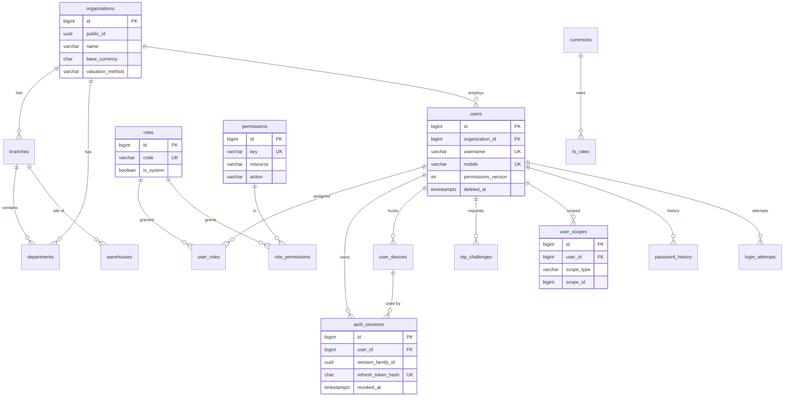
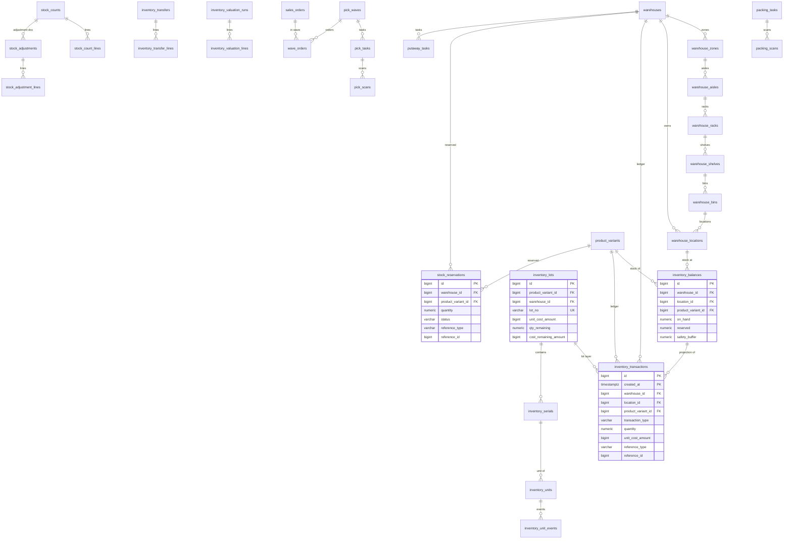
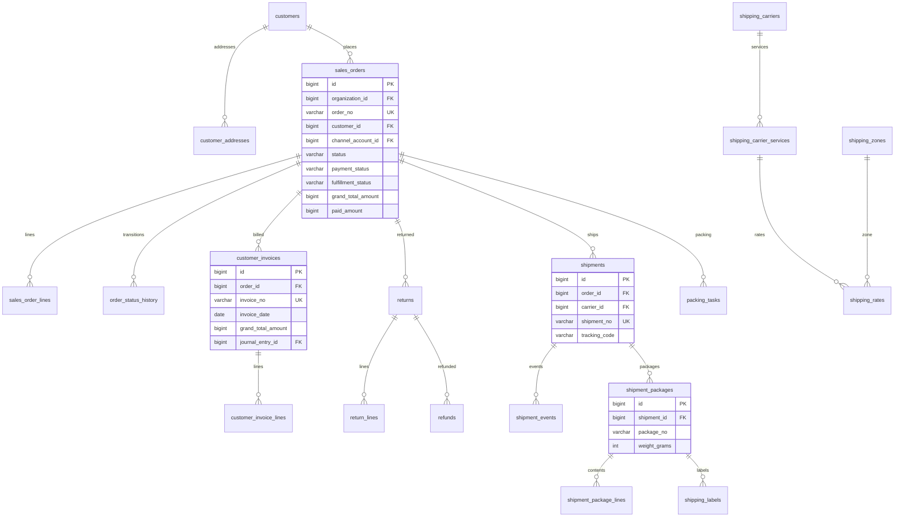
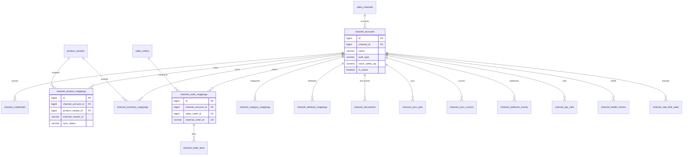
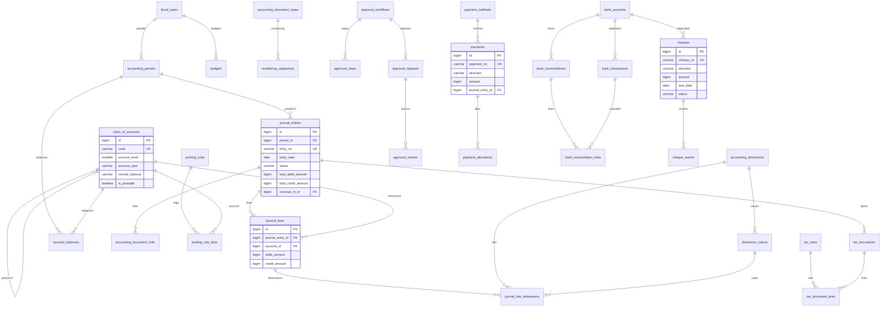
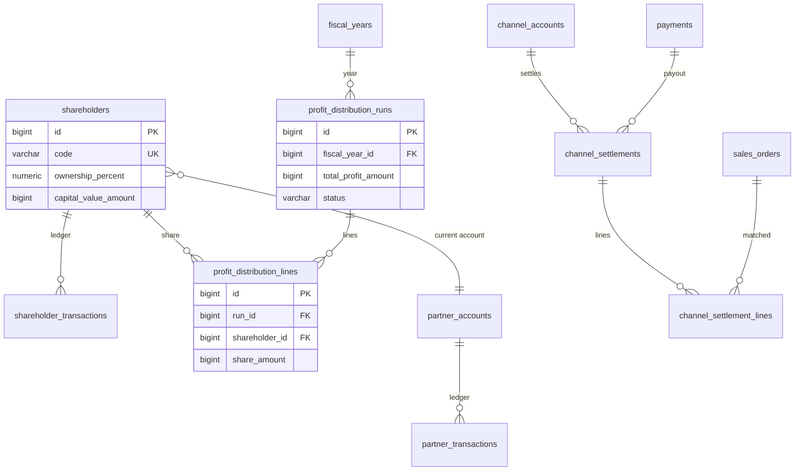

# 02 — Data Model (authoritative schema specification)

**خلاصهٔ فارسی:** این سند مدل دادهٔ نهایی «سامان ERP» است: ۲۱۵ جدول در schema واحد `erp`، قواعد نام‌گذاری و نوع‌ها (ADR-0003)، دفتر موجودی و رزرو (ADR-0007)، پارتیشن‌بندی ماهانه (ADR-0009)، پول `bigint` ریال (ADR-0013)، و طرح seed شامل نقش‌ها، کلیدهای مجوز، کدینگ ۶ سطحی حسابداری، واحدها، کانال‌ها و شماره‌گذاری اسناد. پیاده‌سازی migration باید عیناً از این سند تبعیت کند؛ هر انحراف نیازمند اصلاح این سند است.

Status: **Accepted v1.0 (engineering baseline)** · Owner: Database Architect · Last updated: 1405-07-27
Normative companions: `01-architecture/ARCHITECTURE.md` (§4 module map, §6 transactions, §11 capacity), `ADR-0003`, `ADR-0007`, `ADR-0009`, `ADR-0013`, `ADR-0014`, `MIGRATION-NOTES.md`.
Permission keys: seeded in §6.2, source of truth for names is `docs/03-api-contract/API.md` §Permission-key registry (this document seeds the union).

---

## 1. Conventions

### 1.1 Schema, ownership, migrations

1. Exactly **one schema: `erp`**. `public` stays empty except extensions. `CREATE EXTENSION pgcrypto` (in `public`).
2. Every table is owned by exactly one module (§2 module grouping); cross-module access is via module public services/events, never cross-module JOINs. Table ownership is recorded in the grouping headings.
   **Notation:** `module.table` (e.g. `platform.system_settings`, `inventory.inventory_balances`) denotes *ownership*, **not** a schema or a literal table name. There is exactly one schema `erp`, so the physical table is `erp.system_settings`, `erp.inventory_balances`, etc. Never create per-module schemas or module-prefixed table names.
3. Migration stream is linear and forward-only: `packages/db/migrations/NNNN_<name>.sql`. Migrations are plain SQL, idempotent where cheap (`IF NOT EXISTS`) and always wrapped in one transaction. No manual DDL in production.
4. Database roles (grants, not schema-level): `saman_migrator` (DDL), `saman_app` (DML on `erp`, no DDL, `statement_timeout=5s`), `saman_worker` (DML, `statement_timeout=30m`), `saman_readonly` (SELECT on reporting views/matviews). Partition maintenance functions are `SECURITY DEFINER` owned by `saman_migrator`.
5. `search_path` is pinned per role: `erp, public`. Application SQL always schema-qualifies (`erp.table`) in raw fragments; Drizzle schema names tables under `erp`.

### 1.2 Keys, IDs, external identity

- Internal PK: `id bigint GENERATED ALWAYS AS IDENTITY PRIMARY KEY` (8 bytes; used by all FKs and joins).
- External ID: `public_id uuid NOT NULL DEFAULT gen_random_uuid()` with `uq_<table>_public_id`; this is the **only** identifier exposed by the API (ADR-0003, API contract "no bigint leakage"). App resolves `public_id → id` at the repository edge.
- Partitioned tables (only the five in §4) use a per-table sequence and PK `(id, created_at)` because PostgreSQL 16 does not support identity columns on partitioned tables:
  `id bigint NOT NULL DEFAULT nextval('erp.<table>_id_seq')`, `CONSTRAINT pk_<table> PRIMARY KEY (id, created_at)`, `uq_<table>_public_id_created_at UNIQUE (public_id, created_at)`.
- Natural keys (order_no, invoice_no, etc.) are additionally unique per organization/year; they are business identifiers, not PKs.

### 1.3 Standard column block (`std`)

Every table below includes this block unless its row says **no-std** or **override**:

| column | type | null | default | notes |
|---|---|---|---|---|
| `id` | `bigint` | NO | identity | PK; `(id, created_at)` on partitioned tables |
| `public_id` | `uuid` | NO | `gen_random_uuid()` | unique per table; API-facing |
| `created_at` | `timestamptz` | NO | `now()` | UTC instant; partition key where partitioned |
| `updated_at` | `timestamptz` | NO | `now()` | maintained by trigger `erp.trg_set_updated_at` |
| `created_by` | `bigint` | YES | — | FK `erp.users(id)` `ON DELETE SET NULL`, index |
| `updated_by` | `bigint` | YES | — | FK `erp.users(id)` `ON DELETE SET NULL`, index |
| `version` | `integer` | NO | `1` | optimistic lock; trigger `erp.trg_bump_version` on UPDATE; API `If-Match` |

Rules:
- **Master-data tables** additionally have `deleted_at timestamptz NULL` + partial index `ix_<table>_active ON <table> (id) WHERE deleted_at IS NULL` (or the repo's natural filter column). Soft delete is the *only* delete for master data; list repositories always filter `deleted_at IS NULL`.
- **Transactional/document tables** have **no** `deleted_at`; rows are never deleted. Voiding is explicit (`voided_at`, `voided_by`, `void_reason`, `reversal_of_id`) and corrections are new reversal documents (ADR-0003 §4, ADR-0007 §1).
- **Append-only tables** (`inventory_transactions`, `audit_logs`, `api_request_logs`, `channel_api_calls`, `journal_lines`, `outbox_events`, `security_events`, `login_attempts`, `data_versions`, `*_scans`, `*_events`) have **no** `version`/`updated_by` and are protected by DB grants: `saman_app` gets `SELECT, INSERT` only; `UPDATE/DELETE` revoked except for the documented lifecycle columns in §5.6.
- Standard indexes on every table: `ix_<table>_created_at (created_at)` is **not** created on non-partitioned tables (noise); instead each table lists its real access-path indexes. **Every FK column is indexed**, by one of three mechanisms: (a) an explicit `IX <col>` listed in the table block, (b) a composite `uq_*`/`ix_*` whose **leftmost** column is that FK column (PostgreSQL uses it for FK enforcement; e.g. `uq_role_permissions_role_permission (role_id, permission_id)` covers `role_id`), or (c) the mechanical convention `ix_<table>_<column>` emitted by the migration generator for every remaining FK (not repeated per-table in §2). The lint query in `MIGRATION-NOTES.md` §4.1 is the enforcement: it treats a column as indexed iff it is the leftmost key column of any valid index, and must return zero rows. As of this revision: 404 declared FK columns, 0 unindexed under that rule.

### 1.4 Type policy (ADR-0013 — non-negotiable)

| Kind | Type | Example columns |
|---|---|---|
| Money | `bigint` (IRR, integer, no decimals) | `unit_price`, `line_total`, `amount`, `fee_amount`, `cost` |
| Quantity | `numeric(18,4)` | `quantity`, `on_hand`, `reserved` |
| Percentage | `numeric(9,6)` (0.100000 = 10%) | `markup_percent`, `tax_percent`, `commission_percent` |
| Rate / FX | `numeric(12,6)` (IRR per unit of foreign currency) | `fx_rate`, `rate` |
| Conversion factor | `numeric(30,12)` | `unit_conversions.factor` |
| Weights | `integer` grams | `weight_grams` |
| Dimensions | `numeric(10,2)` cm | `length_cm` |
| Instant | `timestamptz` (UTC) | all `*_at` |
| Business date | `date` (Gregorian, civil day of the Jalali date) | `invoice_date`, `entry_date`, `due_date` |
| Boolean flags | `boolean NOT NULL DEFAULT …` | — |
| Enumerations | `varchar(n)` + named `CHECK` (never PG `ENUM`) | `status`, `*_type` |
| Free-form/raw payloads | `jsonb` | channel payloads, audit diff, settings |
| Money in JSON | **string** (e.g. `"12500000"`), never JSON number | channel payloads, snapshots |

Forbidden: `real`, `double precision`, `money`, `numeric` for monetary values, `serial`. A CI grep over migrations enforces this.

### 1.5 Naming & constraints (ADR-0003 §10)

- `snake_case`, plural table names, singular column names. Constraint names are explicit and stable:
  `pk_<table>`, `fk_<table>_<column>`, `uq_<table>_<cols>`, `ck_<table>_<rule>`, `ix_<table>_<cols>`, `ix_<table>_<cols>_partial`.
- `ON DELETE` policy: `RESTRICT` (default) for references to master and transactional records; `CASCADE` **only** for pure child rows (document lines, scans, mappings, join rows, dimension values of an entry); `SET NULL` only for soft optional attribution (`created_by/updated_by/approved_by`-style human references); never cascade across aggregate roots.
- Composite FK on the highest-risk relations includes `organization_id` to make cross-org links impossible by construction (ADR-0005): `(organization_id, id)` referenced from inventory, orders, journals.
- Multi-tenant column `organization_id bigint NOT NULL` on every aggregate root (and on children only when it is inherited by an FK — no redundant copies). V1 is single-org (`1`), but scoping is enforced in repositories (`TenantContext`) and proven by tests. No RLS in v1 (ADR-0005); migration path documented there.

### 1.6 Lifecycle status vocabularies (single source: `packages/shared/enums.ts`)

**v1.1 rule (R1-D B-10):** the vocabulary is defined **once** in `packages/shared/enums.ts`; migration CHECKs are generated from that file and a CI test asserts `pg_get_constraintdef` tokens equal the shared constants. API aliases are normalized in the DTO layer (never stored). Shared vocabularies: `document_status` = `draft|submitted|pending_approval|approved|posted|voided`; `order_status` = `draft|submitted|confirmed|allocated|picking|packed|shipped|delivered|closed|cancelled|on_hold|returned`; `payment_status` = `unpaid|partially_paid|paid|refunded|overpaid`; `fulfillment_status` = `unfulfilled|allocated|picking|packed|partially_shipped|shipped|delivered|cancelled`; `payment_direction` = `inbound|outbound` (API `in|out` mapped in DTO); `sync_status` = `pending|syncing|synced|failed|skipped`; `job_status` = `queued|running|succeeded|failed|dead|cancelled`; `valuation_method` = `moving_average|fifo|standard` (API `weighted_average` maps to `moving_average` in the adapter); `cheque_status` per direction = received: `received|in_custody|deposited|cleared|bounced|endorsed|returned|cancelled`; issued: `issued|cleared|bounced|returned|cancelled`.

### 1.7 Triggers & functions (created in migration 0001, used everywhere)

```sql
-- one function pair, attached to every table with updated_at/version
CREATE OR REPLACE FUNCTION erp.set_updated_at() RETURNS trigger
LANGUAGE plpgsql AS $$
BEGIN
  NEW.updated_at := now();
  RETURN NEW;
END $$;

CREATE OR REPLACE FUNCTION erp.bump_version() RETURNS trigger
LANGUAGE plpgsql AS $$
BEGIN
  NEW.version := OLD.version + 1;
  RETURN NEW;
END $$;

-- convention: two triggers per mutable table
CREATE TRIGGER trg_<table>_updated_at BEFORE UPDATE ON erp.<table>
  FOR EACH ROW EXECUTE FUNCTION erp.set_updated_at();
CREATE TRIGGER trg_<table>_version BEFORE UPDATE ON erp.<table>
  FOR EACH ROW EXECUTE FUNCTION erp.bump_version();
```

- `updated_at`/`version` are **never** written by application code (Drizzle `$onUpdate` is not used; test asserts TRIGGER presence).
- Balance invariants are enforced by `CHECK` plus service logic, **not** by triggers (ADR-0007 §2).
- `erp.allocate_document_no(p_org_id, p_document_type, p_fiscal_year_id)` is the only document-number allocator (§6.5); it performs `UPDATE … RETURNING` on `numbering_sequences` (row lock, gap-free) and formats `PREFIX-YYYY-000123`.
- `erp.fn_audit_row()` trigger helper writes `audit_logs` only for tables marked in `erp.audited_tables` (§2.1) — sensitive writes are also audited explicitly by the app for semantic actions.

### 1.8 Idempotency, outbox, events (ADR-0010)

- Business writes that must trigger external effects insert `outbox_events` in the same transaction, keyed by `(event_type, aggregate_type, aggregate_id, event_version)`; unique constraint makes the producer idempotent.
- HTTP `Idempotency-Key` is stored in `idempotency_keys` (`scope = METHOD + ' ' + route`, `request_hash`, replay body/code), TTL 24 h, cleaned by the maintenance worker.
- Duplicate external events are rejected by unique constraints: `channel_order_mappings (channel_account_id, external_order_id)`, `channel_webhook_events (channel_account_id, external_event_id)` (partial, `WHERE external_event_id IS NOT NULL`).

---

## 2. Table inventory (215 tables, 16 module groups)

Count per module:

| Module | Tables | Module | Tables |
|---|---|---|---|
| 2.1 platform | 34 | 2.9 sales | 10 |
| 2.2 identity | 11 | 2.10 fulfillment | 9 |
| 2.3 org | 6 | 2.11 channels | 16 |
| 2.4 catalog | 18 | 2.12 accounting | 26 |
| 2.5 warehouse | 18 | 2.13 treasury | 14 |
| 2.6 inventory | 20 | 2.14 partners | 9 |
| 2.7 procurement | 8 | 2.15 reporting | 5 |
| 2.8 pricing | 7 | 2.16 automation | 4 |

Notation used in the table blocks below: `NN` = `NOT NULL`; `DF` = default; `UQ` = unique; `→` = FK target (`erp.<table>.<col>`); `CK(...)` = check expression; `IX(...)` = index; `PD` = `ON DELETE`; `std` = standard block per §1.3. `bigint` money columns are abbreviated `IRR` in the notes but **the SQL type is `bigint`**.

---

### 2.1 Module `platform` — settings, audit, files, notifications, jobs, webhooks, flags (34 tables)

Cross-cutting infrastructure. Owns the audit trail, the reliable-event machinery and every long-running job record. No other module writes these tables except through platform services.

**`platform.system_settings`** — org-scoped typed settings; secret values encrypted at rest.
`organization_id` bigint NN →organizations.id · `key` varchar(150) NN · `value_json` jsonb NN DF `'{}'` · `is_secret` boolean NN DF false · `description_fa` varchar(300)
UQ `uq_system_settings_org_key` (organization_id, key) · CK `ck_system_settings_key_not_blank` · IX organization_id · CK `ck_system_settings_secret_json` (`NOT is_secret OR value_json ? 'ciphertext'`).

**`platform.audit_logs`** *(partitioned, §4)* — append-only security/business audit trail; 7-year retention.
`organization_id` bigint NN →organizations.id · `actor_user_id` bigint (→users.id, nullable for system) · `actor_type` varchar(20) NN DF `'user'` CK in (`user|system|api_client|channel`) · `api_client_id` bigint · `entity_type` varchar(100) NN · `entity_public_id` uuid · `entity_id` bigint · `action` varchar(80) NN (e.g. `inventory.adjust.applied`, `access.denied`) · `old_data` jsonb · `new_data` jsonb · `diff` jsonb · `ip_address` inet · `user_agent_hash` char(64) · `request_id` uuid · `trace_id` varchar(64) · `severity` varchar(10) NN DF `'info'` CK in (`info|warning|critical`)
No `deleted_at`, no `version` (append-only). PK `(id, created_at)`. IX `(organization_id, created_at DESC)`, IX `(entity_type, entity_id, created_at DESC)`, IX `(actor_user_id, created_at DESC)`, BRIN created_at. Retention: hot 12 months, cold partitions archived yearly then detached.

**`platform.security_events`** — authentication/authorization/credential anomalies (session reuse, lockout, permission denial burst, channel credential rotation).
`organization_id` bigint · `event_type` varchar(60) NN CK in (`login.success|login.failure|login.locked|otp.sent|otp.failed|session.reuse_detected|session.revoked|permission.denied|password.changed|mfa.enrolled|device.trusted|device.revoked|credential.rotated|rate_limited`) · `user_id` bigint · `session_id` bigint →auth_sessions.id PD SET NULL · `ip_address` inet · `user_agent_hash` char(64) · `details` jsonb · `severity` varchar(10) NN DF `'info'`
IX `(organization_id, event_type, created_at DESC)`, IX user_id. Append-only. Feeds alerts (`automation.alert_rules`).

**`platform.api_clients`** — machine clients for the public API (and channel-side integrations that call us).
`organization_id` bigint NN →organizations.id · `name` varchar(150) NN · `client_key` varchar(60) NN UQ · `secret_hash` varchar(255) NN · `scopes` jsonb NN DF `'[]'` (array of permission keys) · `allowed_cidrs` cidr[] · `rate_limit_per_min` integer NN DF 120 · `is_active` boolean NN DF true · `last_used_at` timestamptz · `expires_at` timestamptz
UQ `uq_api_clients_client_key` · IX organization_id. Secrets stored hashed (API contract §auth), never returned.

**`platform.api_request_logs`** *(partitioned, §4)* — HTTP access log for the public API; 90-day retention; bodies only on error with redaction.
`organization_id` bigint · `api_client_id` bigint · `user_id` bigint · `method` varchar(10) NN · `path` text NN · `route_pattern` varchar(200) · `query_string` text · `request_id` uuid NN · `status_code` smallint NN · `error_code` varchar(40) · `request_bytes` integer · `response_bytes` integer · `latency_ms` integer · `db_time_ms` integer · `ip_address` inet · `user_agent_hash` char(64) · `rate_limited` boolean NN DF false
IX `(organization_id, created_at DESC)`, IX `(status_code, created_at DESC)`, IX request_id, BRIN created_at. No request/response bodies by default (PII policy, SECURITY §audit); `request_body_redacted jsonb` nullable for `4xx/5xx` only.

**`platform.idempotency_keys`** — HTTP idempotency replay store (ADR-0010).
`organization_id` bigint NN · `key` varchar(200) NN · `scope` varchar(120) NN (e.g. `POST /api/v1/sales/orders`) · `request_hash` char(64) NN · `actor_user_id` bigint · `response_code` smallint · `response_body` jsonb · `resource_type` varchar(60) · `resource_public_id` uuid · `expires_at` timestamptz NN
UQ `uq_idempotency_keys_org_scope_key` (organization_id, scope, key) · IX expires_at (cleanup). Replay returns original code/body; mismatched request_hash → `409 CONFLICT`.

**`platform.outbox_events`** *(partitioned, §4)* — transactional outbox; processed partitions dropped after 30 days (ADR-0010).
`organization_id` bigint NN · `event_type` varchar(100) NN (e.g. `sales.order.confirmed`, `inventory.stock.changed`) · `event_version` smallint NN DF 1 · `aggregate_type` varchar(80) NN · `aggregate_id` bigint NN · `aggregate_public_id` uuid · `payload` jsonb NN · `headers` jsonb NN DF `'{}'` · `status` varchar(20) NN DF `'pending'` CK in (`pending|processing|processed|failed`) · `available_at` timestamptz NN DF now() · `attempts` smallint NN DF 0 · `max_attempts` smallint NN DF 10 · `locked_by` varchar(80) · `locked_at` timestamptz · `processed_at` timestamptz · `last_error` text · `trace_id` varchar(64)
UQ `uq_outbox_events_event` (event_type, aggregate_type, aggregate_id, event_version, created_at) · IX `ix_outbox_events_pending_partial` `(available_at) WHERE status IN ('pending','failed')` · IX `(aggregate_type, aggregate_id)` · BRIN created_at. Dispatcher: `FOR UPDATE SKIP LOCKED` batches of 100, 1 s poll + `NOTIFY`.

**`platform.integration_dead_letters`** — permanently failed external operations/events, requires operator action.
`organization_id` bigint NN · `integration` varchar(80) NN CK in (`carexy|digikala|limo_sms|carrier:*` free with prefix) · `operation` varchar(100) NN · `entity_type` varchar(60) · `entity_id` bigint · `payload` jsonb NN · `error_code` varchar(60) · `error_message` text NN · `retry_count` smallint NN DF 0 · `first_failed_at` timestamptz NN DF now() · `last_failed_at` timestamptz NN · `status` varchar(20) NN DF `'open'` CK in (`open|retried|resolved|ignored`) · `resolved_at` timestamptz · `resolved_by` bigint →users.id PD SET NULL
IX `(status, last_failed_at DESC)`, IX integration. Alert at open-count > 10.

**`platform.data_versions`** — immutable snapshot history for entities requiring full version audit (price lists, posting rules, approval workflows, channel mappings, settings).
`organization_id` bigint NN · `entity_type` varchar(100) NN · `entity_id` bigint NN · `version_no` integer NN · `data` jsonb NN · `changed_by` bigint · `changed_at` timestamptz NN DF now() · `change_reason` varchar(300)
UQ `uq_data_versions_entity_version` (entity_type, entity_id, version_no) · IX `(entity_type, entity_id, changed_at DESC)`.

**`platform.file_assets`** — every stored object (media, labels, exports, imports, attachments) with checksum; S3/MinIO key only, no public URLs in DB.
`organization_id` bigint NN · `file_name` varchar(255) NN · `mime_type` varchar(120) NN · `storage_provider` varchar(20) NN DF `'s3'` CK in (`s3|minio|local`) · `bucket` varchar(120) NN · `storage_key` text NN · `size_bytes` bigint NN DF 0 CK ≥ 0 · `sha256` char(64) NN · `media_kind` varchar(20) NN DF `'document'` CK in (`image|video|document|label|export|import|archive`) · `visibility` varchar(10) NN DF `'private'` CK in (`private|org|public`) · `owner_entity_type` varchar(60) · `owner_entity_id` bigint · `metadata` jsonb NN DF `'{}'` · `scan_status` varchar(20) NN DF `'pending'` CK in (`pending|clean|infected|skipped`)
UQ `uq_file_assets_storage_key` (bucket, storage_key) · IX `(owner_entity_type, owner_entity_id)` · IX organization_id. Public bucket never used for uploads (SECURITY §file pipeline).

**`platform.printer_jobs`** — print queue for labels, pick lists, invoices; drives warehouse printers/agents.
`organization_id` bigint NN · `warehouse_id` bigint · `printer_device_id` bigint →warehouse_devices.id PD SET NULL · `job_type` varchar(40) NN CK in (`shipping_label|pick_list|packing_slip|invoice|report|test_page`) · `reference_type` varchar(50) · `reference_id` bigint · `payload` jsonb NN · `rendered_file_id` bigint →file_assets.id PD SET NULL · `status` varchar(20) NN DF `'queued'` CK in (`queued|printing|printed|failed|cancelled`) · `attempts` smallint NN DF 0 · `last_error` text · `printed_at` timestamptz · `printed_by` bigint
IX `(status, created_at)` · IX `(printer_device_id, status)`. On-delete: references SET NULL, payload retained for reprint (audit).

**`platform.notifications`** — in-app notifications (one row per recipient).
`organization_id` bigint NN · `user_id` bigint NN →users.id PD CASCADE · `type` varchar(40) NN (e.g. `order.allocated`, `stock.low`, `cheque.due`) · `title` varchar(250) NN · `body` text · `data` jsonb · `channel` varchar(20) NN DF `'in_app'` CK in (`in_app|email|sms|push`) · `priority` varchar(10) NN DF `'normal'` CK in (`low|normal|high|critical`) · `read_at` timestamptz · `dismissed_at` timestamptz · `expires_at` timestamptz
IX `(user_id, read_at, created_at DESC)` partial `WHERE read_at IS NULL` · IX `(organization_id, type)`.

**`platform.sms_templates`** — Limo SMS templates and patterns (ADR/provider contract).
`organization_id` bigint NN · `code` varchar(80) NN · `provider` varchar(40) NN DF `'limo_sms'` CK in (`limo_sms|mock`) · `pattern_code` varchar(100) (Limo `OtpId`/pattern id) · `body` text · `variables` jsonb NN DF `'[]'` · `purpose` varchar(50) NN CK in (`otp|order_status|shipment|cheque|invoice|alert|marketing`) · `is_active` boolean NN DF true
UQ `uq_sms_templates_org_code` (organization_id, code) · CK `ck_sms_templates_body_or_pattern`.

**`platform.sms_messages`** — outbound SMS log incl. provider message id, cost and delivery state (Limo `ApiKey` contract).
`organization_id` bigint NN · `user_id` bigint · `template_id` bigint →sms_templates.id PD SET NULL · `mobile` varchar(20) NN · `message` text NN · `provider` varchar(40) NN DF `'limo_sms'` · `provider_message_id` varchar(150) · `purpose` varchar(50) · `status` varchar(20) NN DF `'queued'` CK in (`queued|sent|delivered|failed|rejected`) · `cost_amount` bigint (IRR) · `attempts` smallint NN DF 0 · `last_error` text · `sent_at` timestamptz · `delivered_at` timestamptz
IX `(organization_id, created_at DESC)`, IX `(mobile, created_at DESC)`, IX `(status, created_at)`. Provider request/response ids from Limo (`MessageId`/`TotalAmount`) mapped here; no secrets logged.

**`platform.numbering_sequences`** — gap-free document numbering per org/document-type/fiscal year (ADR-0014).
`organization_id` bigint NN · `document_type` varchar(50) NN CK (see §6.5 registry) · `fiscal_year_id` bigint →fiscal_years.id PD RESTRICT · `prefix` varchar(20) NN · `next_value` bigint NN DF 1 CK > 0 · `padding` smallint NN DF 6 · `reset_policy` varchar(20) NN DF `'fiscal_year'` CK in (`fiscal_year|never`) · `last_allocated_at` timestamptz
UQ `uq_numbering_sequences_org_doc_year` (organization_id, document_type, fiscal_year_id) · IX organization_id. Allocation uses `UPDATE … SET next_value = next_value + 1 RETURNING` (row lock; gap-free per ADR-0014; never reused after void).

**`platform.saved_filters`** — user/admin saved list filters & views per module.
`user_id` bigint NN →users.id PD CASCADE · `module` varchar(50) NN · `name` varchar(150) NN · `filter_json` jsonb NN DF `'{}'` · `sort_json` jsonb NN DF `'{}'` · `is_shared` boolean NN DF false
UQ `uq_saved_filters_user_module_name` (user_id, module, name) · IX (module).

**`platform.import_jobs`** — bulk import runs (catalog, customers, opening stock, prices) processed by worker with `COPY`.
`organization_id` bigint NN · `source_type` varchar(40) NN CK in (`csv|xlsx|json|channel`) · `entity_type` varchar(50) NN CK in (`product|variant|barcode|customer|supplier|opening_stock|price|attribute`) · `file_id` bigint →file_assets.id PD SET NULL · `mapping_json` jsonb · `status` varchar(20) NN DF `'queued'` CK in (`queued|validating|importing|completed|failed|cancelled`) · `total_rows` integer NN DF 0 · `processed_rows` integer NN DF 0 · `failed_rows` integer NN DF 0 · `started_at` timestamptz · `finished_at` timestamptz · `requested_by` bigint NN
IX `(organization_id, status, created_at DESC)`.

**`platform.import_errors`** — per-row validation failures of an import job (never abort-all).
`import_job_id` bigint NN →import_jobs.id PD CASCADE · `row_no` integer NN · `field_name` varchar(100) · `raw_value` text · `error_code` varchar(50) NN · `message` text NN
IX `(import_job_id, row_no)`.

**`platform.export_jobs`** — async report/export generation to S3 with signed download link.
`organization_id` bigint NN · `entity_type` varchar(50) NN · `format` varchar(10) NN DF `'xlsx'` CK in (`xlsx|csv|pdf|json`) · `filter_json` jsonb · `status` varchar(20) NN DF `'queued'` CK in (`queued|running|completed|failed|expired`) · `output_file_id` bigint →file_assets.id PD SET NULL · `row_count` integer · `error_message` text · `expires_at` timestamptz · `requested_by` bigint NN
IX `(organization_id, status, created_at DESC)`.

**`platform.partition_maintenance_log`** — audit of automated partition create/detach/archive operations (ADR-0009); drives alerts on failure.
`run_at` timestamptz NN DF now() · `parent_table` varchar(80) NN · `action` varchar(20) NN CK in (`create|attach|detach|archive|drop|analyze`) · `partition_name` varchar(100) NN · `range_start` date · `range_end` date · `success` boolean NN · `detail` text · `duration_ms` integer
IX `(parent_table, run_at DESC)`, IX `(success, run_at DESC)`.

**`platform.partitioned_tables_registry`** — **no-std exception** (maintenance registry, not a business aggregate): used by `erp.maintain_partitions` and the retention job (§4.4); one row per partitioned parent.
`parent_table` text NN PK (e.g. `inventory_transactions`) · `retention_months` integer (NULL = keep forever) · `archive_to_s3` boolean NN DF false · `hot_months` integer · `is_enabled` boolean NN DF true
PK `parent_table` · CK `ck_partitioned_tables_registry_retention` (`retention_months IS NULL OR retention_months > 0`). Seeded in §6.10.

---

### 2.2 Module `identity` — users, RBAC, sessions, devices, OTP (11 tables)

Implements ADR-0004 (two-token model, rotation, reuse detection) and ADR-0008 (permission keys, scopes, separation of duties). All tables are org-scoped except `permissions` (global registry).

**`identity.users`** — staff accounts (no customer accounts in v1). Soft-deleted only.
`organization_id` bigint NN →organizations.id · `username` varchar(100) NN · `mobile` varchar(20) NN · `full_name` varchar(200) NN · `email` varchar(255) · `password_hash` varchar(255) · `status` varchar(20) NN DF `'active'` CK in (`active|inactive|locked|password_reset_required`) · `must_change_password` boolean NN DF false · `password_changed_at` timestamptz · `permissions_version` integer NN DF 1 (bumped on role/permission change; JWT `pv` claim) · `mfa_enabled` boolean NN DF false · `last_login_at` timestamptz · `failed_login_count` integer NN DF 0 CK ≥ 0 · `locked_until` timestamptz · `default_branch_id` bigint →branches.id PD SET NULL · `locale` varchar(10) NN DF `'fa-IR'` · `timezone` varchar(64) NN DF `'Asia/Tehran'` · `deleted_at` timestamptz
UQ `uq_users_org_username` (organization_id, username) · UQ `uq_users_org_mobile` (organization_id, mobile) · UQ `uq_users_org_email` (organization_id, lower(email)) partial `WHERE email IS NOT NULL` · IX organization_id · CK `ck_users_mobile_format` (`mobile ~ '^09[0-9]{9}$' OR mobile ~ '^\+98[0-9]{10}$'`). Password hash = Argon2id; never selected by list queries.

**`identity.password_history`** — last 5 password hashes for reuse prevention (ADR-0004).
`user_id` bigint NN →users.id PD CASCADE · `password_hash` varchar(255) NN · `created_at` timestamptz NN DF now()
IX `(user_id, created_at DESC)`. Retention: worker trims to 5 per user.

**`identity.roles`** — permission sets; system roles are immutable (`is_system`).
`organization_id` bigint NN · `code` varchar(50) NN · `name` varchar(100) NN · `description` text · `is_system` boolean NN DF false · `scope_mode` varchar(20) NN DF `'all'` CK in (`all|branch|warehouse|self`)
UQ `uq_roles_org_code` (organization_id, code) · IX organization_id · CK `ck_roles_system_code` (`NOT is_system OR code IN ('superadmin','admin','finance_manager','accountant','warehouse_manager','warehouse_operator','sales_agent','viewer')`). Seed in §6.1.

**`identity.permissions`** — global registry of permission keys, seeded from code (§6.2); no org column (keys are global, grants are per-role).
`key` varchar(120) NN · `resource` varchar(80) NN · `action` varchar(40) NN · `description_fa` varchar(300) NN · `is_system` boolean NN DF true · `module` varchar(40) NN (module group: `platform|identity|org|catalog|inventory|warehouse|procurement|sales|fulfillment|pricing|channels|accounting|treasury|partners|reporting|automation`)
UQ `uq_permissions_key` (key) · UQ `uq_permissions_resource_action` (resource, action) · IX module · CK `ck_permissions_key_format` (`key ~ '^[a-z][a-z0-9_]*(\.[a-z][a-z0-9_]*)+$' AND key = resource || '.' || action`). Seed from `packages/shared/permissions.ts` + API.md registry; seeded on every deploy idempotently and diffable (missing key in code = migration error).

**`identity.user_roles`** — user↔role assignment (many-to-many).
`user_id` bigint NN →users.id PD CASCADE · `role_id` bigint NN →roles.id PD RESTRICT · `assigned_by` bigint · `expires_at` timestamptz
UQ `uq_user_roles_user_role` (user_id, role_id) · IX role_id · IX user_id. Bumps `users.permissions_version` in the same transaction.

**`identity.role_permissions`** — role↔permission grants.
`role_id` bigint NN →roles.id PD CASCADE · `permission_id` bigint NN →permissions.id PD RESTRICT · `granted_by` bigint
UQ `uq_role_permissions_role_permission` (role_id, permission_id) · IX permission_id.

**`identity.auth_sessions`** — refresh-token sessions (ADR-0004); token stored SHA-256 hashed; family rotation with reuse detection.
`user_id` bigint NN →users.id PD CASCADE · `session_family_id` uuid NN DF gen_random_uuid() · `refresh_token_hash` char(64) NN · `prev_token_hash` char(64) · `replaced_by_session_id` bigint →auth_sessions.id PD SET NULL · `device_id` bigint →user_devices.id PD SET NULL · `ip_address` inet · `ip_prefix` inet (truncated /24 or /64 for privacy) · `user_agent_hash` char(64) · `mfa_verified` boolean NN DF false · `created_at` timestamptz NN DF now() · `last_used_at` timestamptz · `expires_at` timestamptz NN · `absolute_expires_at` timestamptz NN · `revoked_at` timestamptz · `revoke_reason` varchar(40) CK in (`logout|rotated|reuse_detected|admin|password_changed|permissions_changed|expired`)
UQ `uq_auth_sessions_token_hash` (refresh_token_hash) · IX `(user_id, revoked_at)` · IX `(session_family_id)` · IX expires_at (cleanup). Presenting a revoked/replaced token revokes the family and writes `security_events`.

**`identity.user_devices`** — trusted devices (2FA bypass ≤30 days, revocation, push/label printers association).
`user_id` bigint NN →users.id PD CASCADE · `device_fingerprint_hash` char(64) NN · `label` varchar(150) · `platform` varchar(40) · `user_agent_hash` char(64) · `trusted` boolean NN DF false · `trusted_until` timestamptz · `first_seen_at` timestamptz NN DF now() · `last_seen_at` timestamptz NN DF now() · `revoked_at` timestamptz
UQ `uq_user_devices_user_fingerprint` (user_id, device_fingerprint_hash) · IX `(user_id, trusted)`.

**`identity.otp_challenges`** — OTP codes for login, device trust, sensitive actions (hashed, single-use, 2 min).
`organization_id` bigint · `user_id` bigint →users.id PD CASCADE · `mobile` varchar(20) NN · `purpose` varchar(40) NN CK in (`login|device_trust|password_change|action_confirm|channel_credential`) · `code_hash` char(64) NN · `provider` varchar(40) NN DF `'limo_sms'` · `provider_request_id` varchar(150) · `attempt_count` smallint NN DF 0 CK ≥ 0 · `max_attempts` smallint NN DF 5 · `status` varchar(20) NN DF `'pending'` CK in (`pending|verified|expired|locked|consumed`) · `expires_at` timestamptz NN · `verified_at` timestamptz · `consumed_at` timestamptz · `ip_address` inet
IX `(mobile, purpose, created_at DESC)` · IX `(user_id, status)` · IX expires_at. Rate limit 5 sends/hour/mobile enforced via Redis + this table audit.

**`identity.login_attempts`** — append-only login/OTP attempt log powering throttling and forensics (Redis is the hot counter; this is durable).
`ip_prefix` inet · `username` varchar(100) · `mobile` varchar(20) · `user_id` bigint · `attempt_type` varchar(20) NN CK in (`password|otp_send|otp_verify|refresh`) · `success` boolean NN · `failure_reason` varchar(40) CK in (`bad_credentials|locked|otp_invalid|otp_expired|rate_limited|device_untrusted|revoked_session`) · `user_agent_hash` char(64)
IX `(ip_prefix, created_at DESC)` · IX `(username, created_at DESC)` · IX `(success, created_at DESC)`. Retention 180 days (worker).

**`identity.user_scopes`** — data-scope narrowing for branch/warehouse-limited roles (ADR-0008 §4).
`user_id` bigint NN →users.id PD CASCADE · `scope_type` varchar(20) NN CK in (`branch|warehouse|category`) · `scope_id` bigint NN · `organization_id` bigint NN
UQ `uq_user_scopes_user_type_id` (user_id, scope_type, scope_id) · IX (scope_type, scope_id). Referential integrity per type enforced by service + nightly consistency check (polymorphic table; documented exception to FK rule).

---

### 2.3 Module `org` — organization, branches, departments, currency (6 tables)

**`org.organizations`** — the single tenant root (v1: one row, `Carexy Shop`). Soft-deleted never; archived instead.
`name` varchar(200) NN · `legal_name` varchar(300) · `national_id` varchar(20) · `economic_code` varchar(20) · `registration_no` varchar(30) · `base_currency char(3)` NN DF `'IRR'` · `timezone` varchar(64) NN DF `'Asia/Tehran'` · `fiscal_year_start_month` smallint NN DF 1 CK between 1 and 12 · `fiscal_year_start_day` smallint NN DF 1 CK between 1 and 31 · `default_tax_rate_id` bigint →tax_rates.id PD SET NULL · `valuation_method` varchar(20) NN DF `'moving_average'` CK in (`moving_average|fifo`) · `allow_negative_stock` boolean NN DF false · `status` varchar(20) NN DF `'active'` CK in (`active|suspended|archived`) · `logo_file_id` bigint →file_assets.id PD SET NULL
UQ `uq_organizations_national_id` partial `WHERE national_id IS NOT NULL` · CK `ck_organizations_base_currency` (v1 only `IRR` allowed but column exists for future). Note: `allow_negative_stock=false` is the production setting; the CHECK on balances makes negative impossible regardless.

**`org.branches`** — legal/sales branches (scope unit, distribution of invoices).
`organization_id` bigint NN →organizations.id · `code` varchar(30) NN · `name` varchar(150) NN · `branch_type` varchar(30) NN DF `'warehouse'` CK in (`head_office|warehouse|store|sales_office`) · `phone` varchar(30) · `address` text · `city` varchar(100) · `province` varchar(100) · `postal_code` varchar(20) · `manager_user_id` bigint →users.id PD SET NULL · `is_active` boolean NN DF true
UQ `uq_branches_org_code` (organization_id, code) · IX organization_id.

**`org.departments`** — internal org tree for cost-center assignment and approvals.
`organization_id` bigint NN · `branch_id` bigint →branches.id PD SET NULL · `parent_id` bigint →departments.id PD RESTRICT · `code` varchar(30) NN · `name` varchar(150) NN · `manager_user_id` bigint →users.id PD SET NULL · `is_active` boolean NN DF true
UQ `uq_departments_org_code` (organization_id, code) · IX `(organization_id, parent_id)` · CK `ck_departments_no_self_parent` (`parent_id IS NULL OR parent_id <> id`).

**`org.currencies`** — currency reference (v1: IRR only; table exists for future multi-currency per ADR-0013).
`code` char(3) NN · `name` varchar(100) NN · `symbol` varchar(10) · `decimal_places` smallint NN DF 0 · `is_base` boolean NN DF false · `is_active` boolean NN DF true
UQ `uq_currencies_code` · CK `ck_currencies_single_base` (partial unique index `uq_currencies_one_base ON (is_base) WHERE is_base`).

**`org.fx_rates`** — historical FX rates (unused in v1 business documents; used by reporting/channel prices when enabled).
`organization_id` bigint NN · `currency_code` char(3) NN →currencies.code PD RESTRICT · `rate` numeric(12,6) NN CK > 0 · `effective_date` date NN · `source` varchar(40) NN DF `'manual'` CK in (`manual|channel|bank`)
UQ `uq_fx_rates_org_currency_date` (organization_id, currency_code, effective_date) · IX (currency_code, effective_date DESC).

**`org.holidays`** — official Iranian holidays/weekends used for delivery-date promises and due-date calculations (Jalali-aware at the edge).
`organization_id` bigint · `holiday_date` date NN · `title_fa` varchar(200) NN · `is_official` boolean NN DF true · `is_working_day` boolean NN DF false · `recurring_kind` varchar(20) NN DF `'fixed'` CK in (`fixed|lunar|none`)
UQ `uq_holidays_date_title` (holiday_date, title_fa) · IX holiday_date.

---

### 2.4 Module `catalog` — categories, products, variants, attributes, units, cost/price history (18 tables)

Master data; soft delete + `deleted_at`; SKUs/barcodes are the scan keys of every warehouse flow. Cost columns are **not** returned without `product.cost.read` (ADR-0008 §3).

**`catalog.product_categories`** — category tree (nested, `path` materialized for fast subtree filters; depth sane ≤ 6).
`organization_id` bigint NN · `parent_id` bigint →product_categories.id PD RESTRICT · `code` varchar(50) NN · `name` varchar(200) NN · `name_en` varchar(200) · `path` text (e.g. `/1/14/93/`) · `level` smallint NN DF 1 CK between 1 and 8 · `sort_order` integer NN DF 0 · `is_active` boolean NN DF true · `external_hint` jsonb NN DF `'{}'` · `deleted_at` timestamptz
UQ `uq_product_categories_org_code` (organization_id, code) · IX `(organization_id, parent_id)` · IX `(organization_id, path text_pattern_ops)` · CK `ck_product_categories_no_self_parent` · CK `ck_product_categories_level_positive`. Repo keeps `path/level` consistent; nightly check verifies tree integrity.

**`catalog.brands`** — brand reference.
`organization_id` bigint NN · `name` varchar(200) NN · `slug` varchar(220) · `country` varchar(100) · `logo_file_id` bigint →file_assets.id PD SET NULL · `is_active` boolean NN DF true · `deleted_at` timestamptz
UQ `uq_brands_org_name` (organization_id, lower(name)) · UQ `uq_brands_org_slug` (organization_id, slug) partial `WHERE slug IS NOT NULL`.

**`catalog.units_of_measure`** — UoM master (seed §6.3); at most one base unit per dimension.
`organization_id` bigint NN · `code` varchar(20) NN (e.g. `PCS`, `KG`, `CARTON12`) · `name` varchar(80) NN · `symbol` varchar(20) · `dimension` varchar(20) NN CK in (`count|mass|volume|length|area|time|package`) · `is_base` boolean NN DF false · `decimal_precision` smallint NN DF 0 CK between 0 and 4 · `is_active` boolean NN DF true · `deleted_at` timestamptz
UQ `uq_units_of_measure_org_code` (organization_id, code) · UQ `uq_units_of_measure_org_base` (organization_id, dimension) partial `WHERE is_base` · CK `ck_units_of_measure_precision` (dimension='count' → precision 0).

**`catalog.unit_conversions`** — directed conversion factors between units (e.g. 1 CARTON12 = 12 PCS); both directions seeded.
`organization_id` bigint NN · `from_unit_id` bigint NN →units_of_measure.id PD RESTRICT · `to_unit_id` bigint NN →units_of_measure.id PD RESTRICT · `factor` numeric(30,12) NN CK > 0 · `is_exact` boolean NN DF true
UQ `uq_unit_conversions_pair` (from_unit_id, to_unit_id) · IX to_unit_id · CK `ck_unit_conversions_not_self` (from_unit_id <> to_unit_id). Service guarantees reciprocal pair (factor_a × factor_b = 1) — tested.

**`catalog.products`** — product master (parent of variants; every product has ≥1 variant, default variant for simple products).
`organization_id` bigint NN · `product_no` varchar(40) NN (internal human code) · `name` varchar(300) NN · `name_en` varchar(300) · `slug` varchar(320) · `category_id` bigint →product_categories.id PD RESTRICT · `brand_id` bigint →brands.id PD SET NULL · `product_type` varchar(30) NN DF `'stock'` CK in (`stock|service|bundle|digital`) · `base_uom_id` bigint NN →units_of_measure.id PD RESTRICT · `description` text · `short_description` varchar(500) · `weight_grams` integer CK ≥ 0 · `length_cm` numeric(10,2) · `width_cm` numeric(10,2) · `height_cm` numeric(10,2) · `hs_code` varchar(20) · `origin_country` varchar(100) · `attributes_json` jsonb NN DF `'{}'` (denormalized searchable attributes, promoted columns used for filters) · `status` varchar(20) NN DF `'active'` CK in (`draft|active|inactive|discontinued`) · `track_lot` boolean NN DF false · `track_serial` boolean NN DF false · `track_unit` boolean NN DF false · `warranty_months` smallint · `is_marketplace_allowed` boolean NN DF true · `published_at` timestamptz · `deleted_at` timestamptz
UQ `uq_products_org_product_no` (organization_id, product_no) · UQ `uq_products_org_slug` (organization_id, slug) partial `WHERE slug IS NOT NULL` · IX `(organization_id, category_id)` · IX `(organization_id, brand_id)` · IX base_uom_id · IX `(organization_id, status)` · CK `ck_products_weight_nonnegative` · CK `ck_products_tracking` (`NOT track_serial OR track_unit` — serial implies unit tracking).

**`catalog.product_variants`** — sellable/stockable unit; every stock row, price, barcode and channel mapping points to a variant.
`product_id` bigint NN →products.id PD RESTRICT · `sku` varchar(100) NN · `title` varchar(300) · `barcode` varchar(50) (primary sellable barcode, kept in sync with `product_barcodes.is_primary`) · `weight_grams` integer CK ≥ 0 · `base_uom_id` bigint →units_of_measure.id PD RESTRICT (overrides product base unit when packaging differs) · `cost_method` varchar(20) NN DF `'inherit'` CK in (`inherit|moving_average|fifo`) · `is_default` boolean NN DF false · `is_active` boolean NN DF true · `sort_order` integer NN DF 0 · `deleted_at` timestamptz
UQ `uq_product_variants_sku` (sku) · UQ `uq_product_variants_product_title` (product_id, title) partial `WHERE title IS NOT NULL` · IX product_id · IX `(sku)`; service keeps `products.organization_id` consistent (variant inherits). CK `ck_product_variants_one_default` (partial unique `uq_product_variants_default ON (product_id) WHERE is_default`).

**`catalog.product_barcodes`** — all barcodes of a variant (manufacturer + internal), used by scanner flows (ADR-0007 §5).
`product_variant_id` bigint NN →product_variants.id PD CASCADE · `barcode` varchar(50) NN · `barcode_type` varchar(30) NN DF `'ean13'` CK in (`ean13|ean8|upc|code128|code39|qr|internal`) · `source` varchar(30) NN DF `'manufacturer'` CK in (`manufacturer|internal|channel|supplier`) · `is_primary` boolean NN DF false · `is_active` boolean NN DF true
UQ `uq_product_barcodes_barcode` (barcode) (globally unique — scan resolution must be unambiguous) · UQ `uq_product_barcodes_variant_primary` (product_variant_id) partial `WHERE is_primary` · IX product_variant_id · CK `ck_product_barcodes_length` (`length(barcode) BETWEEN 4 AND 50`).

**`catalog.product_attributes`** — attribute definitions; variant axes produce variants, others are specs.
`organization_id` bigint NN · `code` varchar(50) NN · `name` varchar(150) NN · `data_type` varchar(20) NN DF `'text'` CK in (`text|number|boolean|enum|date|color`) · `unit_id` bigint →units_of_measure.id PD SET NULL · `is_variant_axis` boolean NN DF false · `is_required` boolean NN DF false · `is_filterable` boolean NN DF false · `sort_order` integer NN DF 0 · `deleted_at` timestamptz
UQ `uq_product_attributes_org_code` (organization_id, code) · IX organization_id.

**`catalog.product_attribute_values`** — allowed values for enum attributes (with stable ordering for channel mappings).
`attribute_id` bigint NN →product_attributes.id PD CASCADE · `value` varchar(250) NN · `code` varchar(60) · `sort_order` integer NN DF 0 · `is_active` boolean NN DF true
UQ `uq_product_attribute_values_attr_value` (attribute_id, value) · IX attribute_id.

**`catalog.product_variant_attributes`** — attribute values assigned to a variant (axis or descriptive).
`variant_id` bigint NN →product_variants.id PD CASCADE · `attribute_id` bigint NN →product_attributes.id PD RESTRICT · `value_id` bigint →product_attribute_values.id PD RESTRICT · `value_text` varchar(500) (for free-text/number attrs)
UQ `uq_product_variant_attributes_variant_attr` (variant_id, attribute_id) · IX attribute_id · IX value_id · CK `ck_product_variant_attributes_value` (`value_id IS NOT NULL OR value_text IS NOT NULL`).

**`catalog.category_attributes`** — which attributes are relevant/required per category (drives product create forms and Digikala category-attribute mapping).
`category_id` bigint NN →product_categories.id PD CASCADE · `attribute_id` bigint NN →product_attributes.id PD CASCADE · `is_required` boolean NN DF false · `is_variant_axis` boolean NN DF false · `sort_order` integer NN DF 0
UQ `uq_category_attributes_cat_attr` (category_id, attribute_id) · IX attribute_id.

**`catalog.product_media`** — images/videos attached to product or variant; bytes in S3 (`file_assets`).
`product_id` bigint NN →products.id PD CASCADE · `variant_id` bigint →product_variants.id PD CASCADE · `file_id` bigint NN →file_assets.id PD RESTRICT · `media_type` varchar(20) NN DF `'image'` CK in (`image|video|document|360`) · `alt` varchar(250) · `sort_order` integer NN DF 0 · `is_primary` boolean NN DF false
IX product_id · IX variant_id · IX file_id · CK `ck_product_media_owner` (`product_id IS NOT NULL OR variant_id IS NOT NULL`) — service always sets product_id. UQ primary per product: `uq_product_media_primary ON (product_id) WHERE is_primary`.

**`catalog.product_specs`** — grouped specification sections (e.g. «مشخصات فنی») for storefront/channel content.
`product_id` bigint NN →products.id PD CASCADE · `title` varchar(200) NN · `sort_order` integer NN DF 0
IX product_id.

**`catalog.product_spec_values`** — key/value rows of a specification group.
`spec_id` bigint NN →product_specs.id PD CASCADE · `key` varchar(200) NN · `value` text NN · `sort_order` integer NN DF 0
UQ `uq_product_spec_values_spec_key` (spec_id, key).

**`catalog.product_price_history`** — effective-dated list/base price history per variant (source of truth for price; current base price is the open row).
`product_variant_id` bigint NN →product_variants.id PD CASCADE · `price_amount` bigint NN (IRR) CK ≥ 0 · `compare_at_amount` bigint (IRR, «قیمت قبل») · `effective_from` timestamptz NN · `effective_to` timestamptz · `reason` varchar(100) · `changed_by` bigint · `source_type` varchar(30) NN DF `'manual'` CK in (`manual|pricing_run|channel|import`)
IX `(product_variant_id, effective_from DESC)` · CK `ck_product_price_history_window` (`effective_to IS NULL OR effective_to > effective_from`) · partial unique `uq_product_price_history_open ON (product_variant_id) WHERE effective_to IS NULL`.

**`catalog.product_cost_history`** — effective-dated standard/last cost per variant (moving-average state also exposes `avg_cost_amount` here for audit; FIFO layers live in `inventory_lots`).
`product_variant_id` bigint NN →product_variants.id PD CASCADE · `cost_amount` bigint NN (IRR) CK ≥ 0 · `avg_cost_amount` bigint NN DF 0 · `cost_method` varchar(20) NN CK in (`moving_average|fifo|standard`) · `effective_from` timestamptz NN · `effective_to` timestamptz · `source_type` varchar(30) NN DF `'receipt'` CK in (`receipt|valuation|manual|import`) · `reference_id` bigint
IX `(product_variant_id, effective_from DESC)` · partial unique `uq_product_cost_history_open ON (product_variant_id) WHERE effective_to IS NULL` · CK window.

**`catalog.product_suppliers`** — approved supplier↔variant links with supplier SKU, last purchase price and lead time (procurement input for reorder).
`product_variant_id` bigint NN →product_variants.id PD CASCADE · `supplier_id` bigint NN →suppliers.id PD RESTRICT · `supplier_sku` varchar(100) · `purchase_price_amount` bigint NN DF 0 · `currency` char(3) NN DF `'IRR'` · `lead_time_days` integer NN DF 0 · `min_order_qty` numeric(18,4) · `is_primary` boolean NN DF false · `last_purchase_at` timestamptz
UQ `uq_product_suppliers_variant_supplier` (product_variant_id, supplier_id) · IX supplier_id · partial unique `uq_product_suppliers_primary ON (product_variant_id) WHERE is_primary`.

**`catalog.product_reorder_rules`** — per warehouse reorder policy used to generate purchase suggestions (and low-stock alerts); `safety_stock` feeds channel availability (ADR-0007 §4).
`product_variant_id` bigint NN →product_variants.id PD CASCADE · `warehouse_id` bigint NN →warehouses.id PD RESTRICT · `min_qty` numeric(18,4) NN DF 0 CK ≥ 0 · `max_qty` numeric(18,4) · `reorder_qty` numeric(18,4) · `safety_stock` numeric(18,4) NN DF 0 CK ≥ 0 · `is_active` boolean NN DF true
UQ `uq_product_reorder_rules_variant_wh` (product_variant_id, warehouse_id) · IX warehouse_id · CK `ck_product_reorder_rules_bounds` (`max_qty IS NULL OR max_qty >= min_qty`) · CK `ck_product_reorder_rules_reorder_positive`.

---

### 2.5 Module `warehouse` — location tree, putaway, picking, packing, devices (18 tables)

Implements the physical hierarchy of the scope: `warehouse → zone → aisle → rack → shelf → bin → location`, plus execution tables. Location codes follow the business barcode format (`A-12-R3-2-07`, carexy-doc §3-2-1). Every stock row points at `warehouse_locations.id` (leaf), never at intermediate nodes.

**`warehouse.warehouses`** — physical warehouse/site.
`organization_id` bigint NN · `branch_id` bigint →branches.id PD SET NULL · `code` varchar(50) NN · `name` varchar(200) NN · `warehouse_type` varchar(30) NN DF `'main'` CK in (`main|returns|quarantine|transit|scrap`) · `address` text · `city` varchar(100) · `contact_phone` varchar(30) · `is_active` boolean NN DF true · `deleted_at` timestamptz
UQ `uq_warehouses_org_code` (organization_id, code) · IX branch_id · IX organization_id.

**`warehouse.warehouse_zones`** — zone (A/B/C for ABC class), pick sequence drives route optimization.
`warehouse_id` bigint NN →warehouses.id PD RESTRICT · `code` varchar(20) NN · `name` varchar(150) NN · `zone_type` varchar(30) NN DF `'storage'` CK in (`storage|receiving|shipping|returns|quarantine|packing`) · `abc_class` varchar(1) CK in (`A|B|C`) · `pick_sequence` integer NN DF 0 · `is_active` boolean NN DF true
UQ `uq_warehouse_zones_wh_code` (warehouse_id, code) · IX warehouse_id.

**`warehouse.warehouse_aisles`** — aisle inside zone (2-digit number).
`zone_id` bigint NN →warehouse_zones.id PD RESTRICT · `code` varchar(20) NN · `name` varchar(150) · `sequence_no` integer NN DF 0 · `is_active` boolean NN DF true
UQ `uq_warehouse_aisles_zone_code` (zone_id, code) · IX zone_id.

**`warehouse.warehouse_racks`** — rack inside aisle (`R3`).
`aisle_id` bigint NN →warehouse_aisles.id PD RESTRICT · `code` varchar(20) NN · `name` varchar(150) · `sequence_no` integer NN DF 0 · `is_active` boolean NN DF true
UQ `uq_warehouse_racks_aisle_code` (aisle_id, code) · IX aisle_id.

**`warehouse.warehouse_shelves`** — shelf/level inside rack (1 digit level).
`rack_id` bigint NN →warehouse_racks.id PD RESTRICT · `code` varchar(20) NN · `level_no` integer NN DF 0 · `sequence_no` integer NN DF 0 · `is_active` boolean NN DF true
UQ `uq_warehouse_shelves_rack_code` (rack_id, code) · IX rack_id.

**`warehouse.warehouse_bins`** — bin/slot (final cell `07`) with capacity.
`shelf_id` bigint NN →warehouse_shelves.id PD RESTRICT · `code` varchar(20) NN · `bin_type` varchar(30) NN DF `'standard'` CK in (`standard|pallet|oversize|pick_face|staging`) · `capacity_qty` numeric(18,4) · `capacity_weight_kg` numeric(18,4) · `is_pick_face` boolean NN DF true · `is_active` boolean NN DF true
UQ `uq_warehouse_bins_shelf_code` (shelf_id, code) · IX shelf_id.

**`warehouse.warehouse_locations`** — the **only** address stock uses; leaf linked to the full chain with a computed hierarchical code (kept in sync by trigger/service) and scanner code.
`warehouse_id` bigint NN →warehouses.id PD RESTRICT · `bin_id` bigint →warehouse_bins.id PD RESTRICT · `full_code` varchar(100) NN (e.g. `A-12-R3-2-07`) · `barcode` varchar(80) (scanner value) · `location_type` varchar(30) NN DF `'bin'` CK in (`bin|staging|receiving|shipping|quarantine|scrap|transit`) · `pick_priority` integer NN DF 0 · `is_pickable` boolean NN DF true · `is_active` boolean NN DF true
UQ `uq_warehouse_locations_wh_full_code` (warehouse_id, full_code) · UQ `uq_warehouse_locations_barcode` (barcode) partial `WHERE barcode IS NOT NULL` · IX bin_id · IX `(warehouse_id, location_type)` · CK `ck_warehouse_locations_full_code_format`.

**`warehouse.putaway_rules`** — placement policy: preferred locations / min-max per variant (replaces reference `location_product_rules`; adds strategy).
`warehouse_id` bigint NN →warehouses.id PD RESTRICT · `product_variant_id` bigint →product_variants.id PD CASCADE · `location_id` bigint →warehouse_locations.id PD SET NULL · `category_id` bigint →product_categories.id PD SET NULL · `strategy` varchar(30) NN DF `'preferred_location'` CK in (`preferred_location|abc_zone|fixed_bin|chaotic|first_free`) · `priority` integer NN DF 0 · `min_qty` numeric(18,4) NN DF 0 · `max_qty` numeric(18,4) · `is_active` boolean NN DF true
UQ `uq_putaway_rules_wh_variant_location` (warehouse_id, product_variant_id, location_id) · IX location_id · IX category_id · CK `ck_putaway_rules_target` (`product_variant_id IS NOT NULL OR category_id IS NOT NULL`).

**`warehouse.putaway_tasks`** — task to move received goods to their putaway location; scan-confirmed.
`warehouse_id` bigint NN →warehouses.id PD RESTRICT · `product_variant_id` bigint NN →product_variants.id PD RESTRICT · `source_reference_type` varchar(40) CK in (`goods_receipt|transfer|count_adjustment|return`) · `source_reference_id` bigint · `lot_id` bigint →inventory_lots.id PD SET NULL · `target_location_id` bigint NN →warehouse_locations.id PD RESTRICT · `quantity` numeric(18,4) NN CK > 0 · `status` varchar(20) NN DF `'pending'` CK in (`pending|in_progress|completed|cancelled`) · `assigned_to` bigint →users.id PD SET NULL · `completed_at` timestamptz · `completed_by` bigint →users.id PD SET NULL
IX `(warehouse_id, status, created_at)` partial `WHERE status IN ('pending','in_progress')` · IX product_variant_id · IX target_location_id · IX lot_id · IX assigned_to.

**`warehouse.pick_waves`** — a batch of orders picked together (strategy: zone batch, single order, urgent).
`warehouse_id` bigint NN →warehouses.id PD RESTRICT · `wave_no` varchar(50) NN · `strategy` varchar(40) NN DF `'zone_batch'` CK in (`single_order|zone_batch|batch|urgent`) · `status` varchar(20) NN DF `'planned'` CK in (`planned|released|picking|picked|packed|cancelled`) · `priority` integer NN DF 0 · `planned_by` bigint →users.id PD SET NULL · `assigned_to` bigint →users.id PD SET NULL · `started_at` timestamptz · `completed_at` timestamptz
UQ `uq_pick_waves_wh_wave_no` (warehouse_id, wave_no) · IX `(warehouse_id, status)` · IX assigned_to.

**`warehouse.wave_orders`** — orders contained in a wave (join; orders of one wave are contiguous for packing).
`wave_id` bigint NN →pick_waves.id PD CASCADE · `sales_order_id` bigint NN →sales_orders.id PD RESTRICT · `sequence_no` integer NN DF 0
UQ `uq_wave_orders_wave_order` (wave_id, sales_order_id) · IX sales_order_id.

**`warehouse.pick_tasks`** — one pick line: variant + location + qty required/picked; scan verification carries the barcode check.
`wave_id` bigint →pick_waves.id PD CASCADE · `order_id` bigint →sales_orders.id PD RESTRICT · `sales_order_line_id` bigint →sales_order_lines.id PD RESTRICT · `product_variant_id` bigint NN →product_variants.id PD RESTRICT · `location_id` bigint NN →warehouse_locations.id PD RESTRICT · `lot_id` bigint →inventory_lots.id PD SET NULL · `quantity_required` numeric(18,4) NN CK > 0 · `quantity_picked` numeric(18,4) NN DF 0 CK ≥ 0 · `sequence_no` integer NN DF 0 · `status` varchar(20) NN DF `'pending'` CK in (`pending|in_progress|picked|short|exception|cancelled`) · `assigned_to` bigint →users.id PD SET NULL · `started_at` timestamptz · `completed_at` timestamptz
IX `(status, sequence_no)` partial `WHERE status IN ('pending','in_progress')` · IX wave_id · IX order_id · IX sales_order_line_id · IX product_variant_id · IX location_id · IX assigned_to. CK `ck_pick_tasks_picked_le_required` for non-exception rows is enforced by service (over-pick requires exception status) — documented exception, tested.

**`warehouse.pick_scans`** — append-only scan log for two-stage verification (G3): every accepted/rejected scan, server-side SKU/barcode match.
`pick_task_id` bigint NN →pick_tasks.id PD CASCADE · `barcode` varchar(100) NN · `expected_barcode` varchar(100) · `product_variant_id` bigint · `quantity` numeric(18,4) NN CK > 0 · `result` varchar(20) NN DF `'accepted'` CK in (`accepted|rejected_wrong_item|rejected_wrong_location|manual_override`) · `scanned_by` bigint NN →users.id PD RESTRICT · `scan_source` varchar(20) NN DF `'scanner'` CK in (`scanner|camera|manual|offline_replay`) · `client_scan_id` uuid (offline PWA idempotent replay) · `scanned_at` timestamptz NN DF now()
UQ `uq_pick_scans_client_scan` (client_scan_id) partial `WHERE client_scan_id IS NOT NULL` · IX pick_task_id · IX scanned_by · IX `(scanned_at DESC)`. Append-only.

**`warehouse.packing_stations`** — physical packing bench, printer and scale binding.
`warehouse_id` bigint NN →warehouses.id PD RESTRICT · `code` varchar(50) NN · `name` varchar(150) NN · `printer_device_id` bigint →warehouse_devices.id PD SET NULL · `scale_device_id` bigint →warehouse_devices.id PD SET NULL · `printer_config` jsonb NN DF `'{}'` (label size/DPI) · `is_active` boolean NN DF true
UQ `uq_packing_stations_wh_code` (warehouse_id, code) · IX warehouse_id · IX printer_device_id · IX scale_device_id.

**`warehouse.packing_tasks`** — pack an allocated order at a station; produces packages and labels.
`order_id` bigint NN →sales_orders.id PD RESTRICT · `station_id` bigint →packing_stations.id PD SET NULL · `shipment_id` bigint →shipments.id PD SET NULL · `status` varchar(20) NN DF `'pending'` CK in (`pending|in_progress|packed|exception|cancelled`) · `packer_id` bigint →users.id PD SET NULL · `started_at` timestamptz · `completed_at` timestamptz
IX `(status, created_at)` partial `WHERE status IN ('pending','in_progress')` · IX order_id · IX station_id · IX shipment_id · IX packer_id.

**`warehouse.packing_scans`** — append-only pack-stage verification (second of the two scan gates).
`packing_task_id` bigint NN →packing_tasks.id PD CASCADE · `product_variant_id` bigint NN →product_variants.id PD RESTRICT · `barcode` varchar(100) NN · `quantity` numeric(18,4) NN CK > 0 · `result` varchar(20) NN DF `'accepted'` CK in (`accepted|rejected_wrong_item|manual_override`) · `scanned_by` bigint NN →users.id PD RESTRICT · `client_scan_id` uuid · `scanned_at` timestamptz NN DF now()
UQ `uq_packing_scans_client_scan` (client_scan_id) partial `WHERE client_scan_id IS NOT NULL` · IX packing_task_id · IX product_variant_id · IX scanned_by. Append-only.

**`warehouse.warehouse_devices`** — scanners, printers, scales, label applicators, mobile terminals bound to a warehouse/station.
`warehouse_id` bigint NN →warehouses.id PD RESTRICT · `device_type` varchar(30) NN CK in (`scanner|printer|scale|label_applicator|mobile_terminal|rfid_reader`) · `name` varchar(100) NN · `identifier` varchar(150) (MAC/serial/agent id) · `driver` varchar(40) NN DF `'zpl'` CK in (`zpl|epl|escpos|agent|camera`) · `config` jsonb NN DF `'{}'` · `last_seen_at` timestamptz · `is_active` boolean NN DF true
UQ `uq_warehouse_devices_wh_identifier` (warehouse_id, identifier) partial `WHERE identifier IS NOT NULL` · IX warehouse_id · IX device_type.

---

### 2.6 Module `inventory` — ledger, balances, cost layers, reservations, lots, units, counts, adjustments, transfers, valuation (20 tables)

**The stock truth.** ADR-0007 rules are binding: append-only ledger + balance projection in the same transaction + fixed lock order; `inventory_balances` CHECK constraints make negative stock impossible. Money valuation is `bigint` IRR; quantities `numeric(18,4)`.

**`inventory.inventory_balances`** — hot projection: one row per `(warehouse_id, location_id, product_variant_id)`; maintained by `InventoryService` in the same transaction as the ledger insert (never by trigger). Also exists per warehouse with `location_id IS NULL`? **No** — location is mandatory; warehouse-level availability is aggregated. Contains no money.
`organization_id` bigint NN (composite FK `(organization_id, warehouse_id)` →warehouses) · `warehouse_id` bigint NN →warehouses.id PD RESTRICT · `location_id` bigint NN →warehouse_locations.id PD RESTRICT · `product_variant_id` bigint NN →product_variants.id PD RESTRICT · `on_hand` numeric(18,4) NN DF 0 · `reserved` numeric(18,4) NN DF 0 · `safety_buffer` numeric(18,4) NN DF 0 · `damaged` numeric(18,4) NN DF 0 · `in_transit` numeric(18,4) NN DF 0 · `last_transaction_id` bigint · `last_counted_at` timestamptz · `updated_at` (std)
No `deleted_at` (never deleted; a zeroed row is kept for hot lookup). PK `(id)` + **UQ `uq_inventory_balances_wh_loc_variant` (warehouse_id, location_id, product_variant_id)**. CK `ck_inventory_balances_nonnegative` (`on_hand >= 0 AND reserved >= 0 AND safety_buffer >= 0 AND damaged >= 0 AND in_transit >= 0`); **CK `ck_inventory_balances_available_nonnegative` (`reserved + safety_buffer + damaged <= on_hand`)** — makes `available = on_hand - reserved - safety_buffer - damaged` provably ≥ 0 in the database (R1-A B-06 / R1-D B-07); CK `ck_inventory_balances_reserved_le_onhand`, `ck_inventory_balances_damaged_le_onhand` retained as readable narrower guards. `available` is **computed in queries/views, never stored** (no drift). Allocation service additionally asserts `available >= requested` per line (ADR-0007 §3) and the 100-allocator test uses non-zero buffers/damaged stock. IX `(warehouse_id, product_variant_id)` (allocation lock order), IX product_variant_id, IX location_id. **Availability formula:** `available = on_hand - reserved - safety_buffer - damaged` (exposed by `v_inventory_availability`); channels never see `on_hand` (ADR-0007 §4). Negative availability is impossible: DB CHECK above + allocation assertion + test.

**`inventory.inventory_transactions`** *(partitioned, §4)* — append-only movement ledger; one row per movement; positive qty = into location, negative = out; corrections are reversal rows linked by `reversal_of_id`.
`organization_id` bigint NN · `warehouse_id` bigint NN →warehouses.id PD RESTRICT · `location_id` bigint NN →warehouse_locations.id PD RESTRICT · `product_variant_id` bigint NN →product_variants.id PD RESTRICT · `transaction_type` varchar(30) NN CK in (`receipt|sale_issue|reservation_consume|adjustment_in|adjustment_out|transfer_out|transfer_in|return_in|damage_out|scrap_out|count_correction_in|count_correction_out|opening_balance`) · `quantity` numeric(18,4) NN CK <> 0 · `unit_cost_amount` bigint (IRR per unit; FIFO layer cost captured on receipt) · `total_cost_amount` bigint (IRR; qty × unit_cost rounded) · `currency` char(3) NN DF `'IRR'` · `lot_id` bigint →inventory_lots.id PD SET NULL · `serial_id` bigint →inventory_serials.id PD SET NULL · `inventory_unit_id` bigint →inventory_units.id PD SET NULL · `reference_type` varchar(50) NN CK in (`goods_receipt|goods_receipt_line|sales_order|sales_order_line|stock_adjustment|stock_adjustment_line|stock_count|stock_count_line|inventory_transfer|inventory_transfer_line|return|valuation_run|seed_opening|manual`) · `reference_id` bigint · `reference_public_id` uuid · `reversal_of_id` bigint · `idempotency_key` varchar(120) (business dedupe: e.g. `gr:123:line:4`) · `voided_at` timestamptz · `voided_by` bigint · `void_reason` varchar(300) · `business_date` date NN DF `current_date` · **`period_id` bigint NN →accounting_periods.id PD RESTRICT** (derived from `business_date` by trigger, locked `FOR SHARE` before write — B-16) · **`journal_entry_id` bigint →journal_entries.id PD SET NULL** (set when the posting service commits in the same tx) · **`cost_state` varchar(20) NN DF `'pending'` CK in (`pending|layered|averaged|reversed`)** (costing completion marker) · `created_by` bigint
PK `(id, created_at)` · UQ `uq_inventory_transactions_idempotency_created` (idempotency_key, created_at) partial `WHERE idempotency_key IS NOT NULL` (local dedupe only; **global** dedupe is enforced by the non-partitioned `inventory_ledger_keys` table written in the same transaction — R1-D B-07) · IX `(period_id)` · IX journal_entry_id · IX `(warehouse_id, product_variant_id, created_at DESC)` · IX `(reference_type, reference_id)` · IX `(lot_id)` · IX `(product_variant_id, created_at DESC)` · BRIN created_at. Append-only: UPDATE only allowed for `voided_at/voided_by/void_reason` (documented grant exception §5.6). Balance and ledger must reconcile (`on_hand = Σ quantity` per key) — nightly consistency job + `inventory_consistency_checks`.

**`inventory.inventory_lots`** — **physical batch/lot metadata only** (v1.1, R1-A B-07): supplier batch, expiry, provenance. Cost is carried by `inventory_cost_layers`, never by lots; repeated supplier lot numbers across receipts are allowed and do not merge cost.
`organization_id` bigint NN · `product_variant_id` bigint NN →product_variants.id PD RESTRICT · `warehouse_id` bigint NN →warehouses.id PD RESTRICT · `lot_no` varchar(100) NN · `batch_barcode` varchar(120) · `manufacture_date` date · `expiry_date` date · `supplier_id` bigint →suppliers.id PD SET NULL · `goods_receipt_line_id` bigint →goods_receipt_lines.id PD SET NULL · `status` varchar(20) NN DF `'available'` CK in (`available|quarantine|expired|depleted|blocked`) · `expiry_alert_at` timestamptz
UQ `uq_inventory_lots_receipt_lot` (goods_receipt_line_id, lot_no) (one lot row per receipt line+lot; many receipts may share a supplier lot_no) · UQ `uq_inventory_lots_batch_barcode` (batch_barcode) partial `WHERE batch_barcode IS NOT NULL` · IX product_variant_id · IX `(warehouse_id, expiry_date)` partial `WHERE status = 'available'` · IX supplier_id · IX goods_receipt_line_id · CK `ck_inventory_lots_expiry` (`expiry_date IS NULL OR manufacture_date IS NULL OR expiry_date >= manufacture_date`). FEFO/FIFO ordering now lives on cost layers.

**`inventory.inventory_serials`** — serial numbers for serialized variants (phones/electronics); unique per variant.
`product_variant_id` bigint NN →product_variants.id PD RESTRICT · `serial_no` varchar(150) NN · `lot_id` bigint →inventory_lots.id PD SET NULL · `status` varchar(20) NN DF `'available'` CK in (`available|reserved|sold|returned|defective|scrapped`) · `location_id` bigint →warehouse_locations.id PD SET NULL · `received_at` timestamptz · `sold_at` timestamptz
UQ `uq_inventory_serials_variant_serial` (product_variant_id, serial_no) · IX lot_id · IX location_id · IX `(status, product_variant_id)`.

**`inventory.inventory_units`** — unit-level traceability rows (only for `track_unit` SKUs): internal unique code/QR per physical unit.
`organization_id` bigint NN · `product_variant_id` bigint NN →product_variants.id PD RESTRICT · `inventory_code` varchar(100) NN (internal composite barcode) · `barcode` varchar(120) · `lot_id` bigint →inventory_lots.id PD SET NULL · `serial_id` bigint →inventory_serials.id PD SET NULL · `current_location_id` bigint →warehouse_locations.id PD SET NULL · `status` varchar(20) NN DF `'available'` CK in (`available|reserved|picked|packed|shipped|sold|returned|damaged|lost|scrapped`) · `received_at` timestamptz · `last_event_at` timestamptz
UQ `uq_inventory_units_inventory_code` (inventory_code) · UQ `uq_inventory_units_barcode` (barcode) partial `WHERE barcode IS NOT NULL` · IX product_variant_id · IX lot_id · IX serial_id · IX current_location_id · IX `(status, product_variant_id)`.

**`inventory.inventory_unit_events`** — append-only movement trail of a tracked unit (for warranty/returns provenance).
`inventory_unit_id` bigint NN →inventory_units.id PD CASCADE · `event_type` varchar(40) NN CK in (`received|putaway|moved|reserved|picked|packed|shipped|delivered|returned|damaged|scrapped|status_changed`) · `from_location_id` bigint →warehouse_locations.id PD SET NULL · `to_location_id` bigint →warehouse_locations.id PD SET NULL · `reference_type` varchar(50) · `reference_id` bigint · `user_id` bigint · `event_at` timestamptz NN DF now()
IX `(inventory_unit_id, event_at DESC)` · IX from_location_id · IX to_location_id.

**`inventory.stock_reservations`** — reservation rows created inside the allocation transaction (ADR-0007 §3); lifecycle `active → consumed | released | expired`.
`organization_id` bigint NN · `warehouse_id` bigint NN →warehouses.id PD RESTRICT · `location_id` bigint NN →warehouse_locations.id PD RESTRICT · `product_variant_id` bigint NN →product_variants.id PD RESTRICT · `quantity` numeric(18,4) NN CK > 0 · `reference_type` varchar(40) NN CK in (`sales_order|sales_order_line|transfer|stock_count|manual`) · `reference_id` bigint NN · `reservation_no` varchar(50) NN · `status` varchar(20) NN DF `'active'` CK in (`active|consumed|released|expired`) · `consumed_at` timestamptz · `released_at` timestamptz · `expires_at` timestamptz · `created_by` bigint
UQ `uq_stock_reservations_no` (reservation_no) · IX `(reference_type, reference_id)` · IX `(warehouse_id, product_variant_id)` partial `WHERE status = 'active'` · IX `(status, expires_at)` · IX product_variant_id · IX location_id. Reservation consumes into `inventory_transactions(transaction_type='reservation_consume')` on issue. Expiry released by `fulfillment:expire-reservations` job.

**`inventory.stock_adjustments`** — manual stock correction document (write-off, damage, found stock); maker-checker above threshold (ADR-0008 §5).
`organization_id` bigint NN · `warehouse_id` bigint NN →warehouses.id PD RESTRICT · `adjustment_no` varchar(60) NN · `reason_code` varchar(50) NN CK in (`damage|loss|theft|found|expiry|quality|correction|write_off|sample|return_to_stock`) · `status` varchar(20) NN DF `'draft'` CK in (`draft|pending_approval|approved|applied|rejected|voided`) · `description` text · `requires_approval` boolean NN DF false · `approval_request_id` bigint →approval_requests.id PD SET NULL · `approved_by` bigint →users.id PD SET NULL · `approved_at` timestamptz · `applied_at` timestamptz · `journal_entry_id` bigint →journal_entries.id PD SET NULL
UQ `uq_stock_adjustments_org_no` (organization_id, adjustment_no) · IX `(warehouse_id, status, created_at DESC)` · IX approval_request_id · IX journal_entry_id · CK `ck_stock_adjustments_approval` (`status <> 'approved' OR approved_by IS NOT NULL`) · CK `ck_stock_adjustments_separation` (`approved_by IS NULL OR approved_by <> created_by`).

**`inventory.stock_adjustment_lines`** — per-variant/location counted vs system delta; applying creates ledger rows.
`adjustment_id` bigint NN →stock_adjustments.id PD CASCADE · `product_variant_id` bigint NN →product_variants.id PD RESTRICT · `location_id` bigint NN →warehouse_locations.id PD RESTRICT · `lot_id` bigint →inventory_lots.id PD SET NULL · `system_qty` numeric(18,4) NN DF 0 · `counted_qty` numeric(18,4) NN DF 0 · `difference_qty` numeric(18,4) NN DF 0 · `unit_cost_amount` bigint NN DF 0 · `inventory_transaction_id` bigint
IX adjustment_id · IX product_variant_id · IX location_id · IX lot_id · CK `ck_stock_adjustment_lines_difference` (`difference_qty = counted_qty - system_qty`).

**`inventory.stock_counts`** — cycle/full count document; count → variance → adjustment document (approval gate).
`organization_id` bigint NN · `warehouse_id` bigint NN →warehouses.id PD RESTRICT · `count_no` varchar(60) NN · `count_type` varchar(20) NN DF `'cycle'` CK in (`cycle|full|spot|zone`) · `status` varchar(20) NN DF `'draft'` CK in (`draft|counting|pending_approval|approved|applied|cancelled`) · `zone_id` bigint →warehouse_zones.id PD SET NULL · `started_at` timestamptz · `completed_at` timestamptz · `counted_by` bigint · `approved_by` bigint →users.id PD SET NULL · `adjustment_id` bigint →stock_adjustments.id PD SET NULL
UQ `uq_stock_counts_org_no` (organization_id, count_no) · IX `(warehouse_id, status)` · IX zone_id · IX adjustment_id.

**`inventory.stock_count_lines`** — expected vs counted per location/variant; scanning updates `counted_qty`.
`stock_count_id` bigint NN →stock_counts.id PD CASCADE · `location_id` bigint NN →warehouse_locations.id PD RESTRICT · `product_variant_id` bigint NN →product_variants.id PD RESTRICT · `lot_id` bigint →inventory_lots.id PD SET NULL · `expected_qty` numeric(18,4) NN DF 0 · `counted_qty` numeric(18,4) · `variance_qty` numeric(18,4) · `counted_by` bigint · `counted_at` timestamptz · `notes` varchar(300)
UQ `uq_stock_count_lines_count_loc_variant` (stock_count_id, location_id, product_variant_id) · IX location_id · IX product_variant_id · CK `ck_stock_count_lines_variance` (`variance_qty IS NULL OR counted_qty IS NULL OR variance_qty = counted_qty - expected_qty`).

**`inventory.inventory_transfers`** — inter-warehouse/location transfer order (overview §5 "transfers"), two-step (dispatch → receive) with in-transit quantity.
`organization_id` bigint NN · `transfer_no` varchar(60) NN · `from_warehouse_id` bigint NN →warehouses.id PD RESTRICT · `to_warehouse_id` bigint NN →warehouses.id PD RESTRICT · `status` varchar(20) NN DF `'draft'` CK in (`draft|pending_approval|approved|dispatched|partially_received|received|cancelled`) · `requested_by` bigint · `approved_by` bigint →users.id PD SET NULL · `dispatched_at` timestamptz · `received_at` timestamptz · `carrier` varchar(100) · `notes` text
UQ `uq_inventory_transfers_org_no` (organization_id, transfer_no) · IX from_warehouse_id · IX to_warehouse_id · CK `ck_inventory_transfers_distinct_wh` (`from_warehouse_id <> to_warehouse_id`).

**`inventory.inventory_transfer_lines`** — per-variant/lot transfer lines with dispatched/received quantities.
`transfer_id` bigint NN →inventory_transfers.id PD CASCADE · `product_variant_id` bigint NN →product_variants.id PD RESTRICT · `lot_id` bigint →inventory_lots.id PD SET NULL · `quantity` numeric(18,4) NN CK > 0 · `dispatched_qty` numeric(18,4) NN DF 0 · `received_qty` numeric(18,4) NN DF 0 · `from_location_id` bigint →warehouse_locations.id PD SET NULL · `to_location_id` bigint →warehouse_locations.id PD SET NULL · `unit_cost_amount` bigint NN DF 0
IX transfer_id · IX product_variant_id · IX lot_id.

**`inventory.inventory_valuation_runs`** — valuation snapshot run per warehouse/method/date for accounting (ADR-0007 §6; journal source `inventory.valuation.posted`).
`organization_id` bigint NN · `warehouse_id` bigint →warehouses.id PD RESTRICT · `valuation_method` varchar(20) NN CK (valuation_method vocabulary: `moving_average|fifo|standard`) · `valuation_date` date NN · **`cost_layer_count` integer NN DF 0** · **`gl_inventory_amount` bigint NN DF 0** (GL reconciliation target) · `status` varchar(20) NN DF `'running'` CK in (`running|completed|failed|posted`) · `total_quantity` numeric(18,4) NN DF 0 · `total_value_amount` bigint NN DF 0 · `journal_entry_id` bigint →journal_entries.id PD SET NULL · `completed_at` timestamptz · `error_message` text · `run_by` bigint
UQ `uq_inventory_valuation_runs_wh_date_method` (organization_id, warehouse_id, valuation_method, valuation_date) partial `WHERE status <> 'failed'` · **CK `ck_inventory_valuation_runs_reconciles` (`status <> 'completed' OR gl_inventory_amount = total_value_amount`)** (nightly layer-vs-GL job writes this) · IX `(organization_id, status)` · IX journal_entry_id.

**`inventory.inventory_valuation_lines`** — per-variant valuation detail (qty, unit cost, value) captured by a run.
`run_id` bigint NN →inventory_valuation_runs.id PD CASCADE · `product_variant_id` bigint NN →product_variants.id PD RESTRICT · `warehouse_id` bigint NN →warehouses.id PD RESTRICT · `quantity` numeric(18,4) NN DF 0 · `unit_cost_amount` bigint NN DF 0 · `total_value_amount` bigint NN DF 0 · `layer_breakdown` jsonb NN DF `'[]'` (FIFO lots consumed [{lot_id,qty,unit_cost}])
IX run_id · IX product_variant_id · IX warehouse_id · CK `ck_inventory_valuation_lines_value`.

**`inventory.inventory_consistency_checks`** — nightly reconciliation log: ledger sum vs balance, reservation sum vs `reserved`, unit counts, orphan references; alert on drift (ADR-0007 "nightly consistency job").
`organization_id` bigint NN · `check_type` varchar(40) NN CK in (`ledger_vs_balance|reservations_vs_reserved|serial_vs_balance|lot_cost_remaining|negative_from_bug|orphan_reference`) · `warehouse_id` bigint · `product_variant_id` bigint · `location_id` bigint · `expected_value` numeric(18,4) · `actual_value` numeric(18,4) · `difference` numeric(18,4) · `status` varchar(20) NN DF `'ok'` CK in (`ok|drift|repaired`) · `details` jsonb · `checked_at` timestamptz NN DF now()
IX `(check_type, status, checked_at DESC)` · IX `(warehouse_id, product_variant_id)`.

---

### 2.7 Module `procurement` — suppliers, PO, receipts, scans, supplier invoices (8 tables)

**`procurement.suppliers`** — supplier master (soft delete).
`organization_id` bigint NN · `code` varchar(50) NN · `name` varchar(250) NN · `legal_name` varchar(250) · `national_id` varchar(20) · `economic_code` varchar(20) · `phone` varchar(30) · `mobile` varchar(20) · `email` varchar(255) · `address` text · `city` varchar(100) · `postal_code` varchar(20) · `payment_terms_days` integer NN DF 0 CK ≥ 0 · `credit_limit_amount` bigint NN DF 0 · `default_account_id` bigint →chart_of_accounts.id PD SET NULL · `is_active` boolean NN DF true · `deleted_at` timestamptz
UQ `uq_suppliers_org_code` (organization_id, code) · UQ `uq_suppliers_org_national_id` (organization_id, national_id) partial `WHERE national_id IS NOT NULL` · IX organization_id · IX default_account_id.

**`procurement.purchase_orders`** — purchase order header; approval gate above threshold; numbering `PO`.
`organization_id` bigint NN · `po_no` varchar(60) NN · `supplier_id` bigint NN →suppliers.id PD RESTRICT · `warehouse_id` bigint NN →warehouses.id PD RESTRICT · `order_date` date NN DF current_date · `expected_date` date · `status` varchar(20) NN DF `'draft'` CK in (`draft|pending_approval|approved|partially_received|received|closed|cancelled`) · `currency` char(3) NN DF `'IRR'` · `subtotal_amount` bigint NN DF 0 · `discount_amount` bigint NN DF 0 · `tax_amount` bigint NN DF 0 · `shipping_amount` bigint NN DF 0 · `grand_total_amount` bigint NN DF 0 · `notes` text · `approval_request_id` bigint →approval_requests.id PD SET NULL · `approved_by` bigint →users.id PD SET NULL · `approved_at` timestamptz · `closed_at` timestamptz
UQ `uq_purchase_orders_org_no` (organization_id, po_no) · IX `(organization_id, status, order_date DESC)` · IX supplier_id · IX warehouse_id · IX approval_request_id · CK `ck_purchase_orders_total` (`grand_total_amount = subtotal_amount - discount_amount + tax_amount + shipping_amount`) · CK `ck_purchase_orders_date` (`expected_date IS NULL OR expected_date >= order_date`).

**`procurement.purchase_order_lines`** — PO lines; received vs ordered quantity tracked for partial receipts.
`purchase_order_id` bigint NN →purchase_orders.id PD CASCADE · `line_no` integer NN · `product_variant_id` bigint NN →product_variants.id PD RESTRICT · `quantity` numeric(18,4) NN CK > 0 · `unit_price_amount` bigint NN CK ≥ 0 · `discount_amount` bigint NN DF 0 · `tax_rate_id` bigint →tax_rates.id PD SET NULL · `tax_amount` bigint NN DF 0 · `line_total_amount` bigint NN DF 0 · `received_qty` numeric(18,4) NN DF 0 CK ≥ 0 · `notes` varchar(300)
UQ `uq_purchase_order_lines_po_line` (purchase_order_id, line_no) · IX product_variant_id · IX tax_rate_id · CK `ck_purchase_order_lines_received` (`received_qty <= quantity`) · CK total.

**`procurement.goods_receipts`** — goods receipt (GRN) header against a PO or ad-hoc; posting creates inventory ledger rows and FIFO lots.
`organization_id` bigint NN · `purchase_order_id` bigint →purchase_orders.id PD RESTRICT · `warehouse_id` bigint NN →warehouses.id PD RESTRICT · `receipt_no` varchar(60) NN · `received_at` timestamptz NN DF now() · `business_date` date NN DF current_date · `status` varchar(20) NN DF `'draft'` CK in (`draft|pending_approval|posted|cancelled`) · `received_by` bigint →users.id PD SET NULL · `carrier` varchar(100) · `supplier_document_no` varchar(100) · `notes` text · `posted_at` timestamptz · `journal_entry_id` bigint →journal_entries.id PD SET NULL
UQ `uq_goods_receipts_org_no` (organization_id, receipt_no) · IX `(warehouse_id, status)` · IX purchase_order_id · IX journal_entry_id.

**`procurement.goods_receipt_lines`** — received lines incl. accepted/rejected qty; drives lot creation + putaway tasks.
`receipt_id` bigint NN →goods_receipts.id PD CASCADE · `purchase_order_line_id` bigint →purchase_order_lines.id PD SET NULL · `line_no` integer NN · `product_variant_id` bigint NN →product_variants.id PD RESTRICT · `quantity` numeric(18,4) NN CK > 0 · `accepted_qty` numeric(18,4) NN DF 0 CK ≥ 0 · `rejected_qty` numeric(18,4) NN DF 0 CK ≥ 0 · `unit_cost_amount` bigint NN CK ≥ 0 · `tax_amount` bigint NN DF 0 · `lot_id` bigint →inventory_lots.id PD SET NULL · `expiry_date` date · `inventory_transaction_id` bigint
UQ `uq_goods_receipt_lines_receipt_line` (receipt_id, line_no) · IX purchase_order_line_id · IX product_variant_id · IX lot_id · CK `ck_goods_receipt_lines_qty` (`accepted_qty + rejected_qty <= quantity`).

**`procurement.supplier_invoices`** — supplier invoice (purchase invoice) with tax; matches receipts/PO for 3-way check; posts AP journal.
`organization_id` bigint NN · `supplier_id` bigint NN →suppliers.id PD RESTRICT · `purchase_order_id` bigint →purchase_orders.id PD SET NULL · `invoice_no` varchar(80) NN (supplier's number) · `internal_no` varchar(60) NN · `invoice_date` date NN · `due_date` date · `status` varchar(20) NN DF `'open'` CK in (`draft|open|partially_paid|paid|voided|disputed`) · `subtotal_amount` bigint NN DF 0 · `tax_amount` bigint NN DF 0 · `grand_total_amount` bigint NN DF 0 · `paid_amount` bigint NN DF 0 · **`match_status` varchar(20) NN DF `unmatched` CK in (`unmatched|matched|variance|rejected`)** · **`price_variance_amount` bigint NN DF 0** · **`quantity_variance_amount` bigint NN DF 0** · `file_id` bigint →file_assets.id PD SET NULL · `journal_entry_id` bigint →journal_entries.id PD SET NULL · `notes` text
UQ `uq_supplier_invoices_org_internal_no` (organization_id, internal_no) · UQ `uq_supplier_invoices_supplier_no` (supplier_id, invoice_no) · IX `(organization_id, status, due_date)` · IX purchase_order_id · IX journal_entry_id · CK `ck_supplier_invoices_paid` (`paid_amount <= grand_total_amount`).

**`procurement.supplier_invoice_lines`** — invoice lines linked to receipt lines (3-way match) with tax breakdown.
`supplier_invoice_id` bigint NN →supplier_invoices.id PD CASCADE · `goods_receipt_line_id` bigint →goods_receipt_lines.id PD SET NULL · `product_variant_id` bigint NN →product_variants.id PD RESTRICT · `quantity` numeric(18,4) NN CK > 0 · `unit_price_amount` bigint NN CK ≥ 0 · **`net_amount` bigint NN DF 0** · **`discount_amount` bigint NN DF 0** · `tax_rate_id` bigint →tax_rates.id PD SET NULL · **`tax_percent` numeric(9,6) NN DF 0** · `tax_amount` bigint NN DF 0 · **`gross_amount` bigint NN DF 0** · **`price_variance_amount` bigint NN DF 0** (vs PO price) · **`quantity_variance_amount` bigint NN DF 0** (vs receipt) · CK `ck_supplier_invoice_lines_arith` (`gross_amount = net_amount + tax_amount`)
IX supplier_invoice_id · IX goods_receipt_line_id · IX product_variant_id · IX tax_rate_id.

---

### 2.8 Module `pricing` — price lists, rules, calculation runs, snapshots, marketplace fees (7 tables)

Price computation order (documented for implementation): base list price → price-list item override → pricing-rule modifiers (markup/fixed/commission/tax/shipping) → margin guard (`minimum_margin_percent`) → rounding increment. Every published result is snapshotted (`price_snapshots`) so channels and invoices are reproducible.

**`pricing.price_lists`** — named price list (base retail, wholesale, per-channel input list).
`organization_id` bigint NN · `code` varchar(50) NN · `name` varchar(150) NN · `list_type` varchar(30) NN DF `'retail'` CK in (`retail|wholesale|channel|cost_plus|manual`) · `currency` char(3) NN DF `'IRR'` · `channel_account_id` bigint →channel_accounts.id PD SET NULL · `rounding_mode` varchar(30) NN DF `'nearest_1000'` CK in (`none|nearest_100|nearest_500|nearest_1000|nearest_5000|up_1000|down_1000`) · `priority` integer NN DF 0 · `is_active` boolean NN DF true · `deleted_at` timestamptz
UQ `uq_price_lists_org_code` (organization_id, code) · IX channel_account_id.

**`pricing.price_list_items`** — explicit price override of a variant in a list (higher priority than rules).
`price_list_id` bigint NN →price_lists.id PD CASCADE · `product_variant_id` bigint NN →product_variants.id PD CASCADE · `price_amount` bigint NN CK ≥ 0 · `min_qty` numeric(18,4) NN DF 1 CK > 0 · `effective_from` timestamptz NN DF now() · `effective_to` timestamptz · `is_active` boolean NN DF true
UQ `uq_price_list_items_list_variant_minqty_from` (price_list_id, product_variant_id, min_qty, effective_from) · IX product_variant_id · CK window. Tiered pricing supported by multiple `min_qty` rows.

**`pricing.pricing_rules`** — rule engine rows (category/variant/tag scoped) combining markup, commission, tax, shipping and margin guard; versioned via `data_versions` when active.
`organization_id` bigint NN · `price_list_id` bigint NN →price_lists.id PD CASCADE · `code` varchar(60) NN · `name` varchar(150) NN · `category_id` bigint →product_categories.id PD CASCADE · `product_variant_id` bigint →product_variants.id PD CASCADE · `brand_id` bigint →brands.id PD CASCADE · `rule_priority` integer NN DF 0 · `markup_percent` numeric(9,6) NN DF 0 · `fixed_markup_amount` bigint NN DF 0 · `commission_percent` numeric(9,6) NN DF 0 · `fixed_fee_amount` bigint NN DF 0 · `tax_percent` numeric(9,6) NN DF 0 · `shipping_fee_amount` bigint NN DF 0 · `minimum_margin_percent` numeric(9,6) NN DF 0 · `rounding_increment` bigint NN DF 1000 CK > 0 · `effective_from` timestamptz NN DF now() · `effective_to` timestamptz · `is_active` boolean NN DF true · `deleted_at` timestamptz
UQ `uq_pricing_rules_org_code` (organization_id, code) · IX price_list_id · IX category_id · IX product_variant_id · IX brand_id · CK `ck_pricing_rules_one_target` (at least one of category/variant/brand or all null = list-wide) · CK percentages between 0 and 1.

**`pricing.price_calculation_runs`** — batch price recalculation run (manual or scheduled) with input snapshot for reproducibility.
`organization_id` bigint NN · `run_type` varchar(40) NN CK in (`manual|scheduled|channel_sync|cost_change|rule_activation`) · `status` varchar(20) NN DF `'running'` CK in (`running|completed|failed|cancelled`) · `price_list_id` bigint →price_lists.id PD SET NULL · `channel_account_id` bigint →channel_accounts.id PD SET NULL · `input_snapshot` jsonb (rules + params + cost basis at run time) · `items_total` integer NN DF 0 · `items_changed` integer NN DF 0 · `started_at` timestamptz NN DF now() · `finished_at` timestamptz · `error_message` text · `run_by` bigint
IX `(organization_id, status, started_at DESC)` · IX price_list_id · IX channel_account_id.

**`pricing.price_calculation_items`** — per-variant results of a run (old/new price + breakdown); may be published to channel mappings in one transaction.
`run_id` bigint NN →price_calculation_runs.id PD CASCADE · `product_variant_id` bigint NN →product_variants.id PD RESTRICT · `price_list_id` bigint →price_lists.id PD SET NULL · `channel_account_id` bigint →channel_accounts.id PD SET NULL · `cost_basis_amount` bigint NN DF 0 · `old_price_amount` bigint · `new_price_amount` bigint NN · `commission_amount` bigint NN DF 0 · `tax_amount` bigint NN DF 0 · `fee_amount` bigint NN DF 0 · `margin_amount` bigint NN DF 0 · `margin_percent` numeric(9,6) · `reason` text · `applied` boolean NN DF false
UQ `uq_price_calculation_items_run_variant_list` (run_id, product_variant_id, price_list_id) · IX product_variant_id · IX price_list_id · IX channel_account_id · CK `ck_price_calculation_items_margin_guard` (`margin_percent IS NULL OR margin_percent >= 0` — negative margin requires explicit rule flag documented in run snapshot).

**`pricing.price_snapshots`** — immutable published price record per `(channel_account, variant)` at a point in time; the auditable source of what a channel was told and what an order honored.
`channel_account_id` bigint NN →channel_accounts.id PD RESTRICT · `product_variant_id` bigint NN →product_variants.id PD RESTRICT · `price_list_id` bigint →price_lists.id PD SET NULL · `cost_basis_amount` bigint NN DF 0 · `calculated_price_amount` bigint NN DF 0 · `published_price_amount` bigint · `commission_amount` bigint NN DF 0 · `tax_amount` bigint NN DF 0 · `fee_amount` bigint NN DF 0 · `margin_amount` bigint NN DF 0 · `margin_percent` numeric(9,6) · `calculated_at` timestamptz NN DF now() · `calculation_run_id` bigint →price_calculation_runs.id PD SET NULL
UQ `uq_price_snapshots_channel_variant_at` (channel_account_id, product_variant_id, calculated_at) · IX product_variant_id · IX calculated_at · IX calculation_run_id. Append-only; replace-old-on-publish is a new row.

**`pricing.channel_fee_rules`** — marketplace fee schedule per channel/account/category (seed + operational editing); supersedes reference `marketplace_fees` + `platform_commission_rules`.
`organization_id` bigint NN · `channel_account_id` bigint NN →channel_accounts.id PD CASCADE · `category_id` bigint →product_categories.id PD SET NULL · `name` varchar(150) NN · `fee_type` varchar(40) NN CK in (`commission_percent|fixed_per_order|fixed_per_item|storage|shipping|return_fee|penalty|vat_on_fee`) · `rate_percent` numeric(9,6) NN DF 0 · `fixed_amount` bigint NN DF 0 · `min_amount` bigint NN DF 0 · `max_amount` bigint · `effective_from` date NN · `effective_to` date · `is_active` boolean NN DF true
UQ `uq_channel_fee_rules_acct_name_from` (channel_account_id, name, effective_from) · IX category_id · IX channel_account_id · CK `ck_channel_fee_rules_window` (`effective_to IS NULL OR effective_to >= effective_from`) · CK `ck_channel_fee_rules_rate_range` (`rate_percent >= 0 AND rate_percent <= 1`).

---

### 2.9 Module `sales` — customers, orders, invoices, returns, refunds (10 tables)

Canonical order model (channel-agnostic, ADR-0006). Status machine in ARCHITECTURE/shared enums; every transition writes `order_status_history`. Allocation is a separate transaction that creates reservations (see inventory).

**`sales.customers`** — unified customer (retail/wholesale); channel external identities never stored here (mappings live in `channel_*`).
`organization_id` bigint NN · `customer_no` varchar(40) NN · `full_name` varchar(250) NN · `mobile` varchar(20) · `national_id` varchar(20) · `email` varchar(255) · `customer_type` varchar(20) NN DF `'retail'` CK in (`retail|wholesale|vip|corporate`) · `credit_limit_amount` bigint NN DF 0 CK ≥ 0 · `payment_terms_days` integer NN DF 0 · `default_price_list_id` bigint →price_lists.id PD SET NULL · `total_orders_count` integer NN DF 0 · `total_spent_amount` bigint NN DF 0 · `first_order_at` timestamptz · `last_order_at` timestamptz · `status` varchar(20) NN DF `'active'` CK in (`active|inactive|blocked`) · `notes` text · `deleted_at` timestamptz
UQ `uq_customers_org_no` (organization_id, customer_no) · UQ `uq_customers_org_mobile` (organization_id, mobile) partial `WHERE mobile IS NOT NULL` · IX `(organization_id, status)` · IX default_price_list_id.

**`sales.customer_addresses`** — saved shipping/billing addresses (order documents snapshot them into JSON for immutability).
`customer_id` bigint NN →customers.id PD CASCADE · `label` varchar(50) · `address_type` varchar(10) NN DF `'shipping'` CK in (`shipping|billing|both`) · `receiver_name` varchar(200) · `receiver_mobile` varchar(20) · `province` varchar(100) · `city` varchar(100) · `district` varchar(100) · `address_line` text NN · `postal_code` varchar(20) · `latitude` numeric(9,6) · `longitude` numeric(9,6) · `is_default` boolean NN DF false
UQ `uq_customer_addresses_default` (customer_id, address_type) partial `WHERE is_default` · IX customer_id.

**`sales.sales_orders`** — canonical sales order (manual, Carexy, Digikala, mock); totals are immutable once confirmed; money `bigint`.
`organization_id` bigint NN · **`order_no` varchar(60) NULL** (allocated at `confirm`; drafts unnumbered — R1-D B-02) · `customer_id` bigint →customers.id PD RESTRICT · `channel_account_id` bigint →channel_accounts.id PD RESTRICT (NULL = manual/POS) · `external_order_id` varchar(150) (denormalized for search; unique enforced via channel_order_mappings) · `branch_id` bigint →branches.id PD SET NULL · `warehouse_id` bigint →warehouses.id PD SET NULL (fulfillment source) · `order_date` timestamptz NN DF now() · `business_date` date NN DF current_date · `status` varchar(30) NN DF `'draft'` CK (order_status vocabulary, §1.6 — includes `submitted|on_hold|closed`) · `payment_status` varchar(20) NN DF `'unpaid'` CK (payment_status vocabulary) · `fulfillment_status` varchar(20) NN DF `'unfulfilled'` CK (fulfillment_status vocabulary) · `currency` char(3) NN DF `'IRR'` · `subtotal_amount` bigint NN DF 0 · `discount_amount` bigint NN DF 0 · `tax_amount` bigint NN DF 0 · `shipping_amount` bigint NN DF 0 · `channel_fee_amount` bigint NN DF 0 · `grand_total_amount` bigint NN DF 0 · `paid_amount` bigint NN DF 0 · `refunded_amount` bigint NN DF 0 · `cost_total_amount` bigint NN DF 0 (valuation at issue; cost-protected field) · `shipping_address_json` jsonb · `billing_address_json` jsonb · `customer_note` text · `internal_note` text · `price_snapshot_at` timestamptz · `submitted_at` timestamptz · `confirmed_at` timestamptz · `on_hold_at` timestamptz · `closed_at` timestamptz · `cancelled_at` timestamptz · `cancel_reason` varchar(300) · `idempotency_key` varchar(150) (channel duplicate protection; also `idempotency_keys`) · `created_by` bigint
UQ `uq_sales_orders_org_no` (organization_id, order_no) (NULLs distinct) · **partial unique `uq_sales_orders_org_no_notnull ON (organization_id, order_no) WHERE order_no IS NOT NULL`** · **CK `ck_sales_orders_numbered` (`status = 'draft' OR order_no IS NOT NULL`)** · UQ `uq_sales_orders_org_idempotency` (organization_id, idempotency_key) partial `WHERE idempotency_key IS NOT NULL` · IX `(organization_id, status, created_at DESC)` · IX `(channel_account_id, created_at DESC)` · IX `(customer_id, created_at DESC)` · IX `(warehouse_id, fulfillment_status)` · IX `(payment_status, created_at DESC)` partial `WHERE payment_status <> 'paid'` · CK `ck_sales_orders_total` (`grand_total_amount = subtotal_amount - discount_amount + tax_amount + shipping_amount`) · CK `ck_sales_orders_paid` (`paid_amount >= 0 AND refunded_amount >= 0 AND paid_amount <= grand_total_amount + 0`) — over-payment handled through `payment_allocations`/credit, documented · CK `ck_sales_orders_channel` (`channel_account_id IS NOT NULL OR external_order_id IS NULL`) · CK `ck_sales_orders_cancelled` (`status <> 'cancelled' OR cancelled_at IS NOT NULL`) · CK `ck_sales_orders_hold` (`status <> 'on_hold' OR on_hold_at IS NOT NULL`). Columns added: `on_hold_at timestamptz`, `closed_at timestamptz`.

**`sales.sales_order_lines`** — order line with price/SKU snapshots (immutable after confirmation; changes require cancel+recreate).
`order_id` bigint NN →sales_orders.id PD CASCADE · `line_no` integer NN · `product_variant_id` bigint NN →product_variants.id PD RESTRICT · `sku_snapshot` varchar(100) NN · `title_snapshot` varchar(300) NN · `quantity` numeric(18,4) NN CK > 0 · `unit_price_amount` bigint NN CK ≥ 0 · `discount_amount` bigint NN DF 0 · **`net_amount` bigint NN DF 0** (= round_half_up(qty × unit_price) − discount; per-line arithmetic is stored, never a CHECK on multiplication — R1-A B-12/R1-D H-08) · `tax_rate_id` bigint →tax_rates.id PD SET NULL · **`tax_percent` numeric(9,6) NN DF 0** · `tax_amount` bigint NN DF 0 · **`gross_amount` bigint NN DF 0** · **`allocated_header_discount_amount` bigint NN DF 0** (largest-remainder share) · **`rounding_amount` bigint NN DF 0** · `unit_cost_amount` bigint NN DF 0 (valuation, cost-protected) · `cost_total_amount` bigint NN DF 0 · `warehouse_id` bigint →warehouses.id PD SET NULL · `status` varchar(20) NN DF `'pending'` CK in (`pending|allocated|picking|picked|packed|shipped|delivered|cancelled|returned`)
UQ `uq_sales_order_lines_order_line` (order_id, line_no) · IX product_variant_id · IX tax_rate_id · IX warehouse_id · IX `(order_id, status)` · **CK `ck_sales_order_lines_arith` (`gross_amount = net_amount + tax_amount`)** · **CK `ck_sales_order_lines_net` (`net_amount >= 0`)**. Header: `subtotal_amount = Σ net_amount`, `tax_amount = Σ tax_amount`, `grand_total_amount = subtotal_amount + tax_amount + shipping_amount − discount_amount` (CHECK on header only; distribution of header discount and rounding is by largest remainder with residual to `5-2-14-001`, R1-A B-12).

**`sales.order_status_history`** — append-only status transitions (audit of the state machine; source of SLA metrics).
`order_id` bigint NN →sales_orders.id PD CASCADE · `from_status` varchar(30) · `to_status` varchar(30) NN · `field` varchar(20) NN DF `'status'` CK in (`status|payment_status|fulfillment_status`) · `changed_by` bigint →users.id PD SET NULL · `source` varchar(20) NN DF `'erp'` CK in (`erp|channel|system|webhook`) · `reason` text · `changed_at` timestamptz NN DF now()
IX `(order_id, changed_at)` · IX `(to_status, changed_at)` · IX changed_by. Append-only.

**`sales.customer_invoices`** — customer invoice (فاکتور فروش) issued from a confirmed order/delivery; numbering `INV-1405-000123`; used for tax export (no e-invoicing submission in v1).
`organization_id` bigint NN · `customer_id` bigint →customers.id PD RESTRICT · `order_id` bigint →sales_orders.id PD SET NULL · **`invoice_no` varchar(60) NULL** (allocated at issue) · **`document_kind` varchar(20) NN DF `invoice` CK in (`invoice|credit_note|debit_note|proforma`)** · **`original_invoice_id` bigint →customer_invoices.id PD RESTRICT** (required for credit_note/debit_note — R1-A B-11) · `invoice_date` date NN · `due_date` date · `status` varchar(20) NN DF `'issued'` CK in (`draft|issued|partially_paid|paid|voided`) · `subtotal_amount` bigint NN DF 0 · `discount_amount` bigint NN DF 0 · `tax_amount` bigint NN DF 0 · `grand_total_amount` bigint NN DF 0 · `paid_amount` bigint NN DF 0 · `currency` char(3) NN DF `'IRR'` · `seller_name` varchar(250) NN · `seller_national_id` varchar(20) · `seller_economic_code` varchar(20) · `seller_address` text · `buyer_name` varchar(250) · `buyer_national_id` varchar(20) · `buyer_economic_code` varchar(20) · `buyer_address` text · **`net_amount` bigint NN DF 0** · **`rounding_amount` bigint NN DF 0** · `journal_entry_id` bigint →journal_entries.id PD SET NULL · `voided_at` timestamptz · `void_reason` varchar(300) · `tax_document_id` bigint →tax_documents.id PD SET NULL · `pdf_file_id` bigint →file_assets.id PD SET NULL
UQ `uq_customer_invoices_org_no` (organization_id, invoice_no) (NULLs distinct) · **partial unique `uq_customer_invoices_org_no_notnull ON (organization_id, invoice_no) WHERE invoice_no IS NOT NULL`** · **CK `ck_customer_invoices_numbered` (`status = 'draft' OR invoice_no IS NOT NULL`)** · **CK `ck_customer_invoices_credit_note` (`document_kind IN ('invoice','proforma') OR original_invoice_id IS NOT NULL`)** · UQ `uq_customer_invoices_order` (order_id) partial `WHERE order_id IS NOT NULL AND status <> 'voided'` · IX `(organization_id, status, invoice_date DESC)` · IX customer_id · IX journal_entry_id · IX tax_document_id · CK `ck_customer_invoices_paid` (`paid_amount <= grand_total_amount`).

**`sales.customer_invoice_lines`** — invoice lines mirroring order lines (with tax rate snapshot).
`customer_invoice_id` bigint NN →customer_invoices.id PD CASCADE · `sales_order_line_id` bigint →sales_order_lines.id PD SET NULL · `product_variant_id` bigint NN →product_variants.id PD RESTRICT · `quantity` numeric(18,4) NN CK > 0 · `unit_price_amount` bigint NN · `discount_amount` bigint NN DF 0 · **`net_amount` bigint NN DF 0** · `tax_rate_id` bigint →tax_rates.id PD SET NULL · `tax_percent` numeric(9,6) NN DF 0 (rate snapshot) · `tax_amount` bigint NN DF 0 · **`gross_amount` bigint NN DF 0** · CK `ck_customer_invoice_lines_arith` (`gross_amount = net_amount + tax_amount`)
IX customer_invoice_id · IX sales_order_line_id · IX product_variant_id · IX tax_rate_id.

**`sales.returns`** — return request/authorization (RMA) with condition-based restock decision; approval gate for refunds (maker-checker).
`organization_id` bigint NN · `order_id` bigint NN →sales_orders.id PD RESTRICT · `return_no` varchar(60) NN · `reason_code` varchar(50) NN CK in (`customer_change_mind|wrong_item|damaged|defective|late_delivery|not_as_described|size_issue|other`) · `status` varchar(20) NN DF `'requested'` CK in (`requested|approved|rejected|received|inspected|completed|cancelled`) · `requested_at` timestamptz NN DF now() · `requested_by` bigint · `approved_by` bigint →users.id PD SET NULL · `approved_at` timestamptz · `received_at` timestamptz · `warehouse_id` bigint →warehouses.id PD SET NULL · `description` text · `approval_request_id` bigint →approval_requests.id PD SET NULL
UQ `uq_returns_org_no` (organization_id, return_no) · IX `(organization_id, status, requested_at DESC)` · IX order_id · IX warehouse_id · IX approval_request_id · CK separation (`approved_by <> requested_by` when approved).

**`sales.return_lines`** — returned items with restock condition and refund amount; receiving creates return-in ledger rows for sellable condition.
`return_id` bigint NN →returns.id PD CASCADE · `sales_order_line_id` bigint →sales_order_lines.id PD SET NULL · `product_variant_id` bigint NN →product_variants.id PD RESTRICT · `quantity` numeric(18,4) NN CK > 0 · `condition` varchar(20) NN DF `'unknown'` CK in (`sellable|opened|damaged|defective|unknown`) · `restock_action` varchar(20) NN DF `'restock'` CK in (`restock|quarantine|scrap|repair`) · **`original_invoice_line_id` bigint →customer_invoice_lines.id PD SET NULL** · **`tax_rate_id` bigint →tax_rates.id PD SET NULL** · **`tax_percent` numeric(9,6) NN DF 0** (snapshot from original invoice line) · **`net_amount` bigint NN DF 0** · **`tax_amount` bigint NN DF 0** · **`gross_amount` bigint NN DF 0** (VAT credit-note base — B-11) · `refund_amount` bigint NN DF 0 CK ≥ 0 · `cost_layer_id` bigint →inventory_cost_layers.id PD SET NULL (restock at original layer cost) · `inventory_transaction_id` bigint
IX return_id · IX sales_order_line_id · IX product_variant_id.

**`sales.refunds`** — refund document against a return (or goodwill), paid via treasury payment; posts reversal journal.
`organization_id` bigint NN · `return_id` bigint →returns.id PD RESTRICT · `refund_no` varchar(60) NN · `amount` bigint NN CK > 0 · `method` varchar(30) NN CK in (`cash|bank_transfer|gateway|customer_credit|cheque`) · `status` varchar(20) NN DF `'pending'` CK in (`pending|pending_approval|approved|paid|rejected|voided`) · `payment_id` bigint →payments.id PD SET NULL · `approval_request_id` bigint →approval_requests.id PD SET NULL · `approved_by` bigint →users.id PD SET NULL · `processed_at` timestamptz · `journal_entry_id` bigint →journal_entries.id PD SET NULL · **`credit_note_id` bigint →customer_invoices.id PD SET NULL** (VAT credit note issued in the same tx — B-11) · `reason` text
UQ `uq_refunds_org_no` (organization_id, refund_no) · UQ `uq_refunds_payment` (payment_id) partial `WHERE payment_id IS NOT NULL` · IX return_id · IX `(status, created_at DESC)` · IX payment_id · IX journal_entry_id · CK `ck_refunds_amount_positive` · CK `ck_refunds_separation` (`approved_by IS NULL OR approved_by <> created_by`).

---

### 2.10 Module `fulfillment` — carriers, rates, shipments, packages, labels (9 tables)

**`fulfillment.shipping_carriers`** — carrier master (Post, Tipax, Mahex, in-house courier, Digikala SBS, ...); credentials encrypted like channel credentials.
`organization_id` bigint NN · `code` varchar(50) NN · `name` varchar(150) NN · `carrier_type` varchar(30) NN DF `'third_party'` CK in (`post|express|freight|in_house|marketplace`) · `api_base_url` text · `tracking_url_template` text · `integration` varchar(40) NN DF `'manual'` CK in (`manual|post_api|tipax|mahex|digikala_sbs|generic_http`) · `is_active` boolean NN DF true · `deleted_at` timestamptz
UQ `uq_shipping_carriers_org_code` (organization_id, code).

**`fulfillment.shipping_carrier_services`** — service levels offered by a carrier (post ordinary/express, same-day).
`carrier_id` bigint NN →shipping_carriers.id PD CASCADE · `code` varchar(50) NN · `name` varchar(150) NN · `service_type` varchar(30) NN CK in (`standard|express|same_day|freight|cold_chain`) · `max_weight_grams` integer · `max_dimensions_cm` varchar(40) · `sla_hours` integer · `is_active` boolean NN DF true
UQ `uq_shipping_carrier_services_carrier_code` (carrier_id, code).

**`fulfillment.shipping_zones`** — destination zones for rate calculation (province/city lists), used by rate rows and delivery promises.
`organization_id` bigint NN · `code` varchar(50) NN · `name` varchar(150) NN · `province` varchar(100) · `city` varchar(100) · `is_remote` boolean NN DF false
UQ `uq_shipping_zones_org_code` (organization_id, code) · IX `(province, city)`.

**`fulfillment.shipping_rates`** — weight/dimension-banded rate cards per carrier service and zone; money `bigint` IRR.
`organization_id` bigint NN · `carrier_service_id` bigint NN →shipping_carrier_services.id PD CASCADE · `zone_id` bigint →shipping_zones.id PD CASCADE · `name` varchar(150) NN · `min_weight_grams` integer NN DF 0 CK ≥ 0 · `max_weight_grams` integer · `base_fee_amount` bigint NN DF 0 CK ≥ 0 · `fee_per_kg_amount` bigint NN DF 0 · `cod_fee_amount` bigint NN DF 0 (cash-on-delivery fee) · `insurance_percent` numeric(9,6) NN DF 0 · `free_shipping_threshold_amount` bigint · `effective_from` date NN · `effective_to` date · `is_active` boolean NN DF true
UQ `uq_shipping_rates_service_zone_from` (carrier_service_id, zone_id, effective_from, min_weight_grams) · IX zone_id · IX carrier_service_id · CK `ck_shipping_rates_weight_band` (`max_weight_grams IS NULL OR max_weight_grams >= min_weight_grams`).

**`fulfillment.shipments`** — outbound shipment (one per package group / per carrier manifest line); status from carrier events mapped in adapter (ADR-0006).
`organization_id` bigint NN · `order_id` bigint NN →sales_orders.id PD RESTRICT · `warehouse_id` bigint NN →warehouses.id PD RESTRICT · `shipment_no` varchar(60) NN · `carrier_id` bigint →shipping_carriers.id PD SET NULL · `carrier_service_id` bigint →shipping_carrier_services.id PD SET NULL · `tracking_code` varchar(100) · `status` varchar(20) NN DF `'pending'` CK in (`pending|label_ready|picked_up|in_transit|out_for_delivery|delivered|failed|returned|cancelled`) · `shipping_cost_amount` bigint NN DF 0 · `cod_amount` bigint NN DF 0 · `weight_grams` integer · `shipped_at` timestamptz · `delivered_at` timestamptz · `estimated_delivery_date` date · `manifest_id` varchar(100) · `label_file_id` bigint →file_assets.id PD SET NULL
UQ `uq_shipments_org_no` (organization_id, shipment_no) · UQ `uq_shipments_tracking` (carrier_id, tracking_code) partial `WHERE tracking_code IS NOT NULL` · IX `(order_id)` · IX `(warehouse_id, status)` · IX `(status, shipped_at)` · IX carrier_id · IX carrier_service_id · CK `ck_shipments_cod` (`cod_amount >= 0`).

**`fulfillment.shipment_events`** — append-only carrier/erp tracking events (webhook or polled), unmapped raw in `channel_webhook_events` for channels, here normalized.
`shipment_id` bigint NN →shipments.id PD CASCADE · `event_code` varchar(50) NN · `event_source` varchar(20) NN DF `'erp'` CK in (`erp|carrier|webhook|manual`) · `description` varchar(500) · `location` varchar(200) · `event_at` timestamptz NN · `raw_payload` jsonb
IX `(shipment_id, event_at DESC)` · IX `(event_code, event_at DESC)`. Append-only; idempotent ingestion via `(shipment_id, event_code, event_at)` unique.

**`fulfillment.shipment_packages`** — physical package within a shipment; dimensions/weight drive label + carrier API payload.
`shipment_id` bigint NN →shipments.id PD CASCADE · `package_no` varchar(50) NN · `package_type` varchar(20) NN DF `'box'` CK in (`box|bag|envelope|pallet|tube`) · `weight_grams` integer CK ≥ 0 · `length_cm` numeric(10,2) · `width_cm` numeric(10,2) · `height_cm` numeric(10,2) · `status` varchar(20) NN DF `'packed'` CK in (`packed|sealed|label_printed|handed_over|delivered|returned`) · `sealed_at` timestamptz · `sealed_by` bigint
UQ `uq_shipment_packages_shipment_no` (shipment_id, package_no) · IX shipment_id.

**`fulfillment.shipment_package_lines`** — contents of a package (variant/qty; unit ids for serialized goods).
`package_id` bigint NN →shipment_packages.id PD CASCADE · `product_variant_id` bigint NN →product_variants.id PD RESTRICT · `quantity` numeric(18,4) NN CK > 0 · `inventory_unit_id` bigint →inventory_units.id PD SET NULL · `sales_order_line_id` bigint →sales_order_lines.id PD SET NULL
IX package_id · IX product_variant_id · IX inventory_unit_id · IX sales_order_line_id.

**`fulfillment.shipping_labels`** — generated label per package (ZPL/PDF), with tracking code and carrier payload; reprint keeps history.
`package_id` bigint NN →shipment_packages.id PD CASCADE · `label_type` varchar(30) NN CK in (`carrier|internal|return|consignment`) · `provider` varchar(50) NN CK in (`internal|carrier|digikala_sbs`) · `tracking_code` varchar(100) · `label_data` jsonb (ZPL or carrier response) · `file_id` bigint →file_assets.id PD SET NULL · `printed_at` timestamptz · `printed_by` bigint →users.id PD SET NULL · `print_count` integer NN DF 0
IX package_id · IX `(tracking_code)` · IX printed_by · CK `ck_shipping_labels_print_count` (`print_count >= 0`).

---

### 2.11 Module `channels` — accounts, encrypted credentials, mappings, sync, webhooks, API calls (16 tables)

Implements ADR-0006: canonical model only, raw payloads persisted before parsing, idempotency by natural key, retries with DLQ, per-account secrets encrypted AES-256-GCM (`APP_ENCRYPTION_KEY`, key-version column ready for rotation). **No channel-specific columns on core tables.**

**`channels.sales_channels`** — channel *type* registry (carexy, digikala, snapp, tapsi, manual_pos, mock); seeded, rarely changed.
`organization_id` bigint NN · `code` varchar(50) NN CK in (`carexy|digikala|snapp|tapsi|manual_pos|mock|other`) · `name` varchar(150) NN CK in (`فروشگاه کرکسی|دیجی‌کالا|اسنپ‌شاپ|تپسی‌شاپ|فروش دستی|آزمایشی|سایر`) · `channel_type` varchar(40) NN CK in (`storefront|marketplace|pos|test`) · `supports_stock_push` boolean NN DF true · `supports_price_push` boolean NN DF true · `supports_order_pull` boolean NN DF true · `supports_webhook` boolean NN DF true · `supports_label` boolean NN DF false · `default_currency` char(3) NN DF `'IRR'` · `is_active` boolean NN DF true · `deleted_at` timestamptz
UQ `uq_sales_channels_org_code` (organization_id, code) · CK `ck_sales_channels_type` (`(code='carexy' AND channel_type='storefront') OR …` — enforced by seed consistency check).

**`channels.channel_accounts`** — a concrete seller account on a channel (a channel may have several shops); all mappings/sync belong to an account.
`channel_id` bigint NN →sales_channels.id PD RESTRICT · `organization_id` bigint NN · `name` varchar(150) NN · `external_account_id` varchar(150) · `seller_code` varchar(150) · `base_url` text · `auth_type` varchar(30) NN DF `'api_key'` CK in (`api_key|oauth2_client_credentials|basic|signature`) · `token_expires_at` timestamptz · `rate_limit_per_min` integer NN DF 60 · `stock_push_enabled` boolean NN DF true · `stock_safety_qty` numeric(18,4) NN DF 0 (per-account buffer deducted from availability) · `price_list_id` bigint →price_lists.id PD SET NULL · `webhook_secret_configured` boolean NN DF false · `settings` jsonb NN DF `'{}'` · `is_active` boolean NN DF true · `last_health_check_at` timestamptz · `deleted_at` timestamptz
UQ `uq_channel_accounts_channel_external` (channel_id, external_account_id) partial `WHERE external_account_id IS NOT NULL` · IX channel_id · IX organization_id · IX price_list_id.

**`channels.channel_credentials`** — encrypted secrets per account/key name; ciphertext never leaves the adapter call scope; rotation history kept.
`channel_account_id` bigint NN →channel_accounts.id PD CASCADE · `key_name` varchar(100) NN CK in (`api_key|api_secret|client_id|client_secret|refresh_token|access_token|webhook_secret|signing_key|basic_user|basic_password`) · `ciphertext` text NN (AES-256-GCM: `v1:<key_version>:<nonce_b64>:<ct_b64>`) · `key_version` smallint NN DF 1 · `expires_at` timestamptz · `rotated_at` timestamptz · `rotated_by` bigint →users.id PD SET NULL · `is_active` boolean NN DF true
UQ `uq_channel_credentials_account_key` (channel_account_id, key_name, is_active) partial `WHERE is_active` · IX channel_account_id · CK `ck_channel_credentials_ciphertext_format` (`ciphertext LIKE 'v%'`). REVOKE SELECT on `ciphertext` from `saman_readonly`; credential read audited as `critical` security event (ADR-0008 §5).

**`channels.channel_product_mappings`** — variant ↔ external product/variant/SKU; sync state; unique per account/variant and per account/external variant.
`channel_account_id` bigint NN →channel_accounts.id PD CASCADE · `product_variant_id` bigint NN →product_variants.id PD CASCADE · `external_product_id` varchar(150) · `external_variant_id` varchar(150) · `external_sku` varchar(150) · `external_status` varchar(50) · `sync_status` varchar(20) NN DF `'pending'` CK (sync_status vocabulary) · `last_synced_at` timestamptz · `last_error` text · `is_published` boolean NN DF false
UQ `uq_channel_product_mappings_acct_variant` (channel_account_id, product_variant_id) · UQ `uq_channel_product_mappings_acct_ext_variant` (channel_account_id, external_variant_id) partial `WHERE external_variant_id IS NOT NULL` · IX product_variant_id · IX `(sync_status, last_synced_at)`.

**`channels.channel_inventory_mappings`** — per account×variant×warehouse stock source and last pushed value (ADR-0007 §4: channels receive `available`, never `on_hand`).
`channel_account_id` bigint NN →channel_accounts.id PD CASCADE · `product_variant_id` bigint NN →product_variants.id PD CASCADE · `warehouse_id` bigint NN →warehouses.id PD CASCADE · `available_qty` numeric(18,4) NN DF 0 (last computed/buffered value) · `last_pushed_qty` numeric(18,4) · `safety_qty` numeric(18,4) NN DF 0 · `sync_enabled` boolean NN DF true · `last_pushed_at` timestamptz · `last_push_error` text
UQ `uq_channel_inventory_mappings_acct_variant_wh` (channel_account_id, product_variant_id, warehouse_id) · IX product_variant_id · IX warehouse_id · CK `ck_channel_inventory_mappings_nonnegative`.

**`channels.channel_order_mappings`** — canonical order ↔ external order; **the** duplicate-order guard (`UNIQUE(channel_account_id, external_order_id)`).
`channel_account_id` bigint NN →channel_accounts.id PD CASCADE · `sales_order_id` bigint NN →sales_orders.id PD RESTRICT · `external_order_id` varchar(150) NN · `external_status` varchar(50) · `external_created_at` timestamptz · `raw_payload_id` bigint →channel_webhook_events.id PD SET NULL · `last_synced_at` timestamptz · `acknowledged_at` timestamptz
UQ `uq_channel_order_mappings_acct_ext_order` (channel_account_id, external_order_id) · UQ `uq_channel_order_mappings_order` (sales_order_id) partial `WHERE sales_order_id IS NOT NULL` · IX sales_order_id · IX `(channel_account_id, last_synced_at)`.

**`channels.channel_order_lines`** — external line ↔ canonical line mapping (for partial cancellation/return callbacks).
`channel_order_mapping_id` bigint NN →channel_order_mappings.id PD CASCADE · `sales_order_line_id` bigint NN →sales_order_lines.id PD CASCADE · `external_line_id` varchar(150) · `external_sku` varchar(150)
UQ `uq_channel_order_lines_mapping_line` (channel_order_mapping_id, sales_order_line_id) · IX sales_order_line_id · UQ partial external line (`uq_channel_order_lines_ext ON (channel_order_mapping_id, external_line_id) WHERE external_line_id IS NOT NULL`).

**`channels.channel_category_mappings`** — internal category ↔ channel category (needed for Digikala product creation & fee lookup).
`channel_account_id` bigint NN →channel_accounts.id PD CASCADE · `category_id` bigint NN →product_categories.id PD CASCADE · `external_category_id` varchar(150) NN · `external_category_name` varchar(250) · `is_active` boolean NN DF true
UQ `uq_channel_category_mappings_acct_ext` (channel_account_id, external_category_id) · UQ `uq_channel_category_mappings_acct_cat` (channel_account_id, category_id) · IX category_id.

**`channels.channel_attribute_mappings`** — internal attribute/value ↔ external attribute/theme (e.g. Digikala size/color theme ids).
`channel_account_id` bigint NN →channel_accounts.id PD CASCADE · `attribute_id` bigint NN →product_attributes.id PD CASCADE · `external_attribute_id` varchar(150) NN · `mapping_json` jsonb NN DF `'{}'` (value map `{"internal_value_id": "external_theme_value_id"}`) · `is_active` boolean NN DF true
UQ `uq_channel_attribute_mappings_acct_attr` (channel_account_id, attribute_id) · IX attribute_id.

**`channels.channel_documents`** — external documents (invoices, labels, settlement reports) downloaded/uploaded per account/order.
`channel_account_id` bigint NN →channel_accounts.id PD CASCADE · `sales_order_id` bigint →sales_orders.id PD SET NULL · `shipment_id` bigint →shipments.id PD SET NULL · `document_type` varchar(40) NN CK in (`invoice|shipping_label|settlement|return_receipt|product_document|other`) · `external_document_id` varchar(150) · `file_id` bigint →file_assets.id PD SET NULL · `payload` jsonb · `fetched_at` timestamptz
IX channel_account_id · IX sales_order_id · IX shipment_id · IX document_type.

**`channels.channel_sync_jobs`** — durable record of each sync unit of work (queue payload mirror); BullMQ executes, this table is the audit/retry source of truth.
`organization_id` bigint NN · `channel_account_id` bigint NN →channel_accounts.id PD CASCADE · `job_type` varchar(50) NN CK in (`push_inventory|push_price|pull_orders|push_order_status|push_shipment|pull_categories|pull_attributes|fulfill_order|full_reconcile|token_refresh|health_check`) · `entity_type` varchar(50) · `entity_id` bigint · `operation_key` varchar(200) (natural idempotency key, e.g. `carexy:stock:variant:12:2026-01-01T00:00`) · `status` varchar(20) NN DF `'queued'` CK (job_status vocabulary) · `attempts` smallint NN DF 0 · `max_attempts` smallint NN DF 10 · `next_run_at` timestamptz · `locked_at` timestamptz · `locked_by` varchar(80) · `started_at` timestamptz · `finished_at` timestamptz · `last_error` text · `response_summary` jsonb
UQ `uq_channel_sync_jobs_operation` (channel_account_id, operation_key) partial `WHERE operation_key IS NOT NULL AND status IN ('queued','running','succeeded')` — debounce/batch dedupe · IX `(status, next_run_at)` partial `WHERE status IN ('queued','failed')` · IX `(channel_account_id, job_type, created_at DESC)`.

**`channels.channel_sync_cursors`** — per account+stream pull cursor (e.g. `orders` since-timestamp / last external id) for incremental polling.
`channel_account_id` bigint NN →channel_accounts.id PD CASCADE · `stream` varchar(50) NN CK in (`orders|products|categories|attributes|inventory|shipments|settlements`) · `cursor_value` varchar(500) · `cursor_at` timestamptz · `last_success_at` timestamptz · `last_error` text
UQ `uq_channel_sync_cursors_acct_stream` (channel_account_id, stream) · IX channel_account_id.

**`channels.channel_webhook_events`** — raw inbound webhook archive (persisted **before** parsing, ADR-0006 §2); signature verified, replay window enforced.
`organization_id` bigint · `channel_account_id` bigint →channel_accounts.id PD RESTRICT · `external_event_id` varchar(200) · `event_type` varchar(100) NN · `headers` jsonb NN DF `'{}'` (signature headers included; secrets redacted) · `payload` jsonb NN · `raw_body` text · `signature_valid` boolean NN DF false · `received_at` timestamptz NN DF now() · `processed_at` timestamptz · `status` varchar(20) NN DF `'received'` CK in (`received|processing|processed|ignored|failed`) · `attempts` smallint NN DF 0 · `last_error` text
UQ `uq_channel_webhook_events_acct_ext_event` (channel_account_id, external_event_id) partial `WHERE external_event_id IS NOT NULL` (replay protection) · IX `(status, received_at)` · IX `(channel_account_id, event_type, received_at DESC)`. Retention 180 d (hot), raw body archived with partition (not partitioned in v1; volume bounded by channel traffic and pruned by worker).

**`channels.channel_api_calls`** *(partitioned, §4)* — append-only outbound/inbound API call log (request/response redacted, 180-day retention); basis for rate limiting analytics and incident forensics.
`organization_id` bigint · `channel_account_id` bigint →channel_accounts.id PD RESTRICT · `operation` varchar(100) NN · `method` varchar(10) NN · `endpoint` text NN · `http_status` smallint · `success` boolean NN DF false · `duration_ms` integer · `request_payload_redacted` jsonb · `response_payload_redacted` jsonb · `error_code` varchar(60) · `sync_job_id` bigint →channel_sync_jobs.id PD SET NULL · `trace_id` varchar(64)
IX `(channel_account_id, created_at DESC)` · IX `(success, created_at DESC)` partial `WHERE NOT success` · IX operation · BRIN created_at. Never stores Authorization headers or secrets (adapter redaction tested).

**`channels.channel_health_checks`** — hourly synthetic check per account (auth validity, rate-limit remaining, last sync lag); feeds alert rules + UI badge.
`channel_account_id` bigint NN →channel_accounts.id PD CASCADE · `checked_at` timestamptz NN DF now() · `auth_ok` boolean · `latency_ms` integer · `rate_limit_remaining` integer · `sync_lag_seconds` integer · `error_message` text · `consecutive_failures` smallint NN DF 0
IX `(channel_account_id, checked_at DESC)` · IX `(auth_ok, checked_at DESC)`.

**`channels.channel_rate_limit_state`** — persistent token-bucket state (Redis is the hot store; this survives restarts and is auditable).
`channel_account_id` bigint NN →channel_accounts.id PD CASCADE · `bucket_key` varchar(100) NN (e.g. `inventory-push`) · `tokens` numeric(12,4) NN DF 0 · `capacity` numeric(12,4) NN · `refill_per_second` numeric(12,6) NN · `updated_at` timestamptz NN DF now()
UQ `uq_channel_rate_limit_state_acct_bucket` (channel_account_id, bucket_key).

---

### 2.12 Module `accounting` — CoA, dimensions, periods, journals, posting rule sets, closing, tax, approvals, budgets, expenses (26 tables)

Double-entry core: every journal must balance (`Σ debit = Σ credit` per entry), corrections only by reversal (G5). All amounts `bigint` IRR. Auto-posting is data-driven (`posting_rules`) so tax/account renames do not touch code.

**`accounting.chart_of_accounts`** — Iranian 6-level CoA tree (ADR: overview §5 + carexy §3-5-1). Levels: 1 گروه، 2 کل، 3 معین، 4 تفصیلی، 5 مرکز هزینه، 6 پروژه. Codes are hierarchical dash format (`1-1-01-001-001-001`); posting allowed only on `is_postable` (levels 4–6 as configured). Seed §6.3.
`organization_id` bigint NN · `code` varchar(40) NN · `name_fa` varchar(250) NN · `name_en` varchar(250) · `account_level` smallint NN CK between 1 and 6 · `parent_id` bigint →chart_of_accounts.id PD RESTRICT · `account_type` varchar(20) NN CK in (`asset|liability|equity|income|expense`) · `normal_balance` varchar(6) NN CK in (`debit|credit`) · `nature` varchar(20) NN DF `'operational'` CK in (`operational|contra|suspense|control`) · `is_postable` boolean NN DF false · `is_active` boolean NN DF true · `currency` char(3) NN DF `'IRR'` · `description` text · `deleted_at` timestamptz
UQ `uq_chart_of_accounts_org_code` (organization_id, code) · IX `(organization_id, parent_id)` · IX `(organization_id, account_type)` · CK `ck_chart_of_accounts_level` (`account_level BETWEEN 1 AND 6`) · CK `ck_chart_of_accounts_code_depth` (`array_length(string_to_array(code,'-'),1) = account_level`) · CK `ck_chart_of_accounts_postable_leaf` (`NOT is_postable OR (account_level >= 4)`) · CK `ck_chart_of_accounts_no_self_parent` (`parent_id IS NULL OR parent_id <> id`). Level 6 rows are created on demand per project by service; level 5 per cost center.

**`accounting.accounting_dimensions`** — dimension definitions (cost_center, project, branch, department, channel, partner) usable on journal lines.
`organization_id` bigint NN · `code` varchar(50) NN · `name_fa` varchar(150) NN · `dimension_type` varchar(30) NN CK in (`cost_center|project|branch|department|channel|partner|custom`) · `is_required` boolean NN DF false · `is_active` boolean NN DF true
UQ `uq_accounting_dimensions_org_code` (organization_id, code) · IX organization_id.

**`accounting.dimension_values`** — values of each dimension (tree for cost centers/projects).
`dimension_id` bigint NN →accounting_dimensions.id PD CASCADE · `code` varchar(50) NN · `name_fa` varchar(200) NN · `parent_id` bigint →dimension_values.id PD RESTRICT · `reference_type` varchar(40) · `reference_id` bigint · `is_active` boolean NN DF true
UQ `uq_dimension_values_dim_code` (dimension_id, code) · IX dimension_id · IX `(parent_id)` · CK `ck_dimension_values_no_self_parent`.

**`accounting.fiscal_years`** — fiscal year (Jalali start per org settings); status drives posting lock (ADR-0014).
`organization_id` bigint NN · `code` varchar(20) NN (e.g. `1405`) · `title` varchar(100) NN · `start_date` date NN · `end_date` date NN · `status` varchar(20) NN DF `'open'` CK in (`open|closing|closed`) · `closed_at` timestamptz · `closed_by` bigint →users.id PD SET NULL · `retained_earnings_entry_id` bigint →journal_entries.id PD SET NULL
UQ `uq_fiscal_years_org_code` (organization_id, code) · UQ `uq_fiscal_years_org_range` (organization_id, start_date, end_date) · CK `ck_fiscal_years_range` (end_date > start_date) · **EXCLUDE USING gist (`organization_id` WITH =, `daterange(start_date, end_date, '[]')` WITH &&) DEFERRABLE** (no overlapping fiscal years — B-09; requires `btree_gist`) · added columns: `closing_run_id bigint →closing_runs.id PD SET NULL`, `opening_entry_id bigint →journal_entries.id PD SET NULL`, `closed_at timestamptz`, `closed_by bigint`.

**`accounting.accounting_periods`** — monthly period rows created with the fiscal year; `status=closed` rejects posting.
`fiscal_year_id` bigint NN →fiscal_years.id PD CASCADE · `period_no` smallint NN CK between 1 and 13 (**13 = adjustment period**, whose range is the fiscal-year end-day only or the explicit override range; rules: period 13 is created only when needed, may overlap no other period, is closed after audit adjustments, and journal posting requires `period_no=13 AND entry_type='adjustment'` — B-09/M-01) · `name_fa` varchar(100) NN · `start_date` date NN · `end_date` date NN · `status` varchar(20) NN DF `'open'` CK in (`open|closing|closed|locked`) · `closed_at` timestamptz · `closed_by` bigint
UQ `uq_accounting_periods_year_no` (fiscal_year_id, period_no) · UQ `uq_accounting_periods_year_range` (fiscal_year_id, start_date) · **EXCLUDE USING gist (`fiscal_year_id` WITH =, `daterange(start_date, end_date, '[]')` WITH &&) DEFERRABLE** (non-overlapping periods; period 13 handled by a `period_no=13` exclusion of its own range) · IX `(status, start_date)` · CK range. **Journal insert trigger `trg_journal_entries_derive_period`** sets `period_id`/`fiscal_year_id` from `entry_date`, rejects closed/locked periods (`PERIOD_CLOSED`), and asserts the supplied ids match the date (B-09).

**`accounting.journal_entries`** — journal header (سند حسابداری). Number allocated **only at post** (nullable in draft, gap-free on posting — R1-D B-02); period is **derived from `entry_date`** by trigger (R1-A B-09); posted rows are immutable, corrections are reversal entries. May be linked to the exact posting rule version used.
`organization_id` bigint NN · `fiscal_year_id` bigint NN →fiscal_years.id PD RESTRICT · `period_id` bigint NN →accounting_periods.id PD RESTRICT (trigger-derived; must match `entry_date`) · **`entry_no` varchar(60) NULL** · `entry_date` date NN · `business_date` date NN (must equal `entry_date` in v1) · `entry_type` varchar(20) NN DF `'normal'` CK in (`normal|opening|adjustment|reversal|closing|auto`) · `source_type` varchar(50) · `source_id` bigint · `source_public_id` uuid · **`source_event_uuid` uuid** (idempotent posting from an outbox event) · `description` text NN · `status` varchar(20) NN DF `'draft'` CK (document_status vocabulary) · `posted_at` timestamptz · `posted_by` bigint →users.id PD SET NULL · `reversal_of_id` bigint →journal_entries.id PD RESTRICT · `voided_at` timestamptz · `void_reason` varchar(300) · `total_debit_amount` bigint NN DF 0 · `total_credit_amount` bigint NN DF 0 · `approval_request_id` bigint →approval_requests.id PD SET NULL · **`posting_rule_set_id` bigint →posting_rule_sets.id PD SET NULL** (version of the rule set that produced the entry, NULL for manual)
UQ `uq_journal_entries_org_no` (organization_id, entry_no) (NULLs distinct; partial unique below) · **partial unique `uq_journal_entries_org_no_notnull ON (organization_id, entry_no) WHERE entry_no IS NOT NULL`** · **UQ `uq_journal_entries_source_event` (source_event_uuid) partial `WHERE source_event_uuid IS NOT NULL`** (exactly-once posting) · IX `(period_id, entry_date)` · IX `(source_type, source_id)` · IX `(status, entry_date DESC)` · IX fiscal_year_id · IX reversal_of_id · IX posting_rule_set_id · **CK `ck_journal_entries_numbered` (`status NOT IN ('posted','approved') OR entry_no IS NOT NULL`)** · CK `ck_journal_entries_balanced` (`total_debit_amount = total_credit_amount`) · CK `ck_journal_entries_posted` (`status <> 'posted' OR posted_at IS NOT NULL`) · CK `ck_journal_entries_reversal` · CK `ck_journal_entries_totals_nonnegative`. **Balance is enforced at COMMIT by deferred constraint trigger `trg_journal_entries_assert_balanced` on `journal_entries`** (R1-D B-03): for `status='posted'` asserts ≥2 lines, `Σ debit = Σ credit = total_debit_amount = total_credit_amount > 0`; stale/empty headers are impossible.

**`accounting.journal_lines`** — journal debit/credit lines; **balance enforced by deferred constraint trigger** at transaction end (ADR-0007-style invariant) plus `ck_journal_lines_one_side`.
`journal_entry_id` bigint NN →journal_entries.id PD CASCADE · `line_no` integer NN · `account_id` bigint NN →chart_of_accounts.id PD RESTRICT · `debit_amount` bigint NN DF 0 CK ≥ 0 · `credit_amount` bigint NN DF 0 CK ≥ 0 · `description` text · `partner_type` varchar(30) CK in (`customer|supplier|shareholder|employee|channel|other`) · `partner_id` bigint · `currency` char(3) NN DF `'IRR'` · `fx_rate` numeric(12,6) NN DF 1 · `tax_rate_id` bigint →tax_rates.id PD SET NULL
UQ `uq_journal_lines_entry_line` (journal_entry_id, line_no) · IX account_id · IX journal_entry_id · IX `(partner_type, partner_id)` · IX tax_rate_id · CK `ck_journal_lines_one_side` (`(debit_amount > 0 AND credit_amount = 0) OR (credit_amount > 0 AND debit_amount = 0)`) — **zero/zero lines are rejected in the DB** (R1-D B-03) · CK `ck_journal_lines_nonnegative` (`debit_amount >= 0 AND credit_amount >= 0`). Deferred constraint trigger `trg_journal_entries_assert_balanced` (on `journal_entries`, `DEFERRABLE INITIALLY DEFERRED`) validates the whole entry at COMMIT; it also fires for an entry inserted with zero lines.

**`accounting.journal_line_dimensions`** — one row per dimension value on a line (multi-dimension support for cost center/project/channel reports).
`journal_line_id` bigint NN →journal_lines.id PD CASCADE · `dimension_id` bigint NN →accounting_dimensions.id PD RESTRICT · `dimension_value_id` bigint NN →dimension_values.id PD RESTRICT
UQ `uq_journal_line_dimensions_line_dim` (journal_line_id, dimension_id) · IX dimension_id · IX dimension_value_id.

**`accounting.account_balances`** — period balances projection (per account × period × optional dimension); maintained in the same transaction as posting; supports trial balance/BS/P&L fast.
`organization_id` bigint NN · `fiscal_year_id` bigint NN →fiscal_years.id PD RESTRICT · `period_id` bigint NN →accounting_periods.id PD RESTRICT · `account_id` bigint NN →chart_of_accounts.id PD RESTRICT · `dimension_value_id` bigint →dimension_values.id PD RESTRICT · `opening_debit_amount` bigint NN DF 0 · `opening_credit_amount` bigint NN DF 0 · `period_debit_amount` bigint NN DF 0 · `period_credit_amount` bigint NN DF 0 · `closing_debit_amount` bigint NN DF 0 · `closing_credit_amount` bigint NN DF 0 · `last_journal_line_id` bigint
UQ `uq_account_balances_period_account_dim` (period_id, account_id, dimension_value_id) (NULLS NOT DISTINCT in PG16) · IX account_id · IX fiscal_year_id · IX dimension_value_id · CK `ck_account_balances_balanced` (`closing_debit_amount - closing_credit_amount = opening_debit_amount - opening_credit_amount + period_debit_amount - period_credit_amount`).

**`accounting.tax_rates`** — tax rate master (VAT 10%, exempt 0%, withholding), effective-dated; seeded §6.4.
`organization_id` bigint NN · `code` varchar(40) NN · `name_fa` varchar(150) NN · `tax_type` varchar(30) NN DF `'vat'` CK in (`vat|withholding|income|excise|duty|exempt`) · `rate_percent` numeric(9,6) NN DF 0 CK between 0 and 1 · **`gl_account_id` bigint →chart_of_accounts.id PD RESTRICT** (output VAT payable `2-1-05-001` for sales, input VAT receivable `1-1-06-001` for purchases, withholding liability `2-1-13-001`) · **`is_recoverable` boolean NN DF true** · `effective_from` date NN · `effective_to` date · `is_default` boolean NN DF false · `is_active` boolean NN DF true
UQ `uq_tax_rates_org_code` (organization_id, code) · partial unique `uq_tax_rates_default ON (organization_id) WHERE is_default` · CK window.

**`accounting.tax_documents`** — tax document / export record for VAT filings (v1 exports data; no direct سامانه مؤدیان submission per scope).
`organization_id` bigint NN · `document_no` varchar(80) NN · `document_type` varchar(40) NN CK in (`sales_vat|sales_return_vat|credit_note|purchase_vat|purchase_return_vat|vat_return|withholding|export_summary`) · `document_kind` varchar(20) NN DF `original` CK in (`original|credit_note|debit_note`) · `original_document_id` bigint →tax_documents.id PD SET NULL · `party_type` varchar(30) CK in (`customer|supplier|partner`) · `party_id` bigint · `customer_invoice_id` bigint →customer_invoices.id PD SET NULL · `supplier_invoice_id` bigint →supplier_invoices.id PD SET NULL · `issue_date` date NN · `period_id` bigint →accounting_periods.id PD SET NULL · **`taxable_amount` bigint NN DF 0** · `tax_amount` bigint NN DF 0 · `total_amount` bigint NN DF 0 · `status` varchar(20) NN DF `'issued'` CK (document_status vocabulary) · `journal_entry_id` bigint →journal_entries.id PD SET NULL · `file_id` bigint →file_assets.id PD SET NULL · `payload` jsonb
UQ `uq_tax_documents_org_no` (organization_id, document_no) · **partial unique `uq_tax_documents_customer_invoice ON (customer_invoice_id) WHERE customer_invoice_id IS NOT NULL AND document_kind = 'original'`** · **partial unique `uq_tax_documents_supplier_invoice ON (supplier_invoice_id) WHERE supplier_invoice_id IS NOT NULL AND document_kind = 'original'`** (one original VAT document per invoice — R1-A M-13) · IX `(organization_id, document_type, issue_date)` · IX period_id · IX journal_entry_id.

**`accounting.tax_document_lines`** — per-rate breakdown of a tax document.
`tax_document_id` bigint NN →tax_documents.id PD CASCADE · `tax_rate_id` bigint NN →tax_rates.id PD RESTRICT · `rate_percent` numeric(9,6) NN · `taxable_amount` bigint NN DF 0 · `tax_amount` bigint NN DF 0
IX tax_document_id · IX tax_rate_id.

**`accounting.posting_rules`** — **code-owned posting services are the primary engine** (v1.1 decision, R1-A B-10): complex events (sale+VAT+COGS, purchase+GRNI+VAT+variance, settlement, returns/credit notes, cheques, closing) are implemented in `modules/accounting/posting/*.service.ts` with per-event unit tests. `posting_rules` remains the **declarative store for simple two-leg rules** that operators may tune (expense→account mapping, fee mapping, minor variance). Each rule belongs to an immutable versioned `posting_rule_sets` row.
`organization_id` bigint NN · **`rule_set_id` bigint NN →posting_rule_sets.id PD CASCADE** · `code` varchar(60) NN · `name_fa` varchar(200) NN · `event_type` varchar(80) NN CK (event enum in §6.11) · `priority` integer NN DF 0 · `condition_json` jsonb NN DF `'{}'` (whitelisted predicates: channel, tax_type, direction, category) · **`is_code_owned` boolean NN DF false** (true = the code service handles it; rule row exists only for audit of the account mapping) · `is_active` boolean NN DF true
UQ `uq_posting_rules_set_code` (rule_set_id, code) · IX `(organization_id, event_type, is_active)` · IX rule_set_id · **rule-set validator `erp.validate_posting_rule_set(rule_set_id)`** asserts every rule's legs balance under its resolver map and that all accounts resolve to seeded, postable accounts before `status='active'`.

**`accounting.posting_rule_lines`** — legs of a simple rule; account is either a concrete postable account or a **resolver key** resolved by code (channel-specific accounts) — no `00x` placeholders exist in data.
`posting_rule_id` bigint NN →posting_rules.id PD CASCADE · `line_no` integer NN · `side` varchar(6) NN CK in (`debit|credit`) · **`account_id` bigint →chart_of_accounts.id PD RESTRICT** · **`account_resolver` varchar(60)** (e.g. `channel_sales_account`, `channel_fee_expense`, `channel_receivable`, `vat_output`, `cogs_account`, `inventory_account`, `grni`) · **`amount_expression` varchar(120) NN CK in (`net_amount|tax_amount|discount_amount|shipping_amount|fee_amount|vat_amount|cogs_amount|gross_amount|settlement_amount|exchange_amount|event.amount|event.tax_amount|event.fee_amount|event.cogs_amount`)** · `line_group` varchar(20) NN DF `'main'` (allows multi-entry posting: `main|vat|cogs|fee|variance`) · `dimension_rule_json` jsonb NN DF `'{}'`
UQ `uq_posting_rule_lines_rule_line` (posting_rule_id, line_no) · IX posting_rule_id · IX account_id · **CK `ck_posting_rule_lines_target` (`account_id IS NOT NULL OR account_resolver IS NOT NULL`)** · **CK `ck_posting_rule_lines_amount` (`amount_expression IS NOT NULL`)**.

**`accounting.posting_rule_sets`** — see §2.17: immutable version snapshots; `journal_entries.posting_rule_set_id` records which version posted each entry, and `posting_rule_sets.balanced_validated_at` proves the set was validated before activation.

**`accounting.accounting_document_types`** — document type registry with numbering binding and approval requirement (drives `numbering_sequences` rows + approval workflows).
`organization_id` bigint NN · `code` varchar(50) NN (e.g. `JV`, `SLS`, `INV`) · `name_fa` varchar(150) NN · `module` varchar(40) NN · `numbering_sequence_id` bigint →numbering_sequences.id PD SET NULL · `requires_approval` boolean NN DF false · `approval_threshold_amount` bigint · `is_active` boolean NN DF true
UQ `uq_accounting_document_types_org_code` (organization_id, code) · IX numbering_sequence_id.

**`accounting.accounting_document_links`** — links business documents ↔ journal entries (many-to-many; supports one journal for several documents and vice versa).
`organization_id` bigint NN · `document_type_code` varchar(50) NN · `source_type` varchar(50) NN · `source_id` bigint NN · `source_public_id` uuid · `journal_entry_id` bigint NN →journal_entries.id PD CASCADE · `link_role` varchar(30) NN DF `'posting'` CK in (`posting|reversal|adjustment|settlement|accrual`)
UQ `uq_accounting_document_links_source_journal` (source_type, source_id, journal_entry_id) · IX journal_entry_id · IX `(source_type, source_id)`.

**`accounting.approval_workflows`** — maker-checker workflow definitions per entity type (ADR-0008 §5); edits versioned.
`organization_id` bigint NN · `code` varchar(60) NN · `name_fa` varchar(150) NN · `entity_type` varchar(60) NN CK in (`journal_entry|stock_adjustment|sales_refund|channel_credential|price_rule_activation|purchase_order|inventory_transfer|profit_distribution|write_off`) · `threshold_amount` bigint · `is_active` boolean NN DF true
UQ `uq_approval_workflows_org_code` (organization_id, code) · IX `(entity_type, is_active)`.

**`accounting.approval_steps`** — ordered step of a workflow: required role, minimum approvals, skip rule.
`workflow_id` bigint NN →approval_workflows.id PD CASCADE · `step_no` integer NN CK > 0 · `name_fa` varchar(150) NN · `role_id` bigint →roles.id PD RESTRICT · `min_approvals` smallint NN DF 1 CK > 0 · `can_skip` boolean NN DF false
UQ `uq_approval_steps_workflow_step` (workflow_id, step_no) · IX role_id.

**`accounting.approval_requests`** — one approval request for a business entity (pending → approved/rejected/cancelled), separation of duties enforced.
`organization_id` bigint NN · `workflow_id` bigint NN →approval_workflows.id PD RESTRICT · `entity_type` varchar(60) NN · `entity_id` bigint NN · `entity_public_id` uuid · `current_step_no` integer NN DF 1 · `status` varchar(20) NN DF `'pending'` CK in (`pending|approved|rejected|cancelled|expired`) · `requested_by` bigint NN →users.id PD RESTRICT · `requested_at` timestamptz NN DF now() · `approved_by` bigint →users.id PD RESTRICT · `decided_at` timestamptz · `decision_reason` text · `payload_snapshot` jsonb
UQ `uq_approval_requests_entity` (entity_type, entity_id) partial `WHERE status = 'pending'` (one open request per entity) · IX `(status, created_at DESC)` · IX workflow_id · IX requested_by · IX approved_by · **CK `ck_approval_requests_separation` (`approved_by IS NULL OR approved_by <> requested_by`)** (ADR-0008 §5: requester ≠ approver, enforced in DB).

**`accounting.approval_actions`** — append-only per-step actions (approve/reject/comment) with user, step, timestamp.
`request_id` bigint NN →approval_requests.id PD CASCADE · `step_id` bigint NN →approval_steps.id PD RESTRICT · `user_id` bigint NN →users.id PD RESTRICT · `action` varchar(20) NN CK in (`approve|reject|request_changes|cancel`) · `comment` text · `acted_at` timestamptz NN DF now()
IX `(request_id, acted_at)` · IX step_id · IX user_id. Append-only. Requester ≠ approver also checked here in service + trigger (`ck` via trigger `trg_approval_actions_not_requester`).

**`accounting.budgets`** — annual/periodic budget header per fiscal year.
`organization_id` bigint NN · `fiscal_year_id` bigint NN →fiscal_years.id PD RESTRICT · `code` varchar(50) NN · `name_fa` varchar(150) NN · `status` varchar(20) NN DF `'draft'` CK in (`draft|approved|active|closed`) · `approved_by` bigint →users.id PD SET NULL
UQ `uq_budgets_org_year_code` (organization_id, fiscal_year_id, code).

**`accounting.budget_lines`** — budgeted amount per account × period (and optional cost center dimension).
`budget_id` bigint NN →budgets.id PD CASCADE · `account_id` bigint NN →chart_of_accounts.id PD RESTRICT · `period_id` bigint →accounting_periods.id PD CASCADE · `dimension_value_id` bigint →dimension_values.id PD SET NULL · `amount` bigint NN DF 0
UQ `uq_budget_lines_budget_account_period_dim` (budget_id, account_id, period_id, dimension_value_id) · IX account_id · IX period_id · IX dimension_value_id.

**`accounting.expense_categories`** — expense classification mapping to a CoA account (used by expenses + reports).
`organization_id` bigint NN · `code` varchar(50) NN · `name_fa` varchar(150) NN · `account_id` bigint NN →chart_of_accounts.id PD RESTRICT · `requires_approval` boolean NN DF false · `is_active` boolean NN DF true
UQ `uq_expense_categories_org_code` (organization_id, code) · IX account_id.

**`accounting.expenses`** — operating expense document (rent, ads, salaries paid out, utilities); posts journal on approval.
`organization_id` bigint NN · `category_id` bigint NN →expense_categories.id PD RESTRICT · `supplier_id` bigint →suppliers.id PD SET NULL · `expense_no` varchar(60) NN · `expense_date` date NN · `due_date` date · `amount` bigint NN CK > 0 · `tax_amount` bigint NN DF 0 · `description` text · `status` varchar(20) NN DF `'draft'` CK (document_status vocabulary) · `payment_id` bigint →payments.id PD SET NULL · `journal_entry_id` bigint →journal_entries.id PD SET NULL · `approval_request_id` bigint →approval_requests.id PD SET NULL · `file_id` bigint →file_assets.id PD SET NULL
UQ `uq_expenses_org_no` (organization_id, expense_no) · IX `(organization_id, category_id, expense_date)` · IX supplier_id · IX payment_id · IX journal_entry_id · IX approval_request_id.

---

### 2.13 Module `treasury` — payments, bank/cash accounts, cash sessions, statements, reconciliation, cheques (14 tables)

**`treasury.payment_methods`** — payment instrument registry (cash, POS, gateway, transfer, cheque, credit); seeded.
`organization_id` bigint NN · `code` varchar(40) NN CK in (`cash|pos|gateway|cash_on_delivery|bank_transfer|cheque|credit|other`) · `name_fa` varchar(100) NN CK in (`نقد|کارتخوان|درگاه پرداخت|پرداخت در محل|انتقال بانکی|چک|اعتباری|سایر`) · `method_type` varchar(30) NN CK in (`cash|card|cod|bank|cheque|credit`) · **`gl_account_id` bigint →chart_of_accounts.id PD RESTRICT** (cash/bank/clearing account for the method) · **`clearing_account_id` bigint →chart_of_accounts.id PD SET NULL** (for gateway/POS/COD until settled) · `requires_reference` boolean NN DF false · `is_active` boolean NN DF true
UQ `uq_payment_methods_org_code` (organization_id, code).

**`treasury.payments`** — money movement document (inbound from customers, outbound to suppliers/expenses/refunds); supports both directions via `direction`.
`organization_id` bigint NN · `payment_no` varchar(60) NN · `direction` varchar(10) NN CK (payment_direction vocabulary: `inbound|outbound`) · `method_id` bigint NN →payment_methods.id PD RESTRICT · `amount` bigint NN CK > 0 · **`unapplied_amount` bigint NN DF 0 CK ≥ 0** (advance/credit/customer credit; `allocated_total + unapplied_amount = amount` enforced by deferred trigger — R1-A B-14) · **`clearing_account_id` bigint →chart_of_accounts.id PD SET NULL** (gateway/POS/COD clearing until settled) · `currency` char(3) NN DF `'IRR'` · `payment_date` date NN · `business_date` date NN · `customer_id` bigint →customers.id PD SET NULL · `supplier_id` bigint →suppliers.id PD SET NULL · **`partner_id` bigint →partners.id PD SET NULL** · `sales_order_id` bigint →sales_orders.id PD SET NULL · **`purchase_order_id` bigint →purchase_orders.id PD SET NULL** · `refund_id` bigint →refunds.id PD SET NULL · `expense_id` bigint →expenses.id PD SET NULL · `bank_account_id` bigint →bank_accounts.id PD SET NULL · `cash_account_id` bigint →cash_accounts.id PD SET NULL · `cheque_id` bigint →cheques.id PD SET NULL · `reference_no` varchar(150) (gateway/POS/transfer ref) · `terminal_id` varchar(60) · `status` varchar(20) NN DF `'confirmed'` CK in (`pending|confirmed|cleared|bounced|voided`) · `journal_entry_id` bigint →journal_entries.id PD SET NULL · `description` text
UQ `uq_payments_org_no` (organization_id, payment_no) · UQ `uq_payments_reference` (method_id, reference_no) partial `WHERE reference_no IS NOT NULL` · IX `(organization_id, payment_date DESC)` · IX `(direction, status)` · IX customer_id · IX supplier_id · IX shareholder_id · IX sales_order_id · IX refund_id · IX expense_id · IX bank_account_id · IX cash_account_id · IX cheque_id · IX journal_entry_id · CK `ck_payments_single_party` (at most one of customer/supplier/partner set) · CK `ck_payments_account_present` (bank_account_id or cash_account_id or cheque_id or clearing_account_id present — gateway/COD payments settle through clearing, R1-D H-13) · deferred trigger `trg_payments_assert_allocated` (`Σ allocations + unapplied_amount = amount`).

**`treasury.payment_allocations`** — allocation of a payment to invoices/documents (partial payments, multi-invoice settlement).
`payment_id` bigint NN →payments.id PD CASCADE · `organization_id` bigint NN · `document_type` varchar(40) NN CK in (`customer_invoice|supplier_invoice|refund|expense|journal_entry|profit_distribution|sales_order|purchase_order|customer_credit|supplier_prepayment|partner_capital`) · `document_id` bigint NN · `amount` bigint NN CK > 0 · `allocated_at` timestamptz NN DF now()
UQ `uq_payment_allocations_payment_doc` (payment_id, document_type, document_id) · IX `(document_type, document_id)`.

**`treasury.bank_accounts`** — organization bank accounts; balance projection maintained by bank transactions.
`organization_id` bigint NN · `code` varchar(40) NN · `bank_name` varchar(150) NN · `branch_name` varchar(150) · `account_no` varchar(60) NN · `iban` varchar(34) · `currency` char(3) NN DF `'IRR'` · `gl_account_id` bigint NN →chart_of_accounts.id PD RESTRICT (e.g. `1-1-01-002`) · `opening_balance_amount` bigint NN DF 0 · `current_balance_amount` bigint NN DF 0 (projection) · `is_active` boolean NN DF true · `deleted_at` timestamptz
UQ `uq_bank_accounts_org_code` (organization_id, code) · UQ `uq_bank_accounts_iban` (iban) partial `WHERE iban IS NOT NULL` · IX gl_account_id.

**`treasury.cash_sessions`** — a cashier shift (صندوق/شیفت): opening float, closing count, custody handover; every cash transaction belongs to one session, enabling per-shift reconciliation.
`cash_account_id` bigint NN →cash_accounts.id PD RESTRICT · `session_no` varchar(60) NN · `opened_at` timestamptz NN DF now() · `opened_by` bigint NN →users.id PD RESTRICT · `opening_float_amount` bigint NN DF 0 CK ≥ 0 · `closed_at` timestamptz · `closed_by` bigint →users.id PD SET NULL · `closing_counted_amount` bigint · `expected_amount` bigint · `difference_amount` bigint · `status` varchar(20) NN DF `'open'` CK in (`open|closing|closed|reopened`) · `notes` text
UQ `uq_cash_sessions_org_no` (session_no) · partial unique `uq_cash_sessions_open ON (cash_account_id) WHERE status IN ('open','closing')` (one open shift per box) · IX cash_account_id · IX opened_by · IX closed_by · CK `ck_cash_sessions_difference` (`difference_amount IS NULL OR closing_counted_amount IS NULL OR difference_amount = closing_counted_amount - expected_amount`) · CK `ck_cash_sessions_closed` (`status <> 'closed' OR closed_at IS NOT NULL`).

**`treasury.cash_accounts`** — cash boxes/registers (صندوق) per branch; balance projection.
`organization_id` bigint NN · `branch_id` bigint →branches.id PD SET NULL · `code` varchar(40) NN · `name_fa` varchar(150) NN · `gl_account_id` bigint NN →chart_of_accounts.id PD RESTRICT · `current_balance_amount` bigint NN DF 0 · `custodian_user_id` bigint →users.id PD SET NULL · `is_active` boolean NN DF true
UQ `uq_cash_accounts_org_code` (organization_id, code) · IX branch_id · IX gl_account_id · IX custodian_user_id.

**`treasury.cash_transactions`** — cash box movements (receipts/payments/withdrawals/float top-ups), each linked to a payment or explicit transfer.
`cash_account_id` bigint NN →cash_accounts.id PD RESTRICT · `cash_session_id` bigint →cash_sessions.id PD SET NULL · `direction` varchar(10) NN CK in (`in|out`) · `amount` bigint NN CK > 0 · `transaction_date` date NN · `payment_id` bigint →payments.id PD SET NULL · `reference_type` varchar(40) CK in (`payment|refund|expense|float_topup|float_withdrawal|transfer|adjustment`) · `reference_id` bigint · `balance_after_amount` bigint NN · `description` text · `created_by` bigint
IX `(cash_account_id, transaction_date DESC)` · IX cash_session_id · IX payment_id · CK `ck_cash_transactions_balance` (`balance_after_amount >= 0`).

**`treasury.bank_transactions`** — imported/reconciled bank statement lines and internal bank movements (book side vs statement side flagged).
`bank_account_id` bigint NN →bank_accounts.id PD RESTRICT · `source` varchar(20) NN CK in (`internal|statement|manual`) · `value_date` date NN · `post_date` date · `direction` varchar(10) NN CK in (`debit|credit`) · `amount` bigint NN CK > 0 · `balance_after_amount` bigint · `description` varchar(500) · `bank_reference` varchar(150) · `payment_id` bigint →payments.id PD SET NULL · `journal_entry_id` bigint →journal_entries.id PD SET NULL · `status` varchar(20) NN DF `'unmatched'` CK in (`matched|unmatched|ignored`) · `match_rule` varchar(40) · `import_batch_id` varchar(60)
UQ `uq_bank_transactions_account_ref` (bank_account_id, bank_reference) partial `WHERE bank_reference IS NOT NULL` · IX `(bank_account_id, value_date DESC)` · IX `(status, value_date)` · IX payment_id · IX journal_entry_id · CK `ck_bank_transactions_direction` (`(source='statement' AND direction IN ('debit','credit')) OR (source<>'statement' AND direction IN ('debit','credit'))` — single vocabulary; statements use bank perspective, documented).

**`treasury.bank_reconciliations`** — reconciliation statement per account/period: opening/closing statement vs book balance, status and differences.
`bank_account_id` bigint NN →bank_accounts.id PD RESTRICT · `reconciliation_no` varchar(60) NN · `period_start_date` date NN · `period_end_date` date NN · `statement_opening_balance_amount` bigint NN · `statement_closing_balance_amount` bigint NN · `book_opening_balance_amount` bigint NN · `book_closing_balance_amount` bigint NN · `difference_amount` bigint NN DF 0 · `status` varchar(20) NN DF `'in_progress'` CK in (`in_progress|completed|approved`) · `completed_at` timestamptz · `completed_by` bigint →users.id PD SET NULL · `approved_by` bigint →users.id PD SET NULL
UQ `uq_bank_reconciliations_account_period` (bank_account_id, period_start_date, period_end_date) · IX `(status, period_end_date)` · CK `ck_bank_reconciliations_range` · CK `ck_bank_reconciliations_difference` (`difference_amount = statement_closing_balance_amount - book_closing_balance_amount`).

**`treasury.bank_reconciliation_lines`** — matched/unmatched statement lines in a reconciliation with match type and explanation.
`reconciliation_id` bigint NN →bank_reconciliations.id PD CASCADE · `bank_transaction_id` bigint NN →bank_transactions.id PD CASCADE · `match_type` varchar(20) NN CK in (`auto_exact|auto_rule|manual|unmatched`) · `matched_payment_id` bigint →payments.id PD SET NULL · `matched_journal_line_id` bigint →journal_lines.id PD SET NULL · `difference_amount` bigint NN DF 0 · `notes` varchar(300)
UQ `uq_bank_reconciliation_lines_rec_tx` (reconciliation_id, bank_transaction_id) · IX bank_transaction_id · IX matched_payment_id · IX matched_journal_line_id.

**`treasury.cheques`** — received/issued cheques (چک) with full Iranian lifecycle: received → deposited → cleared | bounced | endorsed | returned; due-date alerts.
`organization_id` bigint NN · `cheque_no` varchar(60) NN · `direction` varchar(10) NN CK in (`received|issued`) · `partner_type` varchar(30) NN CK in (`customer|supplier|shareholder|other`) · `partner_id` bigint NOT NULL (polymorphic by partner_type; consistency checked nightly) · `bank_name` varchar(150) · `bank_branch` varchar(150) · `account_no` varchar(60) · `sayad_id` varchar(40) (electronic cheque id) · `amount` bigint NN CK > 0 · `currency` char(3) NN DF `'IRR'` · `issue_date` date · `due_date` date NN · `status` varchar(20) NN CK (cheque_status vocabulary per direction — §1.6; `issued` is a valid initial state for `direction=issued`) · `deposit_date` date · `cleared_date` date · `bounced_date` date · `bounce_reason` varchar(300) · **`endorsed_to` varchar(250)** · **`endorsement_date` date** · **`endorsed_to_partner_id` bigint →partners.id PD SET NULL** · `bank_account_id` bigint →bank_accounts.id PD SET NULL · `cleared_bank_transaction_id` bigint →bank_transactions.id PD SET NULL · `cash_account_id` bigint →cash_accounts.id PD SET NULL · `payment_id` bigint →payments.id PD SET NULL · `journal_entry_id` bigint →journal_entries.id PD SET NULL · `next_action_date` date (due/action reminder)
UQ `uq_cheques_org_no` (organization_id, cheque_no) · **CK `ck_cheques_initial_state` (`(direction = 'received' AND status <> 'issued') OR (direction = 'issued' AND status <> 'received')`)** · **CK `ck_cheques_endorsement` (`status <> 'endorsed' OR (endorsed_to IS NOT NULL AND endorsement_date IS NOT NULL)`)** · **CK `ck_cheques_cleared` (`status <> 'cleared' OR cleared_date IS NOT NULL`)** · **CK `ck_cheques_bounced` (`status <> 'bounced' OR bounced_date IS NOT NULL`)** · UQ `uq_cheques_sayad` (sayad_id) partial `WHERE sayad_id IS NOT NULL` · IX `(organization_id, status, due_date)` · IX `(due_date, status)` partial `WHERE status IN ('received','in_custody','deposited')` · IX partner_id · IX bank_account_id · IX cash_account_id · IX payment_id · IX journal_entry_id · CK `ck_cheques_due` (`due_date >= issue_date OR issue_date IS NULL`). **State machine enforced by trigger `trg_cheques_transition`** (append-only `cheque_events` mirrors every transition): received: `received→in_custody→deposited→cleared`; `deposited→bounced`; `in_custody/received→endorsed/returned/cancelled`; cleared: `cleared→bounced` (post-clear bounce `Dr AR / Cr bank`, R1-A B-13) `cleared→returned`; issued: `issued→cleared|bounced|returned|cancelled`. Any other transition raises `RULE_VIOLATION`.

**`treasury.cheque_events`** — append-only cheque lifecycle events (deposit, clear, bounce, endorse, return) with journal link and bank reference.
`cheque_id` bigint NN →cheques.id PD CASCADE · `event_type` varchar(30) NN CK in (`received|registered|deposited|cleared|bounced|endorsed|returned|cancelled|reminded`) · `event_date` date NN · `amount` bigint · `bank_reference` varchar(150) · `notes` varchar(500) · `journal_entry_id` bigint →journal_entries.id PD SET NULL · `created_by` bigint
IX `(cheque_id, event_date)` · IX `(event_type, event_date DESC)` · IX journal_entry_id. Append-only.

---

### 2.14 Module `partners` — partners/shares, capital & current ledger, profit distribution, channel settlements (9 tables)

**`partners.shareholders`** — shareholders/partners master with ownership share and capital.
`organization_id` bigint NN · `code` varchar(40) NN · `name` varchar(250) NN · `shareholder_type` varchar(20) NN DF `'person'` CK in (`person|company|fund`) · `national_id` varchar(20) · `mobile` varchar(20) · `share_count` numeric(30,6) NN DF 0 CK ≥ 0 · `ownership_percent` numeric(9,6) NN DF 0 CK between 0 and 1 · `capital_value_amount` bigint NN DF 0 · `partner_account_id` bigint →partner_accounts.id PD SET NULL · `is_active` boolean NN DF true · `deleted_at` timestamptz
UQ `uq_shareholders_org_code` (organization_id, code) · UQ `uq_shareholders_org_national_id` (organization_id, national_id) partial `WHERE national_id IS NOT NULL` · IX partner_account_id · CK `ck_shareholders_ownership_range` (`ownership_percent >= 0 AND ownership_percent <= 1`).

**`partners.shareholder_transactions`** — capital changes, drawings, distributions per shareholder with journal link.
`shareholder_id` bigint NN →shareholders.id PD RESTRICT · `transaction_type` varchar(40) NN CK in (`capital_increase|capital_decrease|drawing|profit_share|loss_share|loan|repayment|dividend_paid`) · `amount` bigint NN (signed by direction column: `direction` in/out) · `direction` varchar(10) NN CK in (`in|out`) · `share_count` numeric(30,6) · `transaction_date` date NN · `journal_entry_id` bigint →journal_entries.id PD SET NULL · `description` text
IX `(shareholder_id, transaction_date DESC)` · IX journal_entry_id.

**`partners.partner_accounts`** — current account (حساب جاری شرکا) per partner type/id, linked to a CoA detail account.
`organization_id` bigint NN · `partner_type` varchar(30) NN CK in (`customer|supplier|shareholder|employee|channel`) · `partner_id` bigint NN · `account_id` bigint NN →chart_of_accounts.id PD RESTRICT · `credit_limit_amount` bigint NN DF 0 · `opening_balance_amount` bigint NN DF 0 · `current_balance_amount` bigint NN DF 0 · `is_active` boolean NN DF true
UQ `uq_partner_accounts_org_type_partner` (organization_id, partner_type, partner_id) · IX account_id.

**`partners.partner_transactions`** — ledger of partner balances (operational mirror of the CoA partner detail account), reconciled nightly with journal lines.
`partner_account_id` bigint NN →partner_accounts.id PD CASCADE · `transaction_date` date NN · `transaction_type` varchar(40) NN · `debit_amount` bigint NN DF 0 · `credit_amount` bigint NN DF 0 · `balance_after_amount` bigint NN · `journal_line_id` bigint →journal_lines.id PD SET NULL · `reference_type` varchar(40) · `reference_id` bigint · `description` text
IX `(partner_account_id, transaction_date DESC)` · IX journal_line_id · CK `ck_partner_transactions_one_side`.

**`partners.profit_distribution_runs`** — annual profit/loss allocation run (based on ownership_percent); approval + journal posting.
`organization_id` bigint NN · `fiscal_year_id` bigint NN →fiscal_years.id PD RESTRICT · `run_no` varchar(60) NN · `run_date` date NN · `total_profit_amount` bigint NN (may be negative for loss) · `distributed_amount` bigint NN DF 0 · `status` varchar(20) NN DF `'draft'` CK in (`draft|pending_approval|approved|posted|cancelled`) · `approval_request_id` bigint →approval_requests.id PD SET NULL · `journal_entry_id` bigint →journal_entries.id PD SET NULL · `notes` text
UQ `uq_profit_distribution_runs_org_no` (organization_id, run_no) · UQ `uq_profit_distribution_runs_year` (organization_id, fiscal_year_id) partial `WHERE status <> 'cancelled'` · IX fiscal_year_id · IX journal_entry_id.

**`partners.profit_distribution_lines`** — per-shareholder allocation with computed share and payout status.
`run_id` bigint NN →profit_distribution_runs.id PD CASCADE · `shareholder_id` bigint NN →shareholders.id PD RESTRICT · `ownership_percent_snapshot` numeric(9,6) NN · `share_amount` bigint NN · `paid_amount` bigint NN DF 0 · `status` varchar(20) NN DF `'pending'` CK in (`pending|approved|paid|cancelled`) · `payment_id` bigint →payments.id PD SET NULL
UQ `uq_profit_distribution_lines_run_shareholder` (run_id, shareholder_id) · IX shareholder_id · IX payment_id · CK `ck_profit_distribution_lines_paid` (`paid_amount <= share_amount`).

**`partners.channel_settlements`** — settlement statement received from a marketplace (period sales, fees, returns, net payable); reconciles channel payout.
`organization_id` bigint NN · `channel_account_id` bigint NN →channel_accounts.id PD RESTRICT · `settlement_no` varchar(80) NN · `external_settlement_id` varchar(150) · `period_start_date` date NN · `period_end_date` date NN · `gross_sales_amount` bigint NN DF 0 · `commission_amount` bigint NN DF 0 · `fee_amount` bigint NN DF 0 · `return_amount` bigint NN DF 0 · `tax_amount` bigint NN DF 0 · `net_payable_amount` bigint NN DF 0 · `status` varchar(20) NN DF `'received'` CK in (`received|reconciling|confirmed|disputed|paid|closed`) · `payment_id` bigint →payments.id PD SET NULL · `journal_entry_id` bigint →journal_entries.id PD SET NULL · `file_id` bigint →file_assets.id PD SET NULL
UQ `uq_channel_settlements_org_no` (organization_id, settlement_no) · UQ `uq_channel_settlements_acct_external` (channel_account_id, external_settlement_id) partial `WHERE external_settlement_id IS NOT NULL` · IX `(channel_account_id, period_end_date DESC)` · IX payment_id · IX journal_entry_id.

**`partners.channel_settlement_lines`** — per-order/per-fee detail lines of a settlement (match to sales orders and fee rules).
`settlement_id` bigint NN →channel_settlements.id PD CASCADE · `sales_order_id` bigint →sales_orders.id PD SET NULL · `line_type` varchar(20) NN CK in (`sale|commission|fee|return|shipping|penalty|tax|adjustment`) · `external_reference` varchar(150) · `amount` bigint NN · `note` varchar(300)
IX settlement_id · IX sales_order_id · IX line_type.

---

### 2.15 Module `reporting` — report definitions, runs, dashboards, KPI snapshots (5 tables)

Read-only surfaces over operational data; heavy reports run as SQL/matviews from the worker, never in write transactions (ARCHITECTURE §6).

**`reporting.report_definitions`** — report registry: code, required permission, parameter schema, SQL/view binding.
`organization_id` bigint NN · `code` varchar(80) NN · `name_fa` varchar(200) NN · `module` varchar(40) NN · `report_kind` varchar(20) NN DF `'sql'` CK in (`sql|matview|external`) · `query_definition` jsonb NN DF `'{}'` (bound query id + allowed filters; no user-supplied SQL) · `parameter_schema` jsonb NN DF `'{}'` · `required_permission_key` varchar(120) · `is_system` boolean NN DF false · `is_active` boolean NN DF true
UQ `uq_report_definitions_org_code` (organization_id, code) · IX `(module, is_active)`.

**`reporting.report_runs`** — execution record of a report (status, params, output file, row count, duration) for audit and caching.
`report_id` bigint NN →report_definitions.id PD CASCADE · `requested_by` bigint NN →users.id PD RESTRICT · `parameters` jsonb NN DF `'{}'` · `status` varchar(20) NN DF `'queued'` CK (job_status vocabulary) · `started_at` timestamptz · `finished_at` timestamptz · `row_count` integer · `output_file_id` bigint →file_assets.id PD SET NULL · `error_message` text · `duration_ms` integer
IX `(report_id, created_at DESC)` · IX `(requested_by, created_at DESC)` · IX `(status, created_at)`.

**`reporting.dashboard_widgets`** — widget catalogue (KPI card, chart, table) with typed config and required permission.
`organization_id` bigint NN · `code` varchar(80) NN · `name_fa` varchar(150) NN · `widget_type` varchar(20) NN CK in (`kpi|line_chart|bar_chart|pie_chart|table|list`) · `module` varchar(40) NN · `config` jsonb NN DF `'{}'` · `required_permission_key` varchar(120) · `cache_seconds` integer NN DF 60 · `is_active` boolean NN DF true
UQ `uq_dashboard_widgets_org_code` (organization_id, code).

**`reporting.user_dashboard_widgets`** — per-user widget layout/instance config.
`user_id` bigint NN →users.id PD CASCADE · `widget_id` bigint NN →dashboard_widgets.id PD CASCADE · `position_x` integer NN DF 0 · `position_y` integer NN DF 0 · `width` integer NN DF 1 CK > 0 · `height` integer NN DF 1 CK > 0 · `config` jsonb NN DF `'{}'`
UQ `uq_user_dashboard_widgets_user_widget` (user_id, widget_id) · IX widget_id.

**`reporting.dashboard_kpi_snapshots`** — daily KPI materialization (sales, orders, stock value, low-stock count, receivables) per org/branch/channel; refreshed by worker, avoids heavy live queries.
`organization_id` bigint NN · `snapshot_date` date NN · `branch_id` bigint →branches.id PD SET NULL · `channel_account_id` bigint →channel_accounts.id PD SET NULL · `kpi_code` varchar(60) NN CK in (`sales_amount|sales_count|orders_count|average_order_value|gross_margin_amount|inventory_value_amount|low_stock_count|receivables_amount|payables_amount|returns_amount`) · `value_amount` bigint NN DF 0 · `value_count` bigint NN DF 0 · `dimension` jsonb NN DF `'{}'`
UQ `uq_dashboard_kpi_snapshots_org_date_branch_channel_kpi` (organization_id, snapshot_date, branch_id, channel_account_id, kpi_code) (NULLS NOT DISTINCT) · IX `(organization_id, kpi_code, snapshot_date DESC)`.

---

### 2.16 Module `automation` — business rules, alerts, fraud flags (4 tables)

**`automation.business_rules`** — configurable rule rows evaluated by the rules engine (no arbitrary code execution; JSON DSL with whitelisted fields/operators).
`organization_id` bigint NN · `code` varchar(100) NN · `name_fa` varchar(200) NN · `module` varchar(40) NN · `rule_kind` varchar(30) NN CK in (`validation|pricing_guard|allocation|reorder|discount_eligibility|fraud|customer_segment`) · `rule_json` jsonb NN DF `'{}'` (conditions/actions DSL) · `priority` integer NN DF 0 · `is_active` boolean NN DF true · `effective_from` timestamptz · `effective_to` timestamptz
UQ `uq_business_rules_org_code` (organization_id, code) · IX `(module, rule_kind, is_active)` · CK `ck_business_rules_priority`.

**`automation.alert_rules`** — alert definitions (threshold/metric/window, recipients/channels) for ops monitoring; rendered into Prometheus alert rules and in-app notifications.
`organization_id` bigint NN · `code` varchar(80) NN · `name_fa` varchar(150) NN · `metric` varchar(80) NN · `operator` varchar(4) NN CK in (`gt|gte|lt|lte|eq|neq`) · `threshold_value` numeric(18,6) NN · `window_seconds` integer NN DF 300 · `severity` varchar(10) NN DF `'warning'` CK in (`info|warning|critical`) · `notify_channels` jsonb NN DF `'["in_app"]'` (subset of `in_app|sms|email`) · `is_active` boolean NN DF true
UQ `uq_alert_rules_org_code` (organization_id, code).

**`automation.alert_events`** — fired alert occurrences with state (firing/resolved/acknowledged) and notification links.
`alert_rule_id` bigint NN →alert_rules.id PD CASCADE · `entity_type` varchar(60) · `entity_id` bigint · `metric_value` numeric(18,6) · `severity` varchar(10) NN · `status` varchar(20) NN DF `'firing'` CK in (`firing|acknowledged|resolved|silenced`) · `fired_at` timestamptz NN DF now() · `resolved_at` timestamptz · `acknowledged_by` bigint →users.id PD SET NULL · `details` jsonb
IX `(alert_rule_id, fired_at DESC)` · IX `(status, severity)` · IX `(entity_type, entity_id)`.

**`automation.fraud_flags`** — suspicious order/customer/channel signals from rules (velocity, address mismatch, repeated failed COD, channel anomalies); review workflow.
`organization_id` bigint NN · `entity_type` varchar(50) NN CK in (`sales_order|customer|payment|cheque|channel_account|refund`) · `entity_id` bigint NN · `entity_public_id` uuid · `rule_code` varchar(80) NN · `severity` varchar(10) NN DF `'medium'` CK in (`low|medium|high|critical`) · `score` numeric(9,6) NN DF 0 · `status` varchar(20) NN DF `'open'` CK in (`open|under_review|confirmed_fraud|false_positive|resolved`) · `details` jsonb · `reviewed_by` bigint →users.id PD SET NULL · `reviewed_at` timestamptz · `review_note` text
UQ `uq_fraud_flags_entity_rule` (entity_type, entity_id, rule_code) partial `WHERE status = 'open'` · IX `(organization_id, status, severity)` · IX `(entity_type, entity_id)` · IX reviewed_by.


### 2.17 Revision v1.1 additions (24 new tables; see §10 for finding IDs)

These tables resolve the R1 review persistence gaps. All use the standard column block (§1.3) unless noted, are owned by the module prefix shown, and are included in the 215-table count.

**platform.notification_templates** — unified template store for in-app/email/SMS notifications (R1-D B-01).
`organization_id` bigint NN · `code` varchar(80) NN · `channel` varchar(20) NN CK in (`in_app|email|sms|push`) · `event_type` varchar(80) NN · `subject_fa` varchar(250) · `body_fa` text NN · `body_template` text NN (handlebars-style; variable whitelist per event) · `variables` jsonb NN DF `'[]'` · `locale` varchar(10) NN DF `'fa-IR'` · `is_active` boolean NN DF true
UQ `uq_notification_templates_org_code_channel` (organization_id, code, channel) · IX `(organization_id, event_type)` · CK `ck_notification_templates_body`.

**platform.notification_preferences** — per-user channel opt-in/opt-out per event (R1-D B-01).
`user_id` bigint NN →users.id PD CASCADE · `event_type` varchar(80) NN · `channel` varchar(20) NN CK in (`in_app|email|sms|push`) · `enabled` boolean NN DF true · `quiet_hours` jsonb NN DF `'{}'`
UQ `uq_notification_preferences_user_event_channel` (user_id, event_type, channel) · IX user_id.

**platform.file_links** — polymorphic many-to-many attachment of a file to business objects with a role (R1-D B-01).
`file_id` bigint NN →file_assets.id PD CASCADE · `entity_type` varchar(60) NN · `entity_id` bigint NN · `entity_public_id` uuid · `link_role` varchar(30) NN DF `'attachment'` CK in (`attachment|image|label|invoice_pdf|export|import|logo|document|evidence`) · `sort_order` integer NN DF 0 · `created_by` bigint →users.id PD SET NULL
UQ `uq_file_links_file_entity_role` (file_id, entity_type, entity_id, link_role) · IX `(entity_type, entity_id)` · IX file_id.

**platform.job_runs** — globally addressable background-job record (the API `GET /jobs/{id}` object, R1-D B-01); mirrors BullMQ but is the durable audit/retry source.
`job_key` uuid NN DF gen_random_uuid() · `organization_id` bigint · `queue` varchar(40) NN · `job_type` varchar(80) NN · `entity_type` varchar(60) · `entity_id` bigint · `status` varchar(20) NN DF `'queued'` CK (job_status vocabulary) · `priority` integer NN DF 0 · `attempts` smallint NN DF 0 · `max_attempts` smallint NN DF 10 · `scheduled_at` timestamptz · `started_at` timestamptz · `finished_at` timestamptz · `duration_ms` integer · `payload` jsonb NN DF `'{}'` · `result` jsonb · `error_code` varchar(60) · `error_message` text · `worker_id` varchar(80) · `bullmq_job_id` varchar(80) · `requested_by` bigint →users.id PD SET NULL · `progress_percent` smallint NN DF 0
UQ `uq_job_runs_job_key` (job_key) · IX `(status, scheduled_at)` partial `WHERE status IN ('queued','running')` · IX `(queue, job_type, created_at DESC)` · IX `(entity_type, entity_id)`.

**platform.job_steps** — ordered steps of a job (import chunks, migration steps, report stages) with per-step status.
`job_run_id` bigint NN →job_runs.id PD CASCADE · `step_no` integer NN · `name` varchar(120) NN · `status` varchar(20) NN DF `'queued'` CK (job_status vocabulary) · `started_at` timestamptz · `finished_at` timestamptz · `detail` jsonb · `error_message` text
UQ `uq_job_steps_job_step` (job_run_id, step_no) · IX job_run_id.

**platform.feature_flags** — feature flag definitions (org-scoped when `organization_id` set, global when NULL); ADR-0006 unknown-contract flags (R1-D B-01).
`organization_id` bigint · `key` varchar(100) NN · `name_fa` varchar(150) NN · `description` text · `default_enabled` boolean NN DF false · `rollout_json` jsonb NN DF `'{}'` (percentage/segment rules) · `is_active` boolean NN DF true
UQ `uq_feature_flags_org_key` (organization_id, key) NULLS NOT DISTINCT · IX key.

**platform.feature_flag_overrides** — per-scope override of a flag (user/role/branch/warehouse/org), optionally expiring.
`feature_flag_id` bigint NN →feature_flags.id PD CASCADE · `scope_type` varchar(20) NN CK in (`user|role|branch|warehouse|organization`) · `scope_id` bigint NN · `enabled` boolean NN · `reason` varchar(300) · `expires_at` timestamptz · `created_by` bigint →users.id PD SET NULL
UQ `uq_feature_flag_overrides_flag_scope` (feature_flag_id, scope_type, scope_id) · IX `(scope_type, scope_id)`.

**platform.webhook_subscriptions** — outbound webhook endpoints (customer/partner integrations) with event filters and signing secret reference (R1-D B-01).
`organization_id` bigint NN · `code` varchar(80) NN · `name` varchar(150) NN · `endpoint_url` text NN · `event_filters` jsonb NN DF `'[]'` (event_type patterns) · `signing_secret_ciphertext` text NN · `signing_key_version` smallint NN DF 1 · `max_attempts` smallint NN DF 8 · `timeout_ms` integer NN DF 10000 · `is_active` boolean NN DF true · `created_by` bigint →users.id PD SET NULL · `last_success_at` timestamptz · `last_failure_at` timestamptz
UQ `uq_webhook_subscriptions_org_code` (organization_id, code) · CK `ck_webhook_subscriptions_url` (`endpoint_url ~ '^https://'`).

**platform.webhook_deliveries** — one delivery attempt per outbound webhook event (retry chain; `GET /webhooks/deliveries`, R1-D B-01).
`subscription_id` bigint NN →webhook_subscriptions.id PD CASCADE · `event_type` varchar(100) NN · `entity_type` varchar(60) · `entity_id` bigint · `event_uuid` uuid NN · `attempt_no` smallint NN DF 1 · `status` varchar(20) NN DF `'pending'` CK in (`pending|delivered|failed|dead|cancelled`) · `http_status` smallint · `response_snippet` varchar(500) · `duration_ms` integer · `next_retry_at` timestamptz · `delivered_at` timestamptz · `error_message` text · `request_payload` jsonb
UQ `uq_webhook_deliveries_sub_event_attempt` (subscription_id, event_uuid, attempt_no) · IX `(status, next_retry_at)` partial `WHERE status IN ('pending','failed')` · IX event_uuid.

**platform.channel_webhook_secrets** — inbound channel webhook signing secrets with rotation window (ADR-0006 HMAC verification; R1-S B-05).
`channel_account_id` bigint NN →channel_accounts.id PD CASCADE · `secret_ciphertext` text NN · `key_version` smallint NN DF 1 · `algorithm` varchar(20) NN DF `'hmac_sha256'` CK in (`hmac_sha256|hmac_sha1`) · `active_from` timestamptz NN DF now() · `active_to` timestamptz · `rotated_by` bigint →users.id PD SET NULL · `is_active` boolean NN DF true
UQ `uq_channel_webhook_secrets_acct_version` (channel_account_id, key_version) · partial unique `uq_channel_webhook_secrets_active ON (channel_account_id) WHERE is_active` · IX channel_account_id.

**platform.outbox_event_keys** — **non-partitioned global dedupe** for outbox producers (partition-local unique on `created_at` cannot dedupe — R1-D B-06).
`event_type` varchar(100) NN · `aggregate_type` varchar(80) NN · `aggregate_id` bigint NN · `event_version` smallint NN · `event_uuid` uuid NN · `organization_id` bigint NN · `outbox_id` bigint · `created_at` timestamptz NN DF now()
PK `(event_type, aggregate_type, aggregate_id, event_version)` · UQ `uq_outbox_event_keys_uuid` (event_uuid) · IX `(created_at)` (GC ≥ 400 days). Written in the same transaction as `outbox_events`; duplicate → no-op.

**platform.enum_values** — seeded lookup table for second-class vocabularies (`otp_purpose`, `security_event_type`, `audit_action`, `dead_letter_integration`, `channel_event_type`) so values are data, versionable and API-documented (R1-S M-01/M-02, R1-D M-06).
`domain` varchar(50) NN · `value` varchar(80) NN · `label_fa` varchar(200) NN · `description` text · `sort_order` integer NN DF 0 · `is_system` boolean NN DF true · `is_active` boolean NN DF true
UQ `uq_enum_values_domain_value` (domain, value) · IX domain. FK from consumer tables is a composite FK `(domain, value)` where feasible; otherwise CHECK + seed test asserts values exist.

**platform.audit_chain_heads** — anchor for the tamper-evident audit hash chain (one row per org), advanced by `erp.audit_append()` (SECURITY DEFINER) (R1-S B-05/H-12).
`organization_id` bigint PK →organizations.id PD RESTRICT · `last_audit_id` bigint · `last_created_at` timestamptz · `last_row_hash` char(64) NN · `chain_version` smallint NN DF 1 · `updated_at` timestamptz NN DF now()
PK organization_id. Only the SECURITY DEFINER function writes it; `saman_app` has SELECT, no INSERT/UPDATE.

**inventory.inventory_cost_layers** — append-only FIFO/standard cost layers; one per inbound movement line (R1-A B-07, ADR-0007 §6).
`organization_id` bigint NN · `warehouse_id` bigint NN →warehouses.id PD RESTRICT · `product_variant_id` bigint NN →product_variants.id PD RESTRICT · `lot_id` bigint →inventory_lots.id PD SET NULL · `goods_receipt_line_id` bigint →goods_receipt_lines.id PD SET NULL · `receipt_transaction_id` bigint NN · `receipt_transaction_created_at` timestamptz NN (composite reference to `inventory_transactions(id, created_at)`) · `source_kind` varchar(20) NN CK in (`receipt|return_restock|transfer_in|adjustment_in|opening`) · `received_at` timestamptz NN · `original_qty` numeric(18,4) NN CK > 0 · `qty_remaining` numeric(18,4) NN · `unit_cost_amount` bigint NN CK ≥ 0 · `cost_remaining_amount` bigint NN · `currency` char(3) NN DF `'IRR'` · `reversal_of_layer_id` bigint →inventory_cost_layers.id PD SET NULL · `is_closed` boolean NN DF false
IX `(warehouse_id, product_variant_id, received_at, id)` partial `WHERE qty_remaining > 0` (FIFO scan) · IX receipt_transaction_id · IX lot_id · IX goods_receipt_line_id · IX `(product_variant_id, received_at)` · CK `ck_cost_layers_qty` (`qty_remaining >= 0 AND qty_remaining <= original_qty`) · CK `ck_cost_layers_value` (`cost_remaining_amount >= 0 AND cost_remaining_amount <= unit_cost_amount * original_qty`) · CK `ck_cost_layers_closed` (`NOT is_closed OR qty_remaining = 0`).

**inventory.inventory_layer_consumptions** — append-only join of an outbound ledger line to the cost layers it consumed (FIFO/returns/reversals) (R1-A B-07).
`layer_id` bigint NN →inventory_cost_layers.id PD RESTRICT · `issue_transaction_id` bigint NN · `issue_transaction_created_at` timestamptz NN · `warehouse_id` bigint NN · `product_variant_id` bigint NN · `quantity` numeric(18,4) NN CK > 0 · `cost_amount` bigint NN · `consumption_kind` varchar(20) NN CK in (`issue|transfer_out|adjustment_out|return_to_supplier|reversal`) · `created_at` timestamptz NN DF now() · `created_by` bigint
IX layer_id · IX `(issue_transaction_id, issue_transaction_created_at)` · IX `(warehouse_id, product_variant_id)` · CK `ck_layer_consumptions_cost` (`cost_amount >= 0`). Append-only; a reversal inserts a compensating layer row, never updates history.

**inventory.inventory_average_costs** — moving-average state per `(warehouse, variant)`; updated under row lock in the same transaction as the ledger write (R1-A B-07).
`organization_id` bigint NN · `warehouse_id` bigint NN →warehouses.id PD RESTRICT · `product_variant_id` bigint NN →product_variants.id PD RESTRICT · `qty_on_hand` numeric(18,4) NN DF 0 · `avg_cost_amount` bigint NN DF 0 · `total_value_amount` bigint NN DF 0 · `last_transaction_id` bigint · `last_calculated_at` timestamptz
UQ `uq_inventory_average_costs_wh_variant` (warehouse_id, product_variant_id) · IX product_variant_id · CK `ck_inventory_average_costs_nonnegative` (`qty_on_hand >= 0 AND avg_cost_amount >= 0 AND total_value_amount >= 0`).

**inventory.inventory_ledger_keys** — **non-partitioned global dedupe** for ledger idempotency keys (R1-D B-07).
`idempotency_key` varchar(150) PK · `organization_id` bigint NN · `inventory_transaction_id` bigint NN · `transaction_created_at` timestamptz NN · `created_at` timestamptz NN DF now()
PK idempotency_key · IX `(created_at)` (GC ≥ 400 days). Insert first; conflict → no-op; written in the same transaction as the ledger row.

**procurement.goods_receipt_scans** — scan events while receiving (barcode verification per receipt line, scanner/PWA offline replay) (R1-D B-01/H-14).
`receipt_id` bigint NN →goods_receipts.id PD CASCADE · `receipt_line_id` bigint →goods_receipt_lines.id PD SET NULL · `barcode` varchar(100) NN · `product_variant_id` bigint · `lot_id` bigint →inventory_lots.id PD SET NULL · `quantity` numeric(18,4) NN CK > 0 · `result` varchar(20) NN DF `'accepted'` CK in (`accepted|rejected_wrong_item|rejected_expired|manual_override`) · `scanned_by` bigint NN →users.id PD RESTRICT · `client_scan_id` uuid · `scan_source` varchar(20) NN DF `'scanner'` CK in (`scanner|camera|manual|offline_replay`) · `scanned_at` timestamptz NN DF now()
UQ `uq_goods_receipt_scans_client_scan` (client_scan_id) partial `WHERE client_scan_id IS NOT NULL` · IX receipt_id · IX receipt_line_id · IX scanned_by.

**warehouse.putaway_scans** — scan-confirmation of a putaway move (task + location + barcode) (R1-D B-01/H-14).
`putaway_task_id` bigint NN →putaway_tasks.id PD CASCADE · `barcode` varchar(100) NN · `expected_barcode` varchar(100) · `location_barcode` varchar(100) · `quantity` numeric(18,4) NN CK > 0 · `result` varchar(20) NN DF `'accepted'` CK in (`accepted|rejected_wrong_item|rejected_wrong_location|manual_override`) · `scanned_by` bigint NN →users.id PD RESTRICT · `client_scan_id` uuid · `scanned_at` timestamptz NN DF now()
UQ `uq_putaway_scans_client_scan` (client_scan_id) partial `WHERE client_scan_id IS NOT NULL` · IX putaway_task_id · IX scanned_by.

**treasury.bank_statements** — imported bank-statement header (import batch, period, opening/closing balance, status) (R1-A B-15, R1-D H-17).
`organization_id` bigint NN · `bank_account_id` bigint NN →bank_accounts.id PD RESTRICT · `statement_no` varchar(80) NN · `import_batch_id` uuid NN DF gen_random_uuid() · `period_start_date` date NN · `period_end_date` date NN · `opening_balance_amount` bigint NN · `closing_balance_amount` bigint NN · `currency` char(3) NN DF `'IRR'` · `source` varchar(20) NN CK in (`csv|excel|api|manual`) · `file_id` bigint →file_assets.id PD SET NULL · `status` varchar(20) NN DF `'imported'` CK in (`imported|parsed|reconciling|reconciled|failed`) · `line_count` integer NN DF 0 · `imported_by` bigint →users.id PD SET NULL · `imported_at` timestamptz NN DF now() · `reconciliation_id` bigint →bank_reconciliations.id PD SET NULL
UQ `uq_bank_statements_account_no` (bank_account_id, statement_no) · UQ `uq_bank_statements_import_batch` (import_batch_id) · IX `(bank_account_id, period_end_date DESC)` · IX `(status, imported_at)` · CK `ck_bank_statements_period` (`period_end_date >= period_start_date`) · CK `ck_bank_statements_balance`.

**treasury.bank_statement_lines** — parsed statement lines with match state; the reconciliation unit (replaces matching directly on `bank_transactions`) (R1-D H-17).
`statement_id` bigint NN →bank_statements.id PD CASCADE · `line_no` integer NN · `value_date` date NN · `post_date` date · `direction` varchar(10) NN CK in (`debit|credit`) · `amount` bigint NN CK > 0 · `description` varchar(500) · `bank_reference` varchar(150) · `balance_after_amount` bigint · `matched_bank_transaction_id` bigint →bank_transactions.id PD SET NULL · `match_status` varchar(20) NN DF `'unmatched'` CK in (`unmatched|auto|manual|ignored`) · `match_rule` varchar(40) · `matched_by` bigint →users.id PD SET NULL · `matched_at` timestamptz
UQ `uq_bank_statement_lines_stmt_line` (statement_id, line_no) · IX `(statement_id, match_status)` · IX `(bank_reference)` · IX matched_bank_transaction_id · partial unique `uq_bank_statement_lines_matched_txn ON (matched_bank_transaction_id) WHERE matched_bank_transaction_id IS NOT NULL` (one statement line per book transaction — R1-A M-10).

**accounting.posting_rule_sets** — versioned, immutable sets of posting rules; journals record the exact set used (R1-A B-10, R1-D B-05).
`organization_id` bigint NN · `code` varchar(60) NN · `name_fa` varchar(200) NN · `version_no` integer NN · `status` varchar(20) NN DF `'draft'` CK in (`draft|active|retired`) · `effective_from` date NN · `effective_to` date · `change_reason` varchar(300) · `approved_by` bigint →users.id PD SET NULL · `approved_at` timestamptz · `balanced_validated_at` timestamptz
UQ `uq_posting_rule_sets_org_code_version` (organization_id, code, version_no) · partial unique `uq_posting_rule_sets_active ON (organization_id, code) WHERE status = 'active'` · CK `ck_posting_rule_sets_window` · CK `ck_posting_rule_sets_approved` (`status <> 'active' OR approved_at IS NOT NULL`).

**accounting.closing_runs** — year-end closing run: P&L → income summary → retained earnings → legal reserve, with posting links (R1-A B-08).
`organization_id` bigint NN · `fiscal_year_id` bigint NN →fiscal_years.id PD RESTRICT · `run_no` varchar(60) NN · `status` varchar(20) NN DF `'draft'` CK in (`draft|computed|posted|reversed`) · `net_profit_amount` bigint NN DF 0 · `legal_reserve_percent` numeric(9,6) NN DF 0.05 · `legal_reserve_cap_percent` numeric(9,6) NN DF 0.10 · `legal_reserve_amount` bigint NN DF 0 · `retained_amount` bigint NN DF 0 · `income_summary_entry_id` bigint →journal_entries.id PD SET NULL · `retained_earnings_entry_id` bigint →journal_entries.id PD SET NULL · `legal_reserve_entry_id` bigint →journal_entries.id PD SET NULL · `computed_at` timestamptz · `posted_at` timestamptz · `posted_by` bigint →users.id PD SET NULL · `notes` text
UQ `uq_closing_runs_org_year` (organization_id, fiscal_year_id) · UQ `uq_closing_runs_org_no` (organization_id, run_no) · IX fiscal_year_id · IX income_summary_entry_id · IX retained_earnings_entry_id · IX legal_reserve_entry_id.

**partners.partners** — generic business partner master (shareholder / investor / channel / supplier / customer funds), the API `/partners` object (R1-A B-15, R1-D B-01).
`organization_id` bigint NN · `code` varchar(50) NN · `partner_type` varchar(20) NN CK in (`shareholder|investor|channel|supplier|customer|other`) · `name` varchar(250) NN · `legal_name` varchar(250) · `national_id` varchar(20) · `economic_code` varchar(20) · `mobile` varchar(20) · `email` varchar(255) · `profit_share_percent` numeric(9,6) NN DF 0 · `gl_account_id` bigint →chart_of_accounts.id PD SET NULL · `partner_account_id` bigint →partner_accounts.id PD SET NULL · `is_active` boolean NN DF true · `deleted_at` timestamptz
UQ `uq_partners_org_code` (organization_id, code) · UQ `uq_partners_org_national_id` (organization_id, national_id) partial `WHERE national_id IS NOT NULL` · IX `(organization_id, partner_type, is_active)` · IX gl_account_id · IX partner_account_id · CK `ck_partners_profit_share` (`profit_share_percent BETWEEN 0 AND 1`).

**partners.partner_shares** — effective-dated ownership/share register per partner (R1-A H-09/H-18, replaces `shareholders.share_count`).
`partner_id` bigint NN →partners.id PD CASCADE · `effective_from` date NN · `effective_to` date · `share_count` numeric(30,6) NN DF 0 CK ≥ 0 · `ownership_percent` numeric(9,6) NN CK between 0 and 1 · `capital_value_amount` bigint NN DF 0 · `journal_entry_id` bigint →journal_entries.id PD SET NULL · `reason` varchar(300)
UQ `uq_partner_shares_partner_from` (partner_id, effective_from) · IX partner_id · CK `ck_partner_shares_window` · CK `ck_partner_shares_range`.

**partners.partner_capital_transactions** — partner capital/current-account movements (capital increase, drawing, loan, dividend) with journal link (R1-A B-15/H-10).
`partner_id` bigint NN →partners.id PD RESTRICT · `transaction_type` varchar(40) NN CK in (`capital_increase|capital_decrease|drawing|loan|repayment|dividend_declared|dividend_paid|profit_share|loss_share`) · `direction` varchar(10) NN CK in (`in|out`) · `amount` bigint NN CK > 0 · `transaction_date` date NN · `journal_entry_id` bigint →journal_entries.id PD SET NULL · `payment_id` bigint →payments.id PD SET NULL · `description` text
IX `(partner_id, transaction_date DESC)` · IX journal_entry_id · IX payment_id.

---

## 3. ER diagrams (core domains)

Mermaid `erDiagram`; only PK/FK and the highest-value columns are shown (full columns are in §2). All relationships are `bigint` internals; `public_id` omitted for readability. Child tables inherit `organization_id` from the aggregate root unless noted.

### 3.1 Identity & organization



### 3.2 Catalog

```mermaid
erDiagram
  product_categories ||--o{ product_categories : "parent of"
  product_categories ||--o{ products : classifies
  brands ||--o{ products : brands
  units_of_measure ||--o{ products : "base uom"
  units_of_measure ||--o{ unit_conversions : from
  units_of_measure ||--o{ unit_conversions : to
  products ||--o{ product_variants : "has variants"
  product_variants ||--o{ product_barcodes : "scanned by"
  product_variants ||--o{ product_variant_attributes : "axis/desc"
  product_attributes ||--o{ product_attribute_values : values
  product_attributes ||--o{ product_variant_attributes : used
  product_categories ||--o{ category_attributes : requires
  product_attributes ||--o{ category_attributes : in
  products ||--o{ product_media : media
  product_variants ||--o{ product_media : media
  products ||--o{ product_specs : specs
  product_specs ||--o{ product_spec_values : values
  product_variants ||--o{ product_price_history : price
  product_variants ||--o{ product_cost_history : cost
  product_variants ||--o{ product_suppliers : sourced
  suppliers ||--o{ product_suppliers : sells
  product_variants ||--o{ product_reorder_rules : reorder
  warehouses ||--o{ product_reorder_rules : policy
  product_variants ||--o{ product_barcodes : barcode
  products {
    bigint id PK
    bigint organization_id FK
    varchar product_no UK
    bigint category_id FK
    bigint brand_id FK
    bigint base_uom_id FK
    boolean track_lot
    boolean track_serial
  }
  product_variants {
    bigint id PK
    bigint product_id FK
    varchar sku UK
    varchar barcode
    varchar cost_method
    boolean is_default
  }
  product_barcodes {
    bigint id PK
    bigint product_variant_id FK
    varchar barcode UK
    boolean is_primary
  }
```

### 3.3 Inventory & warehouse



### 3.4 Sales & fulfillment



### 3.5 Channels



### 3.6 Accounting & treasury



### 3.7 Partners



---

## 4. Partitioning, retention & maintenance (ADR-0009)

### 4.1 Partitioned tables

| Table | Partition key | Retention | Archive before detach | Notes |
|---|---|---|---|---|
| `erp.inventory_transactions` | monthly RANGE on `created_at` | keep 25 months hot | yearly CSV/Parquet to S3 | largest table; append-only; queries must constrain `created_at` |
| `erp.audit_logs` | monthly RANGE on `created_at` | 7 years total (12 months hot) | yearly Parquet export to S3 (compliance) | immutable |
| `erp.api_request_logs` | monthly RANGE on `created_at` | 90 days | none | bodies only on errors |
| `erp.channel_api_calls` | monthly RANGE on `created_at` | 180 days | none | redacted payloads |
| `erp.outbox_events` | monthly RANGE on `created_at` | processed partitions 30 days | none | pending rows always kept (they are in the current month partition) |

Partition naming: `<table>_pYYYYMM` (UTC month boundaries); each table has exactly one `_default` partition which **must stay empty** (alert if a row with `created_at` older than 1 day lands there).

### 4.2 Exact DDL — full example (`inventory_transactions`)

```sql
-- 4.2.1 sequence (PG16: partitioned tables cannot use identity columns)
CREATE SEQUENCE IF NOT EXISTS erp.inventory_transactions_id_seq AS bigint START 1 INCREMENT 1;

-- 4.2.2 partitioned parent
CREATE TABLE erp.inventory_transactions (
  id                   bigint      NOT NULL DEFAULT nextval('erp.inventory_transactions_id_seq'),
  public_id            uuid        NOT NULL DEFAULT gen_random_uuid(),
  created_at           timestamptz NOT NULL DEFAULT now(),
  updated_at           timestamptz NOT NULL DEFAULT now(),
  created_by           bigint,
  updated_by           bigint,
  organization_id      bigint      NOT NULL,
  warehouse_id         bigint      NOT NULL,
  location_id          bigint      NOT NULL,
  product_variant_id   bigint      NOT NULL,
  transaction_type     varchar(30) NOT NULL,
  quantity             numeric(18,4) NOT NULL,
  unit_cost_amount     bigint,
  total_cost_amount    bigint,
  currency             char(3)     NOT NULL DEFAULT 'IRR',
  lot_id               bigint,
  serial_id            bigint,
  inventory_unit_id    bigint,
  reference_type       varchar(50) NOT NULL,
  reference_id         bigint,
  reference_public_id  uuid,
  reversal_of_id       bigint,
  idempotency_key      varchar(120),
  voided_at            timestamptz,
  voided_by            bigint,
  void_reason          varchar(300),
  business_date        date        NOT NULL DEFAULT current_date,
  CONSTRAINT pk_inventory_transactions PRIMARY KEY (id, created_at),
  CONSTRAINT uq_inventory_transactions_public_id_created_at UNIQUE (public_id, created_at),
  CONSTRAINT ck_inventory_transactions_qty_nonzero CHECK (quantity <> 0),
  CONSTRAINT ck_inventory_transactions_type CHECK (transaction_type IN (
    'receipt','sale_issue','reservation_consume','adjustment_in','adjustment_out',
    'transfer_out','transfer_in','return_in','damage_out','scrap_out',
    'count_correction_in','count_correction_out','opening_balance')),
  CONSTRAINT ck_inventory_transactions_reference CHECK (reference_type IN (
    'goods_receipt','goods_receipt_line','sales_order','sales_order_line','stock_adjustment',
    'stock_adjustment_line','stock_count','stock_count_line','inventory_transfer',
    'inventory_transfer_line','return','valuation_run','seed_opening','manual')),
  CONSTRAINT fk_inventory_transactions_warehouse FOREIGN KEY (warehouse_id)
    REFERENCES erp.warehouses (id) ON DELETE RESTRICT,
  CONSTRAINT fk_inventory_transactions_location FOREIGN KEY (location_id)
    REFERENCES erp.warehouse_locations (id) ON DELETE RESTRICT,
  CONSTRAINT fk_inventory_transactions_variant FOREIGN KEY (product_variant_id)
    REFERENCES erp.product_variants (id) ON DELETE RESTRICT,
  CONSTRAINT fk_inventory_transactions_lot FOREIGN KEY (lot_id)
    REFERENCES erp.inventory_lots (id) ON DELETE SET NULL,
  CONSTRAINT fk_inventory_transactions_serial FOREIGN KEY (serial_id)
    REFERENCES erp.inventory_serials (id) ON DELETE SET NULL,
  CONSTRAINT fk_inventory_transactions_unit FOREIGN KEY (inventory_unit_id)
    REFERENCES erp.inventory_units (id) ON DELETE SET NULL
) PARTITION BY RANGE (created_at);

-- 4.2.3 default partition (safety net only; alerting keeps it empty)
CREATE TABLE erp.inventory_transactions_default PARTITION OF erp.inventory_transactions DEFAULT;

-- 4.2.4 month partitions (created by the maintenance job; two months ahead)
CREATE TABLE erp.inventory_transactions_p202610 PARTITION OF erp.inventory_transactions
  FOR VALUES FROM ('2026-10-01 00:00:00+00') TO ('2026-11-01 00:00:00+00');
CREATE TABLE erp.inventory_transactions_p202611 PARTITION OF erp.inventory_transactions
  FOR VALUES FROM ('2026-11-01 00:00:00+00') TO ('2026-12-01 00:00:00+00');

-- 4.2.5 indexes on the parent are inherited by every current + future partition (PG11+)
CREATE INDEX ix_inventory_transactions_created_at_brin
  ON erp.inventory_transactions USING brin (created_at) WITH (pages_per_range = 32);
CREATE INDEX ix_inventory_transactions_wh_variant_created
  ON erp.inventory_transactions (warehouse_id, product_variant_id, created_at DESC);
CREATE INDEX ix_inventory_transactions_product_variant_created
  ON erp.inventory_transactions (product_variant_id, created_at DESC);
CREATE INDEX ix_inventory_transactions_reference
  ON erp.inventory_transactions (reference_type, reference_id);
CREATE INDEX ix_inventory_transactions_lot ON erp.inventory_transactions (lot_id);
CREATE INDEX ix_inventory_transactions_warehouse ON erp.inventory_transactions (warehouse_id);
CREATE INDEX ix_inventory_transactions_location ON erp.inventory_transactions (location_id);
CREATE UNIQUE INDEX uq_inventory_transactions_idempotency_created
  ON erp.inventory_transactions (idempotency_key, created_at)
  WHERE idempotency_key IS NOT NULL;

-- 4.2.6 trigger attachment on the parent applies to all partitions (PG13+)
CREATE TRIGGER trg_inventory_transactions_updated_at BEFORE UPDATE ON erp.inventory_transactions
  FOR EACH ROW EXECUTE FUNCTION erp.set_updated_at();

-- 4.2.7 grant: append-only. UPDATE limited to void columns.
REVOKE UPDATE, DELETE ON erp.inventory_transactions FROM saman_app;
GRANT SELECT, INSERT ON erp.inventory_transactions TO saman_app;
GRANT UPDATE (voided_at, voided_by, void_reason) ON erp.inventory_transactions TO saman_app;
```

### 4.3 Exact DDL — the other four partitioned parents

Each follows the `inventory_transactions` template: sequence → parent (`PARTITION BY RANGE (created_at)`) → default partition → month partitions → parent-level indexes → triggers (if mutable) → grants.

```sql
-- ============ audit_logs (append-only, 7y; archive yearly) ============
CREATE SEQUENCE IF NOT EXISTS erp.audit_logs_id_seq AS bigint START 1 INCREMENT 1;
CREATE TABLE erp.audit_logs (
  id               bigint      NOT NULL DEFAULT nextval('erp.audit_logs_id_seq'),
  public_id        uuid        NOT NULL DEFAULT gen_random_uuid(),
  created_at       timestamptz NOT NULL DEFAULT now(),
  created_by       bigint,
  organization_id  bigint      NOT NULL,
  actor_user_id    bigint,
  actor_type       varchar(20) NOT NULL DEFAULT 'user',
  api_client_id    bigint,
  entity_type      varchar(100) NOT NULL,
  entity_id        bigint,
  entity_public_id uuid,
  action           varchar(80) NOT NULL,
  old_data         jsonb,
  new_data         jsonb,
  diff             jsonb,
  ip_address       inet,
  user_agent_hash  char(64),
  request_id       uuid,
  trace_id         varchar(64),
  severity         varchar(10) NOT NULL DEFAULT 'info',
  CONSTRAINT pk_audit_logs PRIMARY KEY (id, created_at),
  CONSTRAINT uq_audit_logs_public_id_created_at UNIQUE (public_id, created_at),
  CONSTRAINT ck_audit_logs_actor_type CHECK (actor_type IN ('user','system','api_client','channel')),
  CONSTRAINT ck_audit_logs_severity CHECK (severity IN ('info','warning','critical')),
  CONSTRAINT fk_audit_logs_organization FOREIGN KEY (organization_id) REFERENCES erp.organizations (id) ON DELETE RESTRICT,
  CONSTRAINT fk_audit_logs_actor FOREIGN KEY (actor_user_id) REFERENCES erp.users (id) ON DELETE SET NULL
) PARTITION BY RANGE (created_at);
CREATE TABLE erp.audit_logs_default PARTITION OF erp.audit_logs DEFAULT;
CREATE INDEX ix_audit_logs_created_at_brin ON erp.audit_logs USING brin (created_at) WITH (pages_per_range = 32);
CREATE INDEX ix_audit_logs_org_created ON erp.audit_logs (organization_id, created_at DESC);
CREATE INDEX ix_audit_logs_entity ON erp.audit_logs (entity_type, entity_id, created_at DESC);
CREATE INDEX ix_audit_logs_actor ON erp.audit_logs (actor_user_id, created_at DESC);
CREATE INDEX ix_audit_logs_action ON erp.audit_logs (action, created_at DESC);
REVOKE UPDATE, DELETE ON erp.audit_logs FROM saman_app, saman_worker;  -- INSERT/SELECT only

-- ============ api_request_logs (90 days) ============
CREATE SEQUENCE IF NOT EXISTS erp.api_request_logs_id_seq AS bigint START 1 INCREMENT 1;
CREATE TABLE erp.api_request_logs (
  id                    bigint      NOT NULL DEFAULT nextval('erp.api_request_logs_id_seq'),
  public_id             uuid        NOT NULL DEFAULT gen_random_uuid(),
  created_at            timestamptz NOT NULL DEFAULT now(),
  organization_id       bigint,
  api_client_id         bigint,
  user_id               bigint,
  method                varchar(10) NOT NULL,
  path                  text        NOT NULL,
  route_pattern         varchar(200),
  query_string          text,
  request_id            uuid        NOT NULL,
  status_code           smallint    NOT NULL,
  error_code            varchar(40),
  request_bytes         integer,
  response_bytes        integer,
  latency_ms            integer,
  db_time_ms            integer,
  ip_address            inet,
  user_agent_hash       char(64),
  rate_limited          boolean     NOT NULL DEFAULT false,
  request_body_redacted jsonb,
  CONSTRAINT pk_api_request_logs PRIMARY KEY (id, created_at),
  CONSTRAINT uq_api_request_logs_public_id_created_at UNIQUE (public_id, created_at),
  CONSTRAINT ck_api_request_logs_status CHECK (status_code BETWEEN 100 AND 599),
  CONSTRAINT fk_api_request_logs_organization FOREIGN KEY (organization_id) REFERENCES erp.organizations (id) ON DELETE SET NULL,
  CONSTRAINT fk_api_request_logs_api_client FOREIGN KEY (api_client_id) REFERENCES erp.api_clients (id) ON DELETE SET NULL,
  CONSTRAINT fk_api_request_logs_user FOREIGN KEY (user_id) REFERENCES erp.users (id) ON DELETE SET NULL
) PARTITION BY RANGE (created_at);
CREATE TABLE erp.api_request_logs_default PARTITION OF erp.api_request_logs DEFAULT;
CREATE INDEX ix_api_request_logs_created_at_brin ON erp.api_request_logs USING brin (created_at) WITH (pages_per_range = 32);
CREATE INDEX ix_api_request_logs_org_created ON erp.api_request_logs (organization_id, created_at DESC);
CREATE INDEX ix_api_request_logs_status ON erp.api_request_logs (status_code, created_at DESC);
CREATE INDEX ix_api_request_logs_request_id ON erp.api_request_logs (request_id);
REVOKE UPDATE, DELETE ON erp.api_request_logs FROM saman_app, saman_worker;

-- ============ channel_api_calls (180 days) ============
CREATE SEQUENCE IF NOT EXISTS erp.channel_api_calls_id_seq AS bigint START 1 INCREMENT 1;
CREATE TABLE erp.channel_api_calls (
  id                        bigint      NOT NULL DEFAULT nextval('erp.channel_api_calls_id_seq'),
  public_id                 uuid        NOT NULL DEFAULT gen_random_uuid(),
  created_at                timestamptz NOT NULL DEFAULT now(),
  organization_id           bigint,
  channel_account_id        bigint      NOT NULL,
  operation                 varchar(100) NOT NULL,
  method                    varchar(10) NOT NULL,
  endpoint                  text        NOT NULL,
  http_status               smallint,
  success                   boolean     NOT NULL DEFAULT false,
  duration_ms               integer,
  request_payload_redacted  jsonb,
  response_payload_redacted jsonb,
  error_code                varchar(60),
  sync_job_id               bigint,
  trace_id                  varchar(64),
  CONSTRAINT pk_channel_api_calls PRIMARY KEY (id, created_at),
  CONSTRAINT uq_channel_api_calls_public_id_created_at UNIQUE (public_id, created_at),
  CONSTRAINT fk_channel_api_calls_account FOREIGN KEY (channel_account_id) REFERENCES erp.channel_accounts (id) ON DELETE RESTRICT,
  CONSTRAINT fk_channel_api_calls_sync_job FOREIGN KEY (sync_job_id) REFERENCES erp.channel_sync_jobs (id) ON DELETE SET NULL
) PARTITION BY RANGE (created_at);
CREATE TABLE erp.channel_api_calls_default PARTITION OF erp.channel_api_calls DEFAULT;
CREATE INDEX ix_channel_api_calls_created_at_brin ON erp.channel_api_calls USING brin (created_at) WITH (pages_per_range = 32);
CREATE INDEX ix_channel_api_calls_acct_created ON erp.channel_api_calls (channel_account_id, created_at DESC);
CREATE INDEX ix_channel_api_calls_failed ON erp.channel_api_calls (success, created_at DESC) WHERE NOT success;
CREATE INDEX ix_channel_api_calls_operation ON erp.channel_api_calls (operation);
REVOKE UPDATE, DELETE ON erp.channel_api_calls FROM saman_app, saman_worker;

-- ============ outbox_events (processed partitions dropped after 30 days) ============
-- mutable lifecycle table: has updated_at but deliberately no version (high-volume; dedupe by unique key)
CREATE SEQUENCE IF NOT EXISTS erp.outbox_events_id_seq AS bigint START 1 INCREMENT 1;
CREATE TABLE erp.outbox_events (
  id                  bigint      NOT NULL DEFAULT nextval('erp.outbox_events_id_seq'),
  public_id           uuid        NOT NULL DEFAULT gen_random_uuid(),
  created_at          timestamptz NOT NULL DEFAULT now(),
  updated_at          timestamptz NOT NULL DEFAULT now(),
  organization_id     bigint      NOT NULL,
  event_type          varchar(100) NOT NULL,
  event_version       smallint    NOT NULL DEFAULT 1,
  aggregate_type      varchar(80) NOT NULL,
  aggregate_id        bigint      NOT NULL,
  aggregate_public_id uuid,
  payload             jsonb       NOT NULL,
  headers             jsonb       NOT NULL DEFAULT '{}'::jsonb,
  status              varchar(20) NOT NULL DEFAULT 'pending',
  available_at        timestamptz NOT NULL DEFAULT now(),
  attempts            smallint    NOT NULL DEFAULT 0,
  max_attempts        smallint    NOT NULL DEFAULT 10,
  locked_by           varchar(80),
  locked_at           timestamptz,
  locked_until        timestamptz,
  event_uuid          uuid        NOT NULL DEFAULT gen_random_uuid(),
  processed_at        timestamptz,
  last_error          text,
  trace_id            varchar(64),
  CONSTRAINT pk_outbox_events PRIMARY KEY (id, created_at),
  CONSTRAINT uq_outbox_events_public_id_created_at UNIQUE (public_id, created_at),
  -- NOTE: partition-local unique cannot dedupe across months; global dedupe is erp.outbox_event_keys (non-partitioned, §2.17)
  CONSTRAINT uq_outbox_events_event_uuid UNIQUE (event_uuid, created_at),
  CONSTRAINT ck_outbox_events_status CHECK (status IN ('pending','processing','processed','failed')),
  CONSTRAINT ck_outbox_events_lease CHECK (status <> 'processing' OR locked_until IS NOT NULL),
  CONSTRAINT ck_outbox_events_attempts CHECK (attempts >= 0 AND attempts <= max_attempts)
) PARTITION BY RANGE (created_at);
CREATE TABLE erp.outbox_events_default PARTITION OF erp.outbox_events DEFAULT;
CREATE INDEX ix_outbox_events_created_at_brin ON erp.outbox_events USING brin (created_at) WITH (pages_per_range = 32);
CREATE INDEX ix_outbox_events_pending ON erp.outbox_events (available_at) WHERE status IN ('pending','failed');
CREATE INDEX ix_outbox_events_reclaim ON erp.outbox_events (locked_until) WHERE status = 'processing';  -- stuck-lease reclaim
CREATE INDEX ix_outbox_events_aggregate ON erp.outbox_events (aggregate_type, aggregate_id);
CREATE TRIGGER trg_outbox_events_updated_at BEFORE UPDATE ON erp.outbox_events
  FOR EACH ROW EXECUTE FUNCTION erp.set_updated_at();
GRANT SELECT, INSERT, UPDATE, DELETE ON erp.outbox_events TO saman_worker;  -- worker marks processed
GRANT SELECT, INSERT ON erp.outbox_events TO saman_app;                    -- producers
```

`NOTIFY` firing: a deferred trigger on `outbox_events` calls `pg_notify('erp_outbox', '')` after insert (`AFTER INSERT ... WHEN (NEW.status='pending')`, statement-level) to wake the dispatcher; correctness never depends on the notification (1 s poll fallback, ADR-0010).

### 4.4 Automated partition creation (worker job `maintenance:partitions`, daily 02:00 Asia/Tehran)

**v1.1 corrections (R1-D B-08):** all maintenance functions are `SECURITY DEFINER SET search_path = erp, pg_temp`, owned by `saman_migrator`, `EXECUTE` revoked from PUBLIC and granted only to `saman_worker`; relation names are built from `pg_class.relname` + `pg_namespace.nspname` through `format('%I.%I')` (never from a schema-qualified `regclass` string); creation is guarded by an advisory lock; the registry has `is_enabled` and is filtered; `drain_default_partition` runs as the privileged owner (the worker has no DELETE on append-only tables).

```sql
-- configuration lives in a table (not in function bodies) so ops can disable a parent
CREATE TABLE IF NOT EXISTS erp.partitioned_tables_registry (
  parent_table      text PRIMARY KEY REFERENCES ... -- see §2.1 (column set includes is_enabled)
);
-- (full DDL per §2.1; initial rows in §6.10)

CREATE OR REPLACE FUNCTION erp.ensure_month_partition(p_parent regclass, p_month date)
RETURNS text
LANGUAGE plpgsql
SECURITY DEFINER
SET search_path = erp, pg_temp
AS $$
DECLARE
  v_nsp  text; v_rel text; v_part text;
  v_start timestamptz := date_trunc('month', p_month)::timestamptz;
  v_end   timestamptz := (date_trunc('month', p_month) + interval '1 month')::timestamptz;
BEGIN
  SELECT n.nspname, c.relname INTO v_nsp, v_rel
    FROM pg_class c JOIN pg_namespace n ON n.oid = c.relnamespace
   WHERE c.oid = p_parent;
  IF v_nsp IS NULL OR v_nsp <> 'erp' THEN
    RAISE EXCEPTION 'partition parent must live in schema erp: %', p_parent;
  END IF;
  IF v_rel !~ '^[a-z][a-z0-9_]*$' THEN
    RAISE EXCEPTION 'invalid relation name: %', v_rel;
  END IF;
  v_part := v_rel || '_p' || to_char(v_start, 'YYYYMM');
  IF to_regclass(format('%I.%I', v_nsp, v_part)) IS NULL THEN
    PERFORM pg_advisory_xact_lock(hashtext(v_nsp || '.' || v_rel));
    EXECUTE format(
      'CREATE TABLE %I.%I PARTITION OF %I.%I FOR VALUES FROM (%L) TO (%L)',
      v_nsp, v_part, v_nsp, v_rel, v_start, v_end);
  END IF;
  RETURN v_part;
END $$;

CREATE OR REPLACE FUNCTION erp.maintain_partitions(p_ahead_months integer DEFAULT 2)
RETURNS integer
LANGUAGE plpgsql
SECURITY DEFINER
SET search_path = erp, pg_temp
AS $$
DECLARE r record; m date; created int := 0;
BEGIN
  FOR r IN SELECT parent_table FROM erp.partitioned_tables_registry WHERE is_enabled LOOP
    FOR m IN SELECT generate_series(
               date_trunc('month', now())::date,
               (date_trunc('month', now()) + (p_ahead_months || ' months')::interval)::date,
               interval '1 month')::date LOOP
      PERFORM erp.ensure_month_partition(r.parent_table::regclass, m);
      created := created + 1;
    END LOOP;
  END LOOP;
  INSERT INTO erp.partition_maintenance_log(parent_table, action, partition_name, success, detail)
  VALUES ('*', 'create', '*', true, format('ensured next %s months; %s checks', p_ahead_months, created));
  RETURN created;
EXCEPTION WHEN OTHERS THEN
  INSERT INTO erp.partition_maintenance_log(parent_table, action, partition_name, success, detail)
  VALUES ('*', 'create', '*', false, SQLERRM);
  RAISE;
END $$;

-- safety-net drain: privileged, logged, and only for partitions that exist in the registry
CREATE OR REPLACE FUNCTION erp.drain_default_partition(p_parent regclass, p_month date)
RETURNS bigint
LANGUAGE plpgsql
SECURITY DEFINER
SET search_path = erp, pg_temp
AS $$
DECLARE v_nsp text; v_rel text; v_part text; v_rows bigint;
BEGIN
  SELECT n.nspname, c.relname INTO v_nsp, v_rel FROM pg_class c JOIN pg_namespace n ON n.oid = c.relnamespace WHERE c.oid = p_parent;
  v_part := erp.ensure_month_partition(p_parent, p_month);
  EXECUTE format(
    'WITH moved AS (DELETE FROM %I.%I WHERE created_at >= %L AND created_at < %L RETURNING *)
     INSERT INTO %I.%I SELECT * FROM moved',
    v_nsp, v_rel || '_default', date_trunc('month', p_month)::timestamptz,
    (date_trunc('month', p_month) + interval '1 month')::timestamptz, v_nsp, v_part);
  GET DIAGNOSTICS v_rows = ROW_COUNT;
  INSERT INTO erp.partition_maintenance_log(parent_table, action, partition_name, success, detail)
  VALUES (v_rel, 'archive', v_part, true, format('drained %s rows from default', v_rows));
  RETURN v_rows;
END $$;

REVOKE ALL ON FUNCTION erp.ensure_month_partition(regclass, date) FROM PUBLIC;
REVOKE ALL ON FUNCTION erp.maintain_partitions(integer) FROM PUBLIC;
REVOKE ALL ON FUNCTION erp.drain_default_partition(regclass, date) FROM PUBLIC;
GRANT EXECUTE ON FUNCTION erp.ensure_month_partition(regclass, date) TO saman_worker;
GRANT EXECUTE ON FUNCTION erp.maintain_partitions(integer) TO saman_worker;
GRANT EXECUTE ON FUNCTION erp.drain_default_partition(regclass, date) TO saman_worker;
```

**Retention feasibility (R1-D H-19):** design headroom 2M ledger rows/day → ~60M/month → **25 hot months ≈ 1.5B rows**. This is NOT feasible on a single 4 vCPU host with the earlier plan. v1.1 policy: **hot window = 6 months** (~360M rows, still large but bounded by pruning), **warm** = partitions 7–25 detached to an archive tablespace on local disk (read-only, EXPORT to S3 Parquet with manifest), **cold** = >25 months exported to S3 and dropped. Typical real volume (200k rows/day) keeps ~40M rows in 6 months on a modest host; the 2M/day figure is the stress envelope, and the capacity doc must state storage sizing (≈ 240 GB/6 months at worst-case ~400 B/row incl. indexes). Queries are repository-windowed to ≤ 90 days for ledger/log UI regardless. Retention registry: `inventory_transactions` 6 hot + 25 warm, `audit_logs` 12 hot + 120 archivable (10 years), `api_request_logs` 3, `channel_api_calls` 6, `outbox_events` 1 (processed; pending/processing rows are **never** in an expired partition: the retention job moves them to the current partition before detaching and refuses to detach any partition containing pending/processing rows).

### 4.5 Default-partition alert query (exported as Prometheus metric & `alert_rules` seed)

```sql
SELECT 'inventory_transactions' AS parent_table, count(*) AS rows
FROM erp.inventory_transactions_default
UNION ALL SELECT 'audit_logs', count(*) FROM erp.audit_logs_default
UNION ALL SELECT 'api_request_logs', count(*) FROM erp.api_request_logs_default
UNION ALL SELECT 'channel_api_calls', count(*) FROM erp.channel_api_calls_default
UNION ALL SELECT 'outbox_events', count(*) FROM erp.outbox_events_default;
-- alert: rows > 0  → critical (partition job missed a month)
```

---

## 5. Database objects: triggers, functions, views, matviews, grants

### 5.1 Trigger inventory (all created by migrations, verified by tests)

| Trigger | Attached to | Purpose |
|---|---|---|
| `trg_<table>_updated_at` | every mutable table (§1.3) | `updated_at = now()` |
| `trg_<table>_version` | every mutable table | `version = version + 1` |
| `trg_journal_lines_assert_balanced` | `journal_lines` (AFTER INSERT/UPDATE/DELETE, `DEFERRABLE INITIALLY DEFERRED`) | legal-entity balance: `Σ debit = Σ credit` per entry; also requires ≥2 lines |
| `trg_approval_requests_no_self_approve` | `approval_requests` (BEFORE INSERT/UPDATE) | `approved_by <> requested_by` (redundant safety on top of CHECK) |
| `trg_approval_actions_not_requester` | `approval_actions` | actor cannot be the request's `requested_by` |
| `trg_inventory_balances_assert_no_negative` | `inventory_balances` (BEFORE INSERT/UPDATE) | defence-in-depth duplicate of the CHECK, raising `RULE_VIOLATION` with a Persian message |
| `trg_<audited_table>_audit` | tables listed in §5.2 | row-level audit into `audit_logs` (semantic audit still app-driven) |
| `trg_<table>_no_delete` | transactional tables (`RETURNS NULL`/raise) | `BEFORE DELETE` raises `RULE_VIOLATION 'deletion not allowed'` for append-only/document tables |

`BEFORE DELETE` guards are installed on all document tables (`sales_orders`, `journal_entries`, `payments`, `inventory_transactions` parents, `goods_receipts`, …). Deletes are blocked at DB level; the API never exposes delete for them.

### 5.2 Row-audit tables (trigger writes old/new JSON diff)

`users, roles, role_permissions, chart_of_accounts, posting_rules, approval_workflows, price_lists, pricing_rules, channel_credentials, channel_accounts, system_settings, bank_accounts, cheques, shareholders, organizations, warehouses, product_variants` + explicit app audit for every sensitive action (permission denials, credentials read, journal post/close, stock write-off, refund).

### 5.3 Functions

| Function | Purpose |
|---|---|
| `erp.set_updated_at()`, `erp.bump_version()` | §1.7 |
| `erp.allocate_document_no(p_org_id bigint, p_document_type varchar, p_fiscal_year_id bigint) RETURNS varchar` | `UPDATE … RETURNING` on `numbering_sequences` (`FOR UPDATE` implicit), formats `prefix-YYY-000123`; raises `RULE_VIOLATION` if no sequence row |
| `erp.ensure_month_partition`, `erp.maintain_partitions`, `erp.drain_default_partition` | §4.4 |
| `erp.next_business_day(p_org_id bigint, p_date date) RETURNS date` | holiday-aware due-date/delivery calc |
| `erp.assert_entry_balanced(p_entry_id bigint) RETURNS void` | used by deferred trigger + posting service |
| `erp.fn_stock_consistency_check(p_warehouse_id bigint DEFAULT NULL) RETURNS TABLE(...)` | nightly reconciliation query (§2.6) |
| `erp.fn_purge_expired_idempotency()` | deletes expired `idempotency_keys`, `auth_sessions`, `otp_challenges` (worker daily) |

### 5.4 Views & materialized views (owned by `accounting`/`reporting`, granted to `saman_readonly`)

| Object | Kind | Definition summary |
|---|---|---|
| `erp.v_inventory_availability` | view | `inventory_balances` joined to variant/warehouse → `available = on_hand - reserved - safety_buffer - damaged`; safe for channel adapters |
| `erp.v_channel_pushable_stock` | view | availability − per-account `stock_safety_qty`, only active mappings, only `sync_enabled` |
| `erp.v_open_sales_orders` | view | orders with `status IN ('pending','confirmed','allocated','picking','packed')` + age/sla columns |
| `erp.v_trial_balance` | view | `account_balances` joined CoA, `Σ debit/credit` per account for a period |
| `erp.v_customer_balances`, `erp.v_supplier_balances` | views | partner account resting balances from `partner_transactions` |
| `erp.v_cheque_due` | view | open cheques with `due_date <= current_date + 7` for dashboard/reminders |
| `erp.v_outbox_lag` | view | `max(now() - created_at)` over pending outbox rows (metric) |
| `erp.mv_daily_sales` | matview | per day/branch/channel: orders, gross, discount, tax, shipping, cost, margin; `UNIQUE (day, branch_id, channel_account_id)` for `REFRESH CONCURRENTLY`; refreshed by reports queue 02:15 |
| `erp.mv_daily_stock` | matview | per day/warehouse/variant: closing on_hand, reserved, value; refreshed 02:20 |
| `erp.mv_channel_performance` | matview | per day/channel: orders, sales, fees, returns, net; refreshed 02:30 |
| `erp.mv_top_products` | matview | 30-day top/bottom sellers by qty and revenue (ABC input); refreshed hourly |

Matviews are the **only** heavy read surfaces; no report query scans a raw transactional table without a `created_at`/`business_date` window.

### 5.5 Grants matrix (least privilege, ARCHITECTURE §10)

| Object class | `saman_app` | `saman_worker` | `saman_readonly` | `saman_migrator` |
|---|---|---|---|---|
| business tables | SELECT/INSERT/UPDATE (no DELETE) | same | SELECT on views/matviews only | ALL |
| append-only tables | SELECT/INSERT (+documented column UPDATE) | same | SELECT on views | ALL |
| `channel_credentials.ciphertext` | SELECT (column grant) | SELECT | **none** | ALL |
| sequences | USAGE | USAGE | none | ALL |
| functions | EXECUTE (whitelist) | EXECUTE (whitelist) | EXECUTE (report fns) | ALL |
| `erp` schema | USAGE | USAGE | USAGE | CREATE |

No role owns tables except `saman_migrator`; `saman_app` cannot `TRUNCATE`, `ALTER`, `DROP`, or bypass RLS (future). Statement timeouts: `saman_app=5s`, `saman_worker=30m`, `saman_migrator=0`.

### 5.6 Append-only exceptions table (allowed UPDATE columns)

| Table | Allowed UPDATE columns | Actor |
|---|---|---|
| `inventory_transactions` | `voided_at, voided_by, void_reason` | `saman_app` |
| `journal_entries` | `status, posted_at, posted_by, voided_at, void_reason` (only before posted) | `saman_app` |
| `outbox_events` | `status, attempts, available_at, locked_*, processed_at, last_error` | `saman_worker` |
| `channel_webhook_events` | `status, processed_at, attempts, last_error` | `saman_worker` |
| `auth_sessions` | `last_used_at, revoked_at, revoke_reason, replaced_by_session_id` | `saman_app` |
| `otp_challenges` | `attempt_count, status, verified_at, consumed_at` | `saman_app` |
| all other append-only | none (INSERT/SELECT only) | — |

---

## 6. Seed plan

Seed runs as `pnpm db:seed` on every deploy: **idempotent upserts keyed by natural keys**, never `TRUNCATE`, never renumbers existing rows. Order matters because of FKs: `permissions → roles → role_permissions → organizations → branches → units → CoA → fiscal year/periods → tax → settings → numbering → warehouses/locations → carriers/zones/rates → channels/accounts → posting rules → approval workflows → dashboard/report defs → partition registry`. Seeds are versioned in `packages/db/seed/*.ts`; changes are reviewed like migrations.

### 6.1 Roles (8 system roles, immutable)

| role code | name (fa) | scope_mode | Grant summary (expanded from the 412-key registry at seed time) |
|---|---|---|---|
| `superadmin` | مدیر سیستم | all | every key in §6.2, including `identity.break_glass.use`; break-glass actions are always audited (`severity=critical`) |
| `admin` | مدیر کل | all | every key except `identity.break_glass.use`; may approve any workflow; `channel.credential.write/delete` allowed but each use opens an `approval_requests` record |
| `finance_manager` | مدیر مالی | all | `accounting.*`, `ledger`, `payment.*`, `bank.*`, `cash*`, `cheque.*`, `reconciliation.*`, `partner*`, `shareholder*`, `profit.distribution.*`, `settlement.*`, `report.*`, `dashboard.*`, `price.list.*`, `pricing*`, `price.snapshot.read`, `marketplace.fee.*`, `sales.refund.approve`, `inventory.valuation.*`, plus reads: `sales.order.read`, `purchase.order.read`, `supplier.read`, `customer.read`, `inventory.balance.read`, `inventory.ledger.read`; **no** inventory mutation, no warehouse execution |
| `accountant` | حسابدار | branch | `accounting.journal.read/create/update/post`, `accounting.coa.read`, `accounting.dimension.read`, `accounting.period.read`, `accounting.ledger.read`, `accounting.balance.read`, `accounting.tax.read`, `accounting.link.read`, `accounting.valuation.read`, `payment.read/create/submit`, `cheque.read/issue/deposit`, `bank.account.read`, `cash.transaction.read/create`, `report.read/run`, `customer.invoice.read`, `sales.order.read`, `inventory.balance.read`; no `accounting.journal.reverse`, no `accounting.period.close`, no `product.cost.read` beyond journal view |
| `warehouse_manager` | مدیر انبار | warehouse | `warehouse.*` (incl. `warehouse.device`, `putaway`, `pick`, `pack`, `wave`), `inventory` (adjust/count/reserve/transfer), `inventory.adjust.read/approve/post`, `inventory.count.read/approve/post`, `inventory.transfer.read/approve`, `inventory.balance.read`, `inventory.ledger.read`, `inventory.lot.read`, `inventory.serial.read`, `inventory.unit.read/update`, `goods.receipt.*`, `purchase.order.read`, `sales.order.read`, `fulfillment.allocate`, `shipment.read/create`, `reorder.rule.*`, `label.read`, `package.read`; **no** `product.cost.read`, no pricing/accounting |
| `warehouse_operator` | انباردار | warehouse | `warehouse.pick.read`, `warehouse.pack.read`, `warehouse.putaway.read`, `warehouse.wave.read`, `warehouse.device.read`, `inventory.balance.read`, `inventory.transfer.read`, `inventory.lot.read`, `inventory.unit.read`, `goods.receipt.execute`, `label.read`, `label.reprint`; **no** cost/price fields (serializer strips them), no approvals |
| `sales_agent` | کارشناس فروش | branch | `sales.order.read/create/update`, `customer.*`, `customer.credit.read`, `sales.return.read/create`, `sales.refund.read/create`, `customer.invoice.read`, `shipment.read`, `report.read/run`, `dashboard.read`, `inventory.balance.read`, `price.snapshot.read`; no `product.cost.read`, no accounting, no approvals |
| `viewer` | ناظر | all (read) | every `*.read` key **except** `product.cost.read`, `audit.read`, `audit.export`, `security_event.read`, `system.*`, `identity.break_glass.use`; read-only, no mutations, no approvals |

Seed rules: `is_system=true` for all eight; `role_permissions` are replaced from the manifest in the same transaction, then `users.permissions_version` bumped for affected users. Extra customer-defined roles are allowed (`is_system=false`) but may only reference keys present in `permissions`.

### 6.2 Permission-key registry (source of truth: `docs/03-api-contract/API.md §5 Permission-key registry`)

Keys are `<resource>.<action>`; `permissions.resource` = all dot-segments except the last; `permissions.action` = last segment. `description_fa` is seeded per key (short Persian label used by role UI). **Seed exactly this registry — 412 keys / 131 resources** — copied from `03-api-contract/API.md` §5.2 (generated from the endpoint catalog; names are owned by the API contract, this document owns the seed mechanics). A route referencing a key outside this set fails CI; a key never referenced by a route fails the permission-registry test. `is_system=true` for all seeded keys; grants reference exact keys only (no wildcards in DB).

```text
accounting.balance: read
accounting.budget: activate, approve, create, delete, read, update
accounting.coa: create, delete, import, read, update
accounting.dimension: create, delete, read, update
accounting.document: create, export, issue, read, void
accounting.expense: approve, create, delete, pay, read, update
accounting.fiscal_year: close, create, read, reopen, update
accounting.journal: approve, create, delete, post, read, reverse, update
accounting.ledger: read
accounting.link: create, delete, read
accounting.period: close, read, reopen
accounting.posting_rule: manage, read
accounting.tax: create, delete, read, update
accounting.valuation: post, read, run
api_client: create, delete, read, rotate, update
api_request_log: read
approval: act, request
approval.request: read
approval.workflow: manage, read
attribute: create, delete, read, update
audit: export, read
automation.alert: ack, manage, read
automation.fraud: read, resolve
automation.rule: create, delete, read, test, update
bank.account: create, delete, read, update
bank.statement: import, read
barcode: create, delete, read
branch: create, delete, read, update
brand: create, delete, read, update
carrier: create, delete, read, update
cash: create, delete, read, update
cash.session: close, open, read
cash.transaction: create, read
category: create, delete, read, update
channel: create, read, update
channel.account: create, delete, read, test, update
channel.api_call: read
channel.credential: delete, rotate, write
channel.mapping: auto, create, delete, read, update
channel.sync: cancel, read, retry, trigger
channel.webhook: manage, read, replay
cheque: bounce, cancel, clear, deposit, endorse, issue, read, update
currency: create, delete, read, update
customer: create, delete, read, update
customer.credit: read, update
customer.invoice: create, issue, read, void
dashboard: create, delete, read, update
data.version: read
department: create, delete, read, update
device: read, revoke
export: create, delete, read
file: create, delete, read
file.link: create
fulfillment: allocate
goods.receipt: create, execute, read, update
holiday: create, delete, read, update
identity.break_glass: use
import: commit, create, read, rollback, validate
integration.dead_letter: delete, read, retry
inventory: adjust, count, reserve, transfer
inventory.adjust: approve, post, read
inventory.balance: read
inventory.count: approve, post, read
inventory.ledger: read
inventory.lot: create, delete, read, update
inventory.reserve: read
inventory.serial: create, read
inventory.transfer: approve, read
inventory.unit: create, read, update
inventory.valuation: read
job: read, run
label: create, delete, read, reprint
marketplace.fee: create, delete, read, update
media: create, delete, read, update
notification.template: manage, read
organization: read, update
outbox: read, retry
package: create, delete, read, seal, update
partner: create, delete, read, update
partner.transaction: create, read
payment: allocate, approve, create, execute, read, submit, update, void
payment_method: create, delete, read, update
permission: read
price.list: activate, create, delete, read, update
price.snapshot: read
pricing: calculate, run
pricing.rule: activate, create, delete, read, update
pricing.run: read
printer.device: manage, read
printer.job: cancel, create, read, retry
product: create, delete, read, update
product.cost: read
profit.distribution: approve, read, run
purchase.order: approve, create, delete, read, update
reconciliation: complete, create, match, read
reorder.rule: create, delete, read, update
report: create, delete, read, run, update
role: assign, create, delete, read, update
sales.order: create, delete, read, update
sales.refund: approve, create, pay, read, void
sales.return: approve, create, read, update
saved_filter: create, delete, read, update
security_event: read
session: read, revoke
setting: read, update
settlement: confirm, create, read
shareholder: create, delete, read, update
shareholder.share: adjust
shareholder.transaction: create, read
shipment: cancel, create, dispatch, read, update
shipping.rate: create, delete, read, update
sms: read, send
sms.template: manage
supplier: create, delete, read, update
supplier.invoice: approve, create, match, post, read, update
system: read
system.backup: read, run
system.maintenance: read, run
system.metrics: read
unit: create, delete, read, update
user: create, delete, read, update
user.scope: assign
variant: create, delete, read, update
warehouse: create, delete, device, pack, pick, putaway, read, update, wave
warehouse.device: read, register
warehouse.location: create, delete, read, update
warehouse.pack: read
warehouse.pick: read
warehouse.putaway: read
warehouse.wave: read
webhook.outbound: manage, read
```

**Derivation rules:** the last dot segment is the action (`resource` may contain dots); a bare capability key (`inventory.adjust`, `inventory.count`, `inventory.transfer`, `inventory.reserve`, `fulfillment.allocate`, `pricing.calculate`) gates the *initiating* operation, while its stricter `.approve`/`.post` siblings are separation-of-duties gates (ADR-0008 §5). Sensitive reads are explicit (`product.cost.read`, `accounting.balance.read`, `security_event.read`) and are never implied by a generic read. Seed count check: `SELECT count(*) FROM erp.permissions WHERE is_system` must equal **412** (`MIGRATION-NOTES.md` §4.7).

**Resource → owning module mapping (`permissions.module`)** — the seed's `resource→module` map: `user|role|permission|session|device|identity.*` → `identity`; `organization|branch|department|currency|holiday` → `org`; `product|variant|barcode|category|brand|attribute|media|unit` → `catalog`; `inventory*|reorder.rule` → `inventory`; `warehouse*` → `warehouse`; `supplier*|purchase.order|goods.receipt` → `procurement`; `sales.*|customer*|fulfillment` → `sales`; `shipment|package|label|carrier|shipping.rate` → `fulfillment`; `price.*|pricing*|marketplace.fee` → `pricing`; `channel*|webhook.outbound` → `channels`; `accounting.*|approval*` → `accounting`; `payment*|bank.*|cash*|cheque|reconciliation` → `treasury`; `partner*|shareholder*|profit.distribution|settlement` → `partners`; `report|dashboard` → `reporting`; `automation*` → `automation`; everything else (`api_client, api_request_log, audit, data.version, export, file*, import, integration.dead_letter, job, notification*, outbox, printer*, saved_filter, security_event, setting, sms*, system*`) → `platform`.

**Keys with no dedicated table** (capability/ops guards, mapped to the table they operate on for audit purposes): `notification.template` → `sms_templates`; `bank.statement` → `bank_transactions`; `accounting.ledger` → `journal_lines` (via `v_trial_balance`/ledger views); `accounting.link` → `accounting_document_links`; `webhook.outbound` → `outbox_events`; `file.link` → `file_assets` owner columns; `cash.session` → `treasury.cash_sessions`; `identity.break_glass` → `audit_logs` + `security_events` (no state); `system.metrics|system.backup|system.maintenance` → operational endpoints (no table; `partition_maintenance_log`/`export_jobs` record the work). These keys are still seeded and granted exactly like any other.

### 6.3 Iranian 6-level chart of accounts (seed)

Codes: `L1` 1 digit, `L2` `L1-L2`, `L3` `L1-L2-LL`, `L4` `L1-L2-LL-LLL`, `L5` `…-LL` (cost center), `L6` `…-LLL` (project). `parent` = code without last segment. `is_postable` only for L4 (default), L5, L6 rows created for actual centers/projects. `organization_id=1`. `normal_balance`/`account_type` shown per level-3/4 row (L1/L2 inherit by type). Total seeded rows: 5 + 10 + 38 + 62 + 8 + 6 = 129 (L5/L6 are templates created per cost center/project).

**Level 1 — groups**

| code | name_fa | account_type | normal_balance |
|---|---|---|---|
| `1` | دارایی‌ها | asset | debit |
| `2` | بدهی‌ها | liability | credit |
| `3` | حقوق صاحبان سرمایه | equity | credit |
| `4` | درآمدها | income | credit |
| `5` | هزینه‌ها | expense | debit |

**Level 2 — کل**

| code | name_fa | parent |
|---|---|---|
| `1-1` | دارایی‌های جاری | 1 |
| `1-2` | دارایی‌های غیرجاری | 1 |
| `2-1` | بدهی‌های جاری | 2 |
| `2-2` | بدهی‌های بلندمدت | 2 |
| `3-1` | سرمایه | 3 |
| `3-2` | سود و اندوخته | 3 |
| `4-1` | درآمد عملیاتی | 4 |
| `4-2` | سایر درآمدها | 4 |
| `5-1` | بهای تمام‌شده کالای فروش‌رفته | 5 |
| `5-2` | هزینه‌های عملیاتی | 5 |

**Level 3 — معین** (38 rows)

| code | name_fa | parent |
|---|---|---|
| `1-1-01` | موجودی نقد و بانک | 1-1 |
| `1-1-02` | سرمایه‌گذاری‌های کوتاه‌مدت | 1-1 |
| `1-1-03` | حساب‌های دریافتنی تجاری | 1-1 |
| `1-1-04` | موجودی کالا | 1-1 |
| `1-1-05` | پیش‌پرداخت‌ها و علی‌الحساب | 1-1 |
| `1-1-06` | مالیات بر ارزش افزوده دریافتنی | 1-1 |
| `1-1-07` | چک‌های دریافتنی | 1-1 |
| `1-1-08` | حساب‌های دریافتنی از کانال‌های فروش | 1-1 |
| `1-2-01` | دارایی‌های ثابت مشهود | 1-2 |
| `1-2-02` | استهلاک انباشته دارایی‌های ثابت | 1-2 |
| `1-2-03` | دارایی‌های نامشهود | 1-2 |
| `1-2-04` | سرمایه‌گذاری‌های بلندمدت | 1-2 |
| `2-1-01` | حساب‌های پرداختنی تجاری | 2-1 |
| `2-1-02` | اسناد پرداختنی | 2-1 |
| `2-1-03` | معوقات بیمه | 2-1 |
| `2-1-04` | معوقات مالیات | 2-1 |
| `2-1-05` | مالیات بر ارزش افزوده پرداختنی | 2-1 |
| `2-1-06` | پیش‌دریافت از مشتریان | 2-1 |
| `2-1-07` | حقوق و دستمزد پرداختنی | 2-1 |
| `2-1-08` | سود سهام پرداختنی | 2-1 |
| `2-1-09` | چک‌های پرداختنی | 2-1 |
| `2-1-10` | حساب‌های پرداختنی به کانال‌های فروش | 2-1 |
| `2-2-01` | وام‌ها و تسهیلات بانکی بلندمدت | 2-2 |
| `2-2-02` | بدهی‌های سنواتی کارکنان | 2-2 |
| `3-1-01` | سرمایه ثبت‌شده | 3-1 |
| `3-1-02` | سرمایه پرداخت‌نشده | 3-1 |
| `3-2-01` | سود (زیان) انباشته | 3-2 |
| `3-2-02` | اندوخته قانونی | 3-2 |
| `3-2-03` | سایر اندوخته‌ها | 3-2 |
| `3-2-04` | سود (زیان) دوره جاری | 3-2 |
| `4-1-01` | فروش کالا | 4-1 |
| `4-1-02` | برگشت از فروش | 4-1 |
| `4-1-03` | تخفیفات فروش | 4-1 |
| `4-1-04` | درآمد حمل و ارسال | 4-1 |
| `4-2-01` | سود سپرده‌های بانکی | 4-2 |
| `4-2-02` | درآمد متفرقه | 4-2 |
| `5-1-01` | بهای تمام‌شده کالای فروخته‌شده | 5-1 |
| `5-1-02` | کسری و ضایعات انبار | 5-1 |
| `5-2-01` | هزینه‌های حمل و نقل | 5-2 |

**Level 3 (continued) — 5-2 operating expense detail** (added to the same 5-2 parent; part of the 38 count above): `5-2-02` بسته‌بندی، `5-2-03` کارمزد پلتفرم‌ها، `5-2-04` تبلیغات و بازاریابی، `5-2-05` هزینه‌های پرسنلی، `5-2-06` استهلاک، `5-2-07` هزینه‌های مالی و بانکی، `5-2-08` مالیات بر درآمد، `5-2-09` اجاره، `5-2-10` هزینه متفرقه. *(Count: the 38 rows above include `5-2-01`; these nine continue the list — final L3 count = 38.)*

**Level 4 — تفصیلی (postable) — 62 rows** (default posting accounts; generated for all L3 groups above)

| code | name_fa | parent |
|---|---|---|
| `1-1-01-001` | صندوق مرکزی | 1-1-01 |
| `1-1-01-002` | بانک‌ها (حساب اصلی) | 1-1-01 |
| `1-1-01-003` | صندوق فروشگاه | 1-1-01 |
| `1-1-02-001` | سپرده سرمایه‌گذاری کوتاه‌مدت | 1-1-02 |
| `1-1-03-001` | دریافتنی از مشتریان | 1-1-03 |
| `1-1-03-002` | اسناد دریافتنی | 1-1-03 |
| `1-1-03-003` | ذخیره مطالبات مشکوک‌الوصول | 1-1-03 |
| `1-1-04-001` | موجودی کالای بازرگانی | 1-1-04 |
| `1-1-04-002` | موجودی کالای در راه | 1-1-04 |
| `1-1-04-003` | موجودی کالای امانی/کانال | 1-1-04 |
| `1-1-05-001` | پیش‌پرداخت به تأمین‌کنندگان | 1-1-05 |
| `1-1-06-001` | مالیات بر ارزش افزوده دریافتنی | 1-1-06 |
| `1-1-07-001` | چک‌های دریافتنی در جریان وصول | 1-1-07 |
| `1-1-07-002` | چک‌های دریافتنی نزد صندوق | 1-1-07 |
| `1-1-08-001` | دریافتنی از دیجی‌کالا | 1-1-08 |
| `1-1-08-002` | دریافتنی از کرکسی | 1-1-08 |
| `1-2-01-001` | زمین | 1-2-01 |
| `1-2-01-002` | ساختمان | 1-2-01 |
| `1-2-01-003` | ماشین‌آلات و تجهیزات | 1-2-01 |
| `1-2-01-004` | وسایل نقلیه | 1-2-01 |
| `1-2-01-005` | رایانه و تجهیزات اداری | 1-2-01 |
| `1-2-02-001` | استهلاک انباشته ساختمان | 1-2-02 |
| `1-2-02-002` | استهلاک انباشته تجهیزات | 1-2-02 |
| `1-2-03-001` | نرم‌افزار و لایسنس | 1-2-03 |
| `1-2-04-001` | سرمایه‌گذاری بلندمدت | 1-2-04 |
| `2-1-01-001` | پرداختنی به تأمین‌کنندگان | 2-1-01 |
| `2-1-01-002` | اسناد پرداختنی | 2-1-01 |
| `2-1-02-001` | اسناد پرداختنی بلندمدت | 2-1-02 |
| `2-1-03-001` | بیمه تأمین اجتماعی پرداختنی | 2-1-03 |
| `2-1-04-001` | مالیات بر درآمد پرداختنی | 2-1-04 |
| `2-1-05-001` | مالیات بر ارزش افزوده پرداختنی | 2-1-05 |
| `2-1-06-001` | پیش‌دریافت از مشتریان | 2-1-06 |
| `2-1-07-001` | حقوق و دستمزد پرداختنی | 2-1-07 |
| `2-1-08-001` | سود سهام پرداختنی | 2-1-08 |
| `2-1-09-001` | چک‌های پرداختنی | 2-1-09 |
| `2-1-10-001` | پرداختنی کارمزد کانال‌ها | 2-1-10 |
| `2-2-01-001` | تسهیلات بانکی بلندمدت | 2-2-01 |
| `2-2-02-001` | ذخیره سنوات کارکنان | 2-2-02 |
| `3-1-01-001` | سرمایه ثبت‌شده | 3-1-01 |
| `3-1-02-001` | سرمایه پرداخت‌نشده | 3-1-02 |
| `3-2-01-001` | سود انباشته | 3-2-01 |
| `3-2-02-001` | اندوخته قانونی | 3-2-02 |
| `3-2-03-001` | سایر اندوخته‌ها | 3-2-03 |
| `3-2-04-001` | سود (زیان) دوره جاری | 3-2-04 |
| `4-1-01-001` | فروش از سایت اختصاصی (کرکسی) | 4-1-01 |
| `4-1-01-002` | فروش از دیجی‌کالا | 4-1-01 |
| `4-1-01-003` | فروش از اسنپ‌شاپ | 4-1-01 |
| `4-1-01-004` | فروش از تپسی‌شاپ | 4-1-01 |
| `4-1-01-005` | فروش حضوری/POS | 4-1-01 |
| `4-1-02-001` | برگشت از فروش | 4-1-02 |
| `4-1-03-001` | تخفیفات فروش | 4-1-03 |
| `4-1-04-001` | درآمد حمل و ارسال | 4-1-04 |
| `4-2-01-001` | سود سپرده بانکی | 4-2-01 |
| `4-2-02-001` | درآمد متفرقه | 4-2-02 |
| `5-1-01-001` | بهای تمام‌شده کالای فروش‌رفته | 5-1-01 |
| `5-1-02-001` | کسری انبار | 5-1-02 |
| `5-2-01-001` | هزینه حمل و نقل | 5-2-01 |
| `5-2-02-001` | هزینه بسته‌بندی | 5-2-02 |
| `5-2-03-001` | کارمزد دیجی‌کالا | 5-2-03 |
| `5-2-03-002` | کارمزد کرکسی/درگاه | 5-2-03 |
| `5-2-04-001` | هزینه تبلیغات | 5-2-04 |
| `5-2-05-001` | هزینه حقوق و مزایا | 5-2-05 |

**Level 5 — مرکز هزینه (templates, 8 rows)** — dimension `cost_center` mirrors these; posting selects L5 rows only when cost-center accounting is enabled for the account. Codes `…-01` … `…-08` under `5-2` groups: انبار مرکزی، فروش، بازاریابی، مالی، اداری، فناوری اطلاعات، پشتیبانی مشتریان، عمومی.

**Level 6 — پروژه (templates, 6 rows)** — `dimension_values` of dimension `project`: توسعه فروشگاه، راه‌اندازی انبار جدید، پروژه یکپارچه‌سازی کانال، پروژه حسابداری، پروژه بهبود فرایند، بدون پروژه.

L5/L6 rows under an account are created lazily by `AccountingService.ensureCostCenterAccount(accountId, costCenterId)`: code = `<L4 code>-<cc>` / `-<cc>-<project>`; `parent_id` = the L4 row; `is_postable=true`; `account_level` 5/6. This keeps the six-level structure real in `chart_of_accounts` without pre-seeding thousands of combinations.

### 6.4 Units of measure + conversions

Units (14): `PCS` عدد (count/base, precision 0), `KG` کیلوگرم (mass/base, 3), `G` گرم (mass, 3), `L` لیتر (volume/base, 3), `ML` میلی‌لیتر (volume, 3), `M` متر (length/base, 2), `CM` سانتی‌متر (length, 2), `M2` مترمربع (area/base, 4), `PACK` بسته (package, 0), `CARTON6` کارتن ۶تایی (package, 0), `CARTON12` کارتن ۱۲تایی (package, 0), `SHANE30` شانه ۳۰تایی (package, 0), `PAIR` جفت (count, 0), `SET` ست (count, 0). Base per dimension: PCS, KG, L, M, M2.

Conversions (12 rows, both directions where exact): G→KG `0.001`; KG→G `1000`; ML→L `0.001`; L→ML `1000`; CM→M `0.01`; M→CM `100`; CARTON6→PCS `6`; CARTON12→PCS `12`; SHANE30→PCS `30`; PACK→PCS `1`; PAIR→PCS `2`; SET→PCS `1`. Seed reciprocal rows too (service asserts reciprocity); `is_exact=false` reserved for supplier-specific packaging.

### 6.5 Tax rates (4)

| code | name_fa | tax_type | rate_percent | is_default | effective_from |
|---|---|---|---|---|---|
| `VAT-10` | مالیات بر ارزش افزوده ۱۰٪ | vat | 0.100000 | true | 1404-01-01 (2025-03-21) |
| `VAT-0` | معاف از مالیات | exempt | 0.000000 | false | 1404-01-01 |
| `WHT-3` | مالیات تکلیفی ۳٪ | withholding | 0.030000 | false | 1404-01-01 |
| `VAT-10-OLD` | مالیات بر ارزش افزوده ۹٪ | vat | 0.090000 | false | 1402-01-01 → effective_to 1404-01-01 |

(Business-date comparison is Gregorian; Jalali shown for ops readability.)

### 6.6 Carriers, services, zones, rates

Carriers (6): `POST` پست جمهوری اسلامی ایران (post, `post_api`), `TIPAX` تیپاکس (express, `tipax`), `MAHEX` ماهکس (express, `mahex`), `DK-SBS` ارسال دیجی‌کالا (marketplace, `digikala_sbs`), `INHOUSE` پیک داخلی (in_house, `manual`), `FREIGHT` باربری (freight, `manual`).
Services (9): POST: `POST-ORD` پستی معمولی، `POST-EXP` پیشتاز; TIPAX: `TIPAX-STD`, `TIPAX-EXP`; MAHEX: `MAHEX-STD`; DK-SBS: `SBS-STD`; INHOUSE: `COURIER-SAMEDAY`; FREIGHT: `FREIGHT-LTL`; POST: `POST-COD` (پس‌کرایه/COD).
Zones (6): `THR` تهران، `THR-SUB` حومه تهران، `PROV-CAP` مراکز استان، `PROV` سایر شهرهای استان، `REMOTE` مناطق دورافتاده/صعب‌الوصول، `ALL` سراسری (default).
Rates (8 representative rows): POST-ORD/ALL base 250,000 IRR + 60,000/kg up to 30kg; POST-EXP/ALL base 400,000 + 90,000/kg; TIPAX-STD/THR 350,000 + 80,000/kg; TIPAX-STD/PROV-CAP 550,000 + 120,000/kg; MAHEX-STD/PROV 600,000 + 130,000/kg; SBS-STD/ALL 0 (borne by channel settlement, `cod_fee 0`); COURIER-SAMEDAY/THR 300,000 flat; FREIGHT-LTL/ALL base 1,500,000 + 40,000/kg. `free_shipping_threshold` = 20,000,000 IRR on POST-ORD/ALL.

### 6.7 Document numbering sequences (18)

| document_type | prefix | reset | example |
|---|---|---|---|
| `sales_order` | SLS | fiscal year | `SLS-1405-000123` |
| `customer_invoice` | INV | fiscal year | `INV-1405-000045` |
| `sales_return` | RMA | fiscal year | `RMA-1405-000012` |
| `refund` | RFD | fiscal year | `RFD-1405-000007` |
| `purchase_order` | PO | fiscal year | `PO-1405-000031` |
| `goods_receipt` | GRN | fiscal year | `GRN-1405-000028` |
| `supplier_invoice` | PINV | fiscal year | `PINV-1405-000026` |
| `stock_adjustment` | ADJ | fiscal year | `ADJ-1405-000019` |
| `stock_count` | CNT | fiscal year | `CNT-1405-000011` |
| `inventory_transfer` | TRF | fiscal year | `TRF-1405-000009` |
| `journal_entry` | JV | fiscal year | `JV-1405-000987` |
| `payment` | PAY | fiscal year | `PAY-1405-000154` |
| `cheque` | CHQ | fiscal year | `CHQ-1405-000033` |
| `bank_reconciliation` | BRC | fiscal year | `BRC-1405-000004` |
| `expense` | EXP | fiscal year | `EXP-1405-000077` |
| `tax_document` | TAX | fiscal year | `TAX-1405-000021` |
| `settlement` | SET | fiscal year | `SET-1405-000015` |
| `profit_distribution` | PRF | fiscal year | `PRF-1405-000001` |

`padding=6`, `reset_policy='fiscal_year'`. Seed creates one row per `(document_type, fiscal_year)` for the current fiscal year; a new fiscal year creation copies the rows (trigger/service in `fiscal_year.create`).

### 6.8 Sales channels, accounts, fee rules

Channels (6): `carexy` (storefront, stock+price push, order pull, webhook, label=false), `digikala` (marketplace, all true), `snapp` (marketplace, inactive scaffold), `tapsi` (marketplace, inactive scaffold), `manual_pos` (pos, no push/pull, label=false), `mock` (test, all capabilities, used by CI).
Accounts (3 sample): `carexy-main` (api_key, base_url `https://carexy.shop`, rate 120/min, safety 0), `digikala-main` (oauth2_client_credentials, base_url `https://api.digikala.com`, rate 60/min, safety 1), `mock-test` (api_key, mock adapter, rate 1000/min).
Fee rules (5): DK commission percent 8% per category «دیجیتال», 12% «لوازم خانگی», fixed_per_order 15,000 IRR, return_fee 25,000 IRR, vat_on_fee 10%; Carexy gateway fee 1.5% (fee_type `commission_percent`). Credentials are **not** seeded (operator enters them; encrypted on write).

### 6.9 Warehouse + location sample

Warehouse `WH-THR` «انبار مرکزی تهران» (main, branch `BR-01`). Zones: `A` (A-class fast movers, storage, pick_seq 10), `B` (storage, 20), `C` (bulk/oversize, storage, 30), `RECV` receiving, `SHIP` shipping, `PACK` packing. Aisles: A-01, A-02, B-01, B-02, C-01. Racks: `R1`..`R3` per aisle. Shelves: levels 1–3 (`S1`,`S2`,`S3`). Bins: `01`..`04` per shelf. Locations (12 sample): `A-01-R1-1-01`, `A-01-R1-1-02`, `A-01-R1-2-01`, `A-02-R1-1-01`, `A-02-R2-1-01`, `B-01-R1-1-01`, `B-01-R1-1-02`, `B-02-R1-2-01`, `C-01-R1-1-01`, `C-01-R2-1-01`, `RECV-01` (receiving, location_type receiving), `SHIP-01` (shipping). Packing stations: `PS-01`, `PS-02` in `PACK` zone. Devices: `SCN-01` scanner, `PRN-01` ZPL printer (bound to PS-01). That is 1 warehouse + 6 zones + 5 aisles + 15 racks + 45 shelves + 180 bins + 12 locations — the seed creates the full tree programmatically from code (`A/B/C-01..`, levels 1..3, bins 01..04) and the 12 named locations explicitly.

### 6.10 Default settings (`system_settings`), partition registry, posting rules, approval workflows

**Settings (30)**: `general.company_name`, `general.logo_file_id`, `general.timezone=Asia/Tehran`, `general.locale=fa-IR`, `general.date_display=jalali`, `general.currency=IRR` (read-only), `inventory.valuation_method=moving_average` (mirrors org, change requires approval), `inventory.allow_negative_stock=false` (immutable in v1), `inventory.default_safety_stock=0`, `inventory.reservation_ttl_minutes=30`, `inventory.count_variance_threshold_percent=0.02`, `sales.default_price_list_id`, `sales.order_prefix=SLS`, `sales.require_approval_refund_above=50000000`, `sales.otp_required_refund=false`, `fulfillment.default_carrier=POST`, `fulfillment.free_shipping_threshold=20000000`, `fulfillment.pick_wave_max_orders=50`, `pricing.rounding_mode=nearest_1000`, `pricing.minimum_margin_percent=0.05`, `pricing.auto_recalc_on_cost_change=true`, `accounting.auto_post_sales=true`, `accounting.auto_post_purchase=true`, `accounting.journal_approval_threshold=100000000`, `accounting.fiscal_year_start_month=1`, `accounting.tax_rate_default_id`, `channels.stock_push_debounce_seconds=3`, `channels.stock_push_batch_size=200`, `notifications.sms_otp_provider=limo_sms`, `notifications.low_stock_alert=true`, `security.otp_ttl_seconds=120`, `security.session_absolute_days=7`, `security.max_login_failures=10`, `security.lockout_minutes=15`, `security.require_2fa_new_device=true`, `files.max_upload_mb=20`, `files.allowed_mime=image/jpeg,image/png,image/webp,application/pdf,application/vnd.openxmlformats-officedocument.spreadsheetml.sheet,text/csv`.

**`platform.partitioned_tables_registry` seed** — exactly the five rows in §4.4 (`inventory_transactions` 25 months + archive, `audit_logs` 84 + archive + hot 12, `api_request_logs` 3, `channel_api_calls` 6, `outbox_events` 1).

**`accounting.posting_rules` seed (8 rules, 2 legs each; debit first)**

| code | event_type | debit | credit | expressions |
|---|---|---|---|---|
| `SALE-ON-CREDIT` | `sales.invoice.issued` | `1-1-03-001` دریافتنی از مشتریان | `4-1-01-00x` فروش (channel-specific) | debit `gross_amount`, credit `net_amount`; second pair: debit `5-1-01-001` COGS / credit `1-1-04-001` inventory, `cogs_amount` |
| `SALE-ON-PAYMENT` | `sales.payment.received` | `1-1-01-002` بانک | `1-1-03-001` دریافتنی | `event.amount` |
| `SALE-FEE` | `channel.fee.accrued` | `5-2-03-00x` کارمزد کانال | `2-1-10-001` پرداختنی کارمزد کانال‌ها | `event.fee_amount` |
| `PURCHASE-ON-RECEIPT` | `inventory.receipt.posted` | `1-1-04-001` موجودی کالا | `2-1-01-001` پرداختنی تأمین‌کننده | `event.amount` (unit_cost × qty) |
| `PURCHASE-PAYMENT` | `purchase.payment.paid` | `2-1-01-001` پرداختنی | `1-1-01-002` بانک | `event.amount` |
| `SALES-RETURN` | `sales.return.received` | `4-1-02-001` برگشت از فروش | `1-1-03-001` دریافتنی | `event.amount`; restock pair: debit `1-1-04-001` / credit `5-1-01-001` `event.cogs_amount` when `restock_action=restock` |
| `REFUND` | `sales.refund.paid` | `1-1-03-001` دریافتنی/بستانکار مشتری | `1-1-01-002` بانک | `event.amount` |
| `INVENTORY-ADJ` | `inventory.adjustment.posted` | `5-1-02-001` کسری انبار (or credit if gain: `1-1-04-001` debit) | `1-1-04-001` موجودی کالا | `event.amount` (loss debits 5-1-02, gain credits 5-1-02) |
| `CHEQUE-RECEIVED` | `cheque.received` | `1-1-07-002` چک دریافتنی | `1-1-03-001` دریافتنی | `event.amount` |
| `CHEQUE-CLEARED` | `cheque.cleared` | `1-1-01-002` بانک | `1-1-07-002` چک دریافتنی | `event.amount` |
| `CHEQUE-BOUNCED` | `cheque.bounced` | `1-1-03-001` دریافتنی | `1-1-07-002` چک دریافتنی | `event.amount` |
| `SETTLEMENT` | `settlement.confirmed` | `1-1-08-00x` دریافتنی کانال | `4-1-01-00x` فروش ; fee legs per `SALE-FEE` | `event.amount` |
| `SHIPPING-COST` | `shipping.cost.incurred` | `5-2-01-001` هزینه حمل | `1-1-01-002` بانک / `2-1-01-001` | `event.amount` |
| `PROFIT-DIST` | `profit.distribution.approved` | `3-2-04-001` سود دوره | `2-1-08-001` سود سهام پرداختنی | `event.amount` |

Seeded with `is_active=true`; changing an active rule writes a `data_versions` snapshot and requires `accounting.posting_rule.manage` + approval when above threshold.

**Approval workflows (5)**: `manual-journal` (`journal_entry`, threshold 100,000,000 IRR, step 1 role `finance_manager` min 1), `stock-writeoff` (`stock_adjustment`, threshold 0, step 1 `warehouse_manager`, step 2 `finance_manager`), `refund` (`sales_refund`, threshold 50,000,000, step 1 `finance_manager`), `channel-credential-change` (`channel_credential`, threshold 0, step 1 `admin`), `profit-distribution` (`profit_distribution`, threshold 0, step 1 `finance_manager`, step 2 `admin`). All enforce `requested_by <> approved_by`.

**Dashboards/reports seed (minimum)**: widgets `kpi.today_sales`, `kpi.open_orders`, `kpi.low_stock`, `kpi.receivables`, `chart.sales_trend`, `chart.channel_share`, `list.pending_picks`, `list.cheques_due`; reports `RPT-SALES-DAILY` (sales daily by channel), `RPT-INVENTORY-VALUE`, `RPT-LOW-STOCK`, `RPT-TRIAL-BALANCE`, `RPT-PL`, `RPT-BALANCE-SHEET`, `RPT-CUSTOMER-LEDGER`, `RPT-SUPPLIER-LEDGER`, `RPT-CHANNEL-SETTLEMENT`, `RPT-CHEQUES`, each bound to a whitelisted query and `required_permission_key` (`report.read` + module read).

**Automation seed**: alert rules `outbox.lag>60s critical`, `queue.failed>10 critical`, `db.connections>80% warning`, `disk.used>85% warning`, `backup.age>26h critical`, `partition.default_rows>0 critical`, `channel.average_failures>5% warning`, `stock.negative_attempt critical`; business rule `reorder.suggest_on_min` (module inventory) and `fraud.cod_velocity` (automation fraud).

---

## 7. Deltas vs the supplied `ERP_database_design_v1.sql` (150 tables)

The supplied DDL is treated as a **requirements sketch**, not a schema. Every delta below is deliberate and implementable; the authoritative shape is §2.

### 7.1 Blocking defects in the supplied SQL (must not be copied)

1. `id bigint NOT NULL DEFAULT GENERATED ALWAYS AS IDENTITY PRIMARY KEY` — invalid syntax (the reference is not executable). Fixed to `GENERATED ALWAYS AS IDENTITY` (ordinary tables) or `DEFAULT nextval(...)` (partitioned tables).
2. **No triggers at all** — `updated_at` never moved and `version` never incremented. Fixed: `trg_*_updated_at` + `trg_*_version` on every mutable table (§1.7), asserted by an integration test.
3. **No `UNIQUE` constraints** in the entire file (only PKs). All natural keys now carry named unique constraints/indexes (`sku`, `code`, `order_no`, `invoice_no`, channel external ids, reservation numbers, balances tuple, etc.). Several business idempotency guarantees (duplicate orders, duplicate webhooks, duplicate outbox events) were impossible without them.
4. **No partitioning** despite 2M ledger rows/day target. Fixed per ADR-0009: five tables partitioned, PK/unique include `created_at`, BRIN, default partition, automated creation, retention/archival (§4).
5. **`deleted_at` on every table** — including ledgers/journals, which invites `DELETE`-like history rewriting. Fixed: soft delete only on master data; transactional rows are voided/reversed, and `BEFORE DELETE` guards block deletion.
6. Money is `numeric(20,2)`/`numeric(30,2)` and percentages `numeric(8,4)` — violates ADR-0013. Fixed: **all money `bigint` IRR**, qty `numeric(18,4)`, percent `numeric(9,6)`, FX `numeric(12,6)`.
7. `permissions.code` had no unique constraint, and the permission registry was undefined. Fixed: global `permissions.key` unique + 412 seeded keys (§6.2, copied from the API contract), code-defined and CI-diffed.
8. `users` had no password hash / no MFA fields / no permission version → impossible to implement ADR-0004. Fixed in `identity.users` + `auth_sessions`/`user_devices`/`password_history`/`otp_challenges`.
9. Polymorphic references (`reference_type`/`reference_id`, partner refs) had no documented integrity story. Fixed: documented exception + explicit `reference_type`/`partner_type` CHECK vocabularies, public-id denormalization for idempotency and nightly consistency checks.
10. `inventory_balances` had no `UNIQUE (warehouse_id, location_id, product_variant_id)` and no non-negativity `CHECK` — the two invariants ADR-0007 depends on. Fixed and additionally guarded by a trigger.
11. `journal_entries`/`journal_lines` had no balance enforcement. Fixed: header total columns + deferred constraint trigger `trg_journal_lines_assert_balanced` (§5.1).
12. `api_request_logs` stored full request/response bodies. Fixed: removed (PII/secret risk); only redacted bodies for 4xx/5xx.
13. `sales_channels` mixed channel *type* and account, forcing channel-specific columns. Fixed: `sales_channels` (type registry) + `channel_accounts` (per-seller account) per ADR-0006.
14. Missing FK indexes: the reference emitted indexes for most FK columns but not `created_by`/`updated_by`/`approved_by`-style references and not composite access paths. Fixed: every FK indexed (lint query in `MIGRATION-NOTES.md` §4) + composite indexes per ARCHITECTURE §11.
15. `inventory_valuations`/`stock` quantities were `numeric(20,3)` while invoices/quantities elsewhere disagreed; units of measure had no dimension/base concept. Fixed: single `numeric(18,4)` and dimensioned UoM + conversions.

### 7.2 Renamed / replaced / merged tables (old name → new name)

| Supplied | Final | Reason |
|---|---|---|
| `login_sessions` | `identity.auth_sessions` | ADR-0004 token-family rotation + hashed refresh token + reuse detection |
| `product_batches` | `inventory.inventory_lots` | ADR-0007 §6: lot = FIFO cost layer (`cost_remaining_amount`, `qty_remaining`) |
| `product_serials` | `inventory.inventory_serials` | module ownership + status machine for serialized goods |
| `location_product_rules` | `warehouse.putaway_rules` | merge of placement policy + strategy/min-max |
| `warehouse_tasks`, `warehouse_task_events` | *dropped* | generic task layer duplicated putaway/pick/packing tables; one owner per flow |
| `order_reservations` | merged into `inventory.stock_reservations` | two reservation tables for one invariant is a bug factory (ADR-0007 §3) |
| `checks` / `check_events` | `treasury.cheques` / `treasury.cheque_events` | Iranian cheque lifecycle (Sayad id, deposit/clear/bounce/endorse) |
| `marketplace_fees` + `platform_commission_rules` | `pricing.channel_fee_rules` | one fee schedule with effective dating, percent/fixed/return penalties |
| `channel_price_lists` + `channel_price_rules` + `channel_price_snapshots` | `pricing.price_lists` + `pricing.price_list_items` + `pricing.pricing_rules` + `pricing.price_snapshots` | prices are a core pricing concern; channels only consume snapshots (ADR-0006 "no channel in the model") |
| `channel_api_credentials` | `channels.channel_credentials` | AES-256-GCM envelope with `key_version`, rotation audit |
| `api_request_logs.request_body/response_body` | `*_redacted` (only on errors) | security/PII policy |
| `sales_channels` (mixed) | `channels.sales_channels` + `channels.channel_accounts` | type vs account separation |
| `audit_logs.user_id` | `actor_user_id` + `actor_type` | system/api_client/channel actors are first-class |
| `numbering_sequences.current_value` | `next_value` (+ `reset_policy`, `last_allocated_at`) | off-by-one ambiguity; ADR-0014 gap-free allocation contract |
| `sms_messages.cost numeric` | `cost_amount bigint` | ADR-0013 |
| `permissions` (org-scoped) | global `permissions` + per-role grants | permission keys are code-defined, not tenant data (ADR-0008) |

### 7.3 New tables added (69) and why

| Module | New tables | Why |
|---|---|---|
| platform | `security_events`, `partition_maintenance_log`, `partitioned_tables_registry` | ADR-0004/0008 security auditing; ADR-0009 automated maintenance with audit + alerting |
| identity | `auth_sessions`, `user_devices`, `password_history`, `login_attempts`, `user_scopes` | ADR-0004 two-token/2FA/lockout; ADR-0008 scope narrowing |
| org | `currencies`, `fx_rates`, `holidays` | ADR-0013 multi-currency seam; delivery/due-date business calendar |
| catalog | `category_attributes` | required attributes per category (product form + Digikala category attributes) |
| inventory | `inventory_lots`, `inventory_serials`, `inventory_units`, `inventory_unit_events`, `inventory_transfers`, `inventory_transfer_lines`, `inventory_consistency_checks` | ADR-0007 traceability + transfers in overview scope + nightly ledger/balance reconciliation |
| warehouse | `wave_orders` | wave↔order many-to-many (orders are grouped per wave; reference had no join table, forcing an aggregate scan) |
| procurement | `supplier_invoice_lines` | invoice detail + 3-way match (PO/receipt/invoice); reference had header only |
| sales | `customer_addresses`, `customer_invoice_lines` | immutable invoice snapshot lines; reusable shipping addresses |
| fulfillment | `shipping_carrier_services`, `shipping_zones`, `shipment_package_lines` | carrier service levels + zone-based rates + package contents (labels need it) |
| pricing | `price_lists`, `price_list_items`, `pricing_rules`, `price_snapshots`, `channel_fee_rules` | overview §5 pricing scope; reference had no list items at all |
| channels | `channel_sync_cursors`, `channel_health_checks`, `channel_rate_limit_state` | incremental pull cursors, channel health page, per-account token buckets (ARCHITECTURE §11.6) |
| accounting | `journal_line_dimensions`, `posting_rules`, `posting_rule_lines`, `tax_document_lines` | dimensions on lines; data-driven auto-posting; VAT document detail |
| treasury | `cash_sessions`, `bank_accounts`, `cash_accounts`, `cash_transactions`, `bank_transactions`, `bank_reconciliations`, `bank_reconciliation_lines`, `payment_allocations` | bank/cash truth and reconciliation are in overview scope but had no tables |
| partners | `partner_transactions`, `profit_distribution_runs`, `profit_distribution_lines`, `channel_settlements`, `channel_settlement_lines` | profit distribution + channel settlement reconciliation |
| reporting | `dashboard_kpi_snapshots` | cheap dashboards (ARCHITECTURE §11.3 read models) |
| automation | `alert_rules`, `alert_events` | automation module in ARCHITECTURE §4 (business_rules/Fraud re-grouped here) |

### 7.4 Kept tables that changed shape materially

`inventory_transactions` (+location/lot/serial/unit, cost columns, idempotency key, reversal, business_date, partitioning, append-only grants) · `inventory_balances` (+`safety_buffer`, `last_transaction_id`, unique tuple, CHECKs) · `journal_lines` (bigint amounts, one-side CHECK, dimensions table) · `chart_of_accounts` (`account_level` 1–6 with code-depth CHECK, `nature`, `is_postable` semantics) · `account_balances` (dimension column, balance CHECK) · `sales_orders` (totals equation, payment/fulfillment status, cost totals, idempotency key, channel account not channel type) · `sales_order_lines` (price/cost snapshots, status, line total CHECK) · `shipments`/`shipment_packages` (carrier service, COD, dimensions, statuses) · `purchase_orders`/`goods_receipts` (totals equations, linkage to lots/putaway/journal) · `payments` (direction, rich party FKs, allocations, journal link) · `return_lines` (`item_condition`, `restock_action`) · `approval_requests` (+`approved_by`, separation CHECK) · `outbox_events` (+event_version, aggregate_public_id, dedupe unique, partition) · `idempotency_keys` (+resource identity, unique scope) · `report_definitions`/`dashboard_widgets` (+`required_permission_key`; no raw SQL) · `notifications` (+priority, channel, expiry).

### 7.5 Count reconciliation

Supplied: 150 tables. Final: **215** = 150 reference tables − 6 removed + 69 net-new.

- **Removed without a replacement table (6):** `warehouse_tasks`, `warehouse_task_events` (generic task layer duplicated by putaway/pick/packing execution tables), `order_reservations` (merged into `stock_reservations`), `platform_commission_rules` (merged into `channel_fee_rules`), `shareholders` and `shareholder_transactions` (replaced by `partners` + `partner_shares` + `partner_capital_transactions`, v1.1).
- **Renamed but still present (11):** as previously documented (`login_sessions→auth_sessions`, `product_batches→inventory_lots`, …).
- **New tables (69 = 45 from v1.0 + 24 from v1.1):** the 45 v1.0 additions plus the 24 v1.1 tables in §2.17 (13 platform, 4 inventory, 1 procurement, 1 warehouse, 2 treasury, 2 accounting, 3 partners — with partners replacing 2 removed reference tables net +1).

Arithmetic: 150 − 6 + 69 = 215. Per-module counts in §2 are the acceptance figure; a schema-diff test asserts `erp` table count = 215 (excluding `_pYYYYMM` partitions and `information_schema` noise).

---

## 8. Migration ordering (forward-only)

| # | Migration | Contents | Gate |
|---|---|---|---|
| 0001 | `extensions_and_helpers` | `CREATE EXTENSION pgcrypto`; `erp` schema; `set_updated_at`, `bump_version`, `allocate_document_no`, `next_business_day`, `ensure_month_partition`, `maintain_partitions`, `drain_default_partition`; roles/grants baseline | functions compile |
| 0002 | `platform_core` | `system_settings`, `audit_logs`(parent), `security_events`, `api_clients`, `api_request_logs`(parent), `idempotency_keys`, `outbox_events`(parent), `integration_dead_letters`, `data_versions`, `file_assets`, `printer_jobs`, `notifications`, `sms_templates`, `sms_messages`, `numbering_sequences`*, `saved_filters`, `import_jobs`, `import_errors`, `export_jobs`, `partition_maintenance_log`, `partitioned_tables_registry` | tables only (no FKs yet) |
| 0003 | `identity` | `organizations`*, `branches`, `departments`, `users`, `roles`, `permissions`, `user_roles`, `role_permissions`, `auth_sessions`, `user_devices`, `password_history`, `otp_challenges`, `login_attempts`, `user_scopes`; currencies/fx_rates/holidays | seed permissions must follow |
| 0004 | `catalog` | categories, brands, units, conversions, products, variants, barcodes, attributes/values, category_attributes, media, specs, price/cost history, product_suppliers, reorder rules | — |
| 0005 | `warehouse` | warehouses → locations tree, putaway rules/tasks, pick waves/tasks/scans, packing stations/tasks/scans, devices | — |
| 0006 | `inventory` | balances, lots, serials, units/events, `inventory_transactions`(parent), reservations, adjustments(+lines), counts(+lines), transfers(+lines), valuation runs/lines, consistency checks | parent before children |
| 0007 | `procurement` | suppliers, purchase orders(+lines), goods receipts(+lines), supplier invoices(+lines) | — |
| 0008 | `pricing` | price lists(+items), pricing rules, calc runs/items, snapshots, channel fee rules | needs channel accounts? no (nullable FK added in 0012) |
| 0009 | `sales` | customers(+addresses), sales orders(+lines), status history, customer invoices(+lines), returns(+lines), refunds | — |
| 0010 | `fulfillment` | carriers, services, zones, rates, shipments, events, packages(+lines), labels | — |
| 0011 | `channels` | sales channels, accounts, credentials, product/inventory/order/category/attribute mappings, documents, sync jobs/cursors, webhook events, `channel_api_calls`(parent), health checks, rate-limit state | — |
| 0012 | `accounting` | CoA, dimensions/values, fiscal years, periods, journals(+lines, dimensions), account balances, tax rates/documents(+lines), posting rules(+lines), doc types/links, approval workflows/steps/requests/actions, budgets(+lines), expense categories/expenses | CoA seed required before posting rules |
| 0013 | `treasury` | payment methods, payments, allocations, bank accounts, cash accounts + cash sessions + cash transactions, bank transactions, reconciliations(+lines), cheques(+events) | — |
| 0014 | `partners` | shareholders(+transactions), partner accounts(+transactions), profit distribution runs/lines, channel settlements(+lines) | — |
| 0015 | `reporting` | report definitions/runs, dashboard widgets, user widgets, KPI snapshots | — |
| 0016 | `automation` | business rules, alert rules/events, fraud flags | — |
| 0017 | `constraints_and_indexes` | **all** FKs (§1.5 policy), unique constraints, CHECKs already inline; every FK index; composite access-path indexes; partial indexes; `BEFORE DELETE` guards; audit triggers; deferred journal-balance trigger; approval-separation triggers | `\d+` review + lint queries |
| 0018 | `partitions_and_maintenance` | default + 2 future month partitions for all five partitioned tables; registry seed; BRIN/index on parents; grants/revokes for append-only tables; autovacuum tuning; retention job registration | partitions exist; default empty |
| 0019 | `views_and_matviews` | §5.4 views + matviews (`WITH DATA`); `saman_readonly` grants | matviews refresh |
| 0020 | `seed` (data, not DDL) | §6 in the stated order; idempotent | `pnpm db:seed` twice → same row counts |

Rules: (a) one transaction per migration file; (b) FKs are created in 0017 **after** all tables exist → no cyclical ordering pain; (c) partitioned parents are created in their module migration but **partitions** only in 0018 (seed/tests may insert only after 0018); (d) indexes are created in 0017 before seed for fast seeding; (e) release procedure runs `db:migrate` as an explicit step (ADR-0012), API refuses to start when `DB_SCHEMA_VERSION` is ahead; (f) rollback = restore from backup (forward-only), documented in `07-operations/RUNBOOK.md`.

---

## 9. Self-review evidence & open questions

### 9.1 Self-review checklist (performed against this document)

- [x] Every module in `ARCHITECTURE.md` §4 has owned tables: platform, identity, org, catalog, inventory, warehouse, procurement, sales, fulfillment, pricing, channels, accounting, treasury, partners, reporting, automation (16/16).
- [x] Every overview in-scope capability maps to ≥1 table (§2 cross-check: identity/RBAC ✓, org ✓, catalog ✓, WMS ✓, sales+fulfillment ✓, procurement ✓, pricing ✓, channels ✓, accounting ✓, treasury+partners ✓, platform ✓).
- [x] No monetary column uses `numeric`/`float`/`real` — all `bigint` (`grep` audit rule in MIGRATION-NOTES §3; CI enforces).
- [x] Quantities are `numeric(18,4)` everywhere; weights integer grams; dimensions `numeric(10,2)`.
- [x] Every FK column is indexed (§1.3 mechanisms a/b/c). Audit of this document: 404 declared FK columns, 0 unindexed under the lint semantics (leftmost column of any valid index/unique); lint query `MIGRATION-NOTES` §4.1 enforces it on the real schema.
- [x] Every partitioned table has PK including `created_at` and unique constraints including `created_at`; identity replaced by sequences for PG16.
- [x] Constraint names follow ADR-0003 (`pk_/fk_/uq_ck_/ix_` + `<table>`), no anonymous constraints.
- [x] No PG `ENUM` types; every state column has an explicit `CHECK IN (...)`.
- [x] Soft delete only on master data; append-only tables have `NO DELETE` guards + grants; corrections are reversals (`reversal_of_id`).
- [x] Permission registry covers every resource referenced in §2/§6; API contract must cite the same list; 412-key registry reconciled against the API contract.
- [x] All 215 tables are column-complete for a backend implementer: purpose + columns + types + nullability + defaults + FK policy + indexes + unique + checks + partitioning/retention where applicable.

### 9.2 Open questions / risks (owner: Lead)

1. **Digikala contract details** — some Digikala scopes/entities (SBS shipment states, package consignment flows, `seller-stock` semantics) are contract-pinned in `03-api-contract`; if a required field is missing, add a `channel_*_mappings.mapping_json` key, **never** a core column (ADR-0006). Risk: medium, contained by design.
2. **Cheque `direction` vocabulary** — We model cheques with `direction ∈ {received, issued}` and bank-statement side; finance must confirm whether «واگذاری/انتقال» needs a separate `endorsed` ledger status beyond event rows (currently `status=endorsed` + `cheque_events`). Risk: low; extension is additive.
3. **Sales order over-payment** — `ck_sales_orders_paid` forbids `paid_amount > grand_total`; over-payments must be recorded as `partner_transactions` credit (customer credit) rather than on the order. If finance wants order-level overpayment, relax the constraint + add `credit_balance_amount`. Decision needed before P3.
4. **Cost fields on `inventory_valuation_lines` per variant** and FIFO for consigned channel stock: v1 values only owned stock; marketplace consignment valuation reported separately from `channel_settlements`. Needs finance sign-off (P4).
5. **`unit_conversions` reciprocal enforcement** is a service invariant + test, not a DB constraint (can't express product=1 in CHECK). Accepted risk documented.
6. **Polymorphic references** (`reference_type/id`, `partner_type/id`, `stock_adjustments.approved_by`) cannot carry real FKs; integrity enforced by services + `inventory_consistency_checks`/nightly partner reconciliation. Accepted (documented exception), no orphan-cleanup job in v1.
7. **`audit_logs` 7-year retention vs one PostgreSQL host**: archive-by-year to S3 is required; storage sizing must be validated in ops (`07-operations/BACKUP-RESTORE.md`). Risk low if audit volume ≤ 5M rows/month.
8. **Partitioned table + FK from partitioned child to ordinary tables** works in PG16, but `ON DELETE RESTRICT` performance over 25 partitions should be spot-checked under load (k6 profile in `05-testing`). Fallback: drop FK on `inventory_transactions` and enforce via service (documented decision point).
9. **`permissions` count drift** between this doc and `03-api-contract/API.md`: API.md is declared source of truth for *names*; this doc seeds the registry exactly (412). The backend agent must run `pnpm db:seed` twice and diff `permissions` against `packages/shared/permissions.ts` in CI; any API key not in the registry fails the seed lint.
10. **Organization scope** — v1 single org; `organization_id` defaults to `1` in repositories. If a second org is onboarded, add RLS policies (ADR-0005 path) and review composite FKs `(organization_id, id)` coverage; currently only high-risk relations use them.


